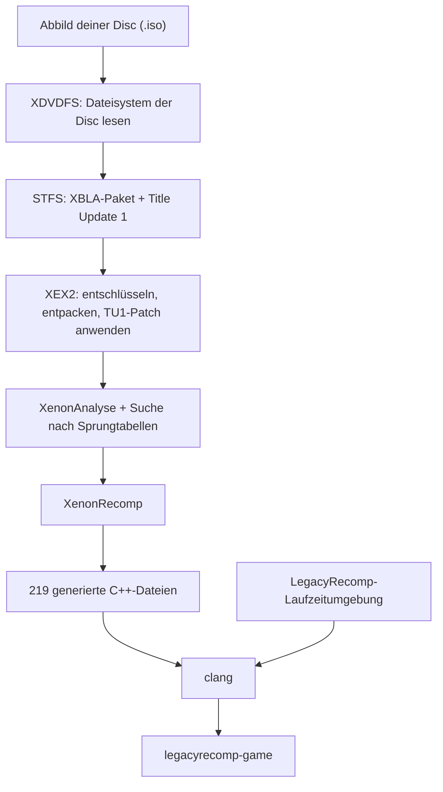

[English](README.md) · [Português (Brasil)](README.pt-BR.md) · [Español](README.es.md) · [Français](README.fr.md) · [Italiano](README.it.md) · **Deutsch** · [简体中文](README.zh-CN.md)

<p align="center">
  
</p>

<p align="center">
  Eine quelloffene statische Rekompilierung von Minecraft: Xbox 360 Edition, die nativ unter Linux läuft.
</p>

<p align="center">
  <a href="LICENSE"></a>
  
  
  
</p>

<p align="center">
  
</p>

## Worum es geht

Minecraft: Xbox 360 Edition wurde für den PowerPC-Prozessor der Xbox 360 geschrieben. LegacyRecomp übersetzt diesen Maschinencode vorab nach C++, Funktion für Funktion, und kompiliert das Ergebnis mit Clang für x86-64. Heraus kommt eine ganz gewöhnliche Linux-Programmdatei. Darunter läuft kein Emulator: Die Arbeit, die ein Emulator während des Spielens Befehl für Befehl erledigt, passiert hier ein einziges Mal beim Kompilieren.

Diese Übersetzung läuft auf deinem Rechner. Der Launcher liest das Abbild deiner eigenen Disc, entpackt das Spiel, spielt das Title Update ein, rekompiliert alles und baut die ausführbare Datei. Dieses Repository liefert die Werkzeuge und eine Laufzeitumgebung, die die Teile der Xbox-360-Systemsoftware ersetzt, mit denen das Spiel spricht. Code aus dem Spiel verteilt es nie.

## Open Source

LegacyRecomp ist freie Software unter der MIT-Lizenz. Beiträge sind willkommen, ob Fehlerberichte, Reverse-Engineering-Notizen oder Code. In [AGENTS.md](AGENTS.md) stehen die Build-Befehle und die Projektregeln, in [docs/](docs/) die Designnotizen, die Notizen zu den Dateiformaten und die Entscheidungsprotokolle (auf Portugiesisch).

## Stand

Spielbar ist das Spiel noch nicht. Auf dem Bildschirm erscheint nichts.

| Meilenstein | Umfang | Stand |
|---|---|---|
| M1 | Pipeline von der Disc bis zur nativen Programmdatei, Grundgerüst der Laufzeitumgebung | Fertig |
| M2 | Kernel-Emulation: Speicher, Threads, Dateien, Synchronisation | Als Nächstes |
| M3 | Grafik: Vulkan-Renderer, mit XenosRecomp übersetzte Shader | Geplant |
| M4 | Audio, Controller, Spielstände | Geplant |
| M5 | Spielbar: Hauptmenü und Welten | Geplant |

Mit M1 macht der Launcher aus deiner Disc `legacyrecomp-game`, und `legacyrecomp run` startet den rekompilierten Einstiegspunkt. Der Spielcode läuft bis zu seinem ersten Aufruf in den Xbox-Kernel, den die Laufzeitumgebung noch nicht bereitstellt, `NtAllocateVirtualMemory`, und beendet sich dann mit Code 3 und einem Bericht, der diesen Aufruf nennt. Das Spiel importiert 459 Systemfunktionen aus xboxkrnl (dem Kernel) und XAM, und bisher ist keine davon implementiert. Das ist die Aufgabe von M2.

Ein Hindernis für die späteren Meilensteine ist schon bekannt: Die festgelegte XenonRecomp-Version unterstützt einige PowerPC-Befehle nicht, die das Spiel verwendet (`bdzf`, `stfsu`, `lfsu`, `vsel128` und weitere). Beim Rekompilieren zeigt sich das in 3.279 Warnungen.

## So funktioniert es

Die Installation besteht aus sieben aufeinanderfolgenden Schritten mit Cache. Schlägt einer fehl oder brichst du ihn ab, setzt der nächste Lauf bei genau diesem Schritt wieder an, und ein Lauf, bei dem schon alles erledigt ist, dauert ein paar Sekunden.



Die `Default.xex` auf der Disc ist nur ein kleiner Loader. Das eigentliche Spiel steckt in einem XBLA-Paket auf der Disc, und auch das Title Update 1 liegt auf der Disc. XenonAnalyse findet in dieser Programmdatei keine einzige Sprungtabelle (Jump Table), deshalb nutzt die Pipeline einen eigenen Scanner, der 221 findet. Auf einem Rechner mit 12 Threads dauert das Kompilieren des generierten Codes etwa 4,5 Minuten, die komplette erste Installation ungefähr 5,5. Der Speicherbedarf hängt davon ab, wie viele Dateien gleichzeitig kompiliert werden: Der Launcher startet höchstens einen Compile-Job pro CPU-Thread und pro 2 GiB RAM, und mit `--jobs` legst du die Zahl selbst fest.

## Erste Schritte

Du brauchst eine x86-64-CPU mit AVX, etwa 8 GB freien Speicherplatz und ein Abbild deiner eigenen Disc von Minecraft: Xbox 360 Edition (Title ID `584111F7`). Die Spieldaten landen in `~/.local/share/legacyrecomp` (oder in `$XDG_DATA_HOME/legacyrecomp`, wenn `XDG_DATA_HOME` gesetzt ist); einen anderen Ordner wählst du mit `--root <Ordner>` oder der Umgebungsvariable `LEGACYRECOMP_ROOT` (`--root` hat Vorrang). Lege diesen Ordner nicht auf ein tmpfs im RAM: Der Build schreibt dort mehrere Gigabyte.

### AppImage

Das AppImage bringt seinen eigenen Compiler (Zig), CMake, Ninja und SDL2 mit, es muss also nichts installiert werden: Es kompiliert das Spiel auf deinem Rechner mit dem, was es dabeihat. Es sollte ab glibc 2.29 laufen (Ubuntu 20.04, Debian 11 und neuer); getestet wurde es bisher nur auf einer Arch-basierten Distribution mit glibc 2.44. Einen Download gibt es noch nicht; bau es aus einem Klon des Repositorys (mit Submodulen):

```sh
packaging/appimage/build.sh        # schreibt packaging/appimage/out/LegacyRecomp-x86_64.AppImage
```

[docs/packaging.md](docs/packaging.md) beschreibt, was der Build-Rechner braucht und was im Image steckt. Danach:

```sh
cd packaging/appimage/out
chmod +x LegacyRecomp-x86_64.AppImage
./LegacyRecomp-x86_64.AppImage                                    # öffnet den Launcher
./LegacyRecomp-x86_64.AppImage install --iso ~/Spiele/minecraft.iso
./LegacyRecomp-x86_64.AppImage run
```

Die Oberfläche des Launchers gibt es vorerst nur auf Portugiesisch. Zieh die ISO ins Fenster (oder nimm **Procurar…**), klick auf **Instalar** und, sobald alle Schritte erledigt sind, auf **Jogar**.

### Aus dem Quellcode bauen

Du brauchst Clang 18 oder neuer, CMake 3.25 oder neuer, Ninja, SDL2 und pkg-config.

```sh
# Arch, Manjaro
sudo pacman -S --needed clang lld llvm cmake ninja sdl2 pkgconf git
# Debian, Ubuntu
sudo apt install clang lld llvm cmake ninja-build libsdl2-dev pkg-config git
# Fedora
sudo dnf install clang lld llvm cmake ninja-build SDL2-devel pkgconf git
```

```sh
# <URL des Repositorys> ist ein Platzhalter: Das Projekt hat noch kein öffentliches Repository
git clone --recursive <URL des Repositorys> legacyrecomp
cd legacyrecomp
cmake --preset release
cmake --build --preset release
```

Die Programme liegen danach in `build/release/bin`:

```sh
build/release/bin/legacyrecomp doctor                              # prüft Compiler, CPU und Speicherplatz
build/release/bin/legacyrecomp install --iso ~/Spiele/minecraft.iso
build/release/bin/legacyrecomp run
build/release/bin/legacyrecomp-gui                                 # der grafische Launcher
```

`legacyrecomp inspect --iso <Datei>` zeigt den Inhalt der Disc und die Header der Programmdatei, ohne etwas zu installieren. Die Optionen des Launchers beschreibt [docs/gui.md](docs/gui.md).

## Technik

| Bereich | Was wir verwenden |
|---|---|
| Sprache und Build | C++20, CMake, Ninja, Clang |
| Recompiler | XenonRecomp, XenonAnalyse und XenonUtils von hedge-dev |
| Launcher-Oberfläche | SDL2, Dear ImGui, Schriften Inter und JetBrains Mono |
| Konfiguration und Tests | toml++, Catch2 |
| Paketierung | AppImage mit mitgelieferter Zig-Toolchain |
| Selbst geschrieben | Leser für XDVDFS, STFS und XEX2, die Installations-Pipeline, die Laufzeitumgebung |

## Projektstruktur

```
src/common/        Fehlertyp, Logging, SHA-256, Pfade
src/formats/       Leser für XDVDFS, STFS und XEX2
src/pipeline/      Installationsschritte, Schritt-Cache, Aufruf externer Werkzeuge
src/launcher/cli/  der Befehl legacyrecomp
src/launcher/gui/  legacyrecomp-gui (SDL2 + Dear ImGui)
src/runtime/       Gastspeicher, XEX-Loader, Kernel-Importe, Build-Vorlage für das Spiel
config/            Recompiler-Einstellungen und erwartete Hashes der unterstützten Version
tests/             Unit-Tests und Integrationstests mit einer echten Disc
tools/             Hilfsskripte für das Reverse Engineering
assets/fonts/      Schriften des Launchers
thirdparty/        Git-Submodule: XenonRecomp, Dear ImGui, Catch2
docs/              Notizen zu Formaten und Reverse Engineering, Entscheidungsprotokolle, Specs und Pläne
```

## Einsatz von KI

Dieses Projekt wird mit starkem Einsatz von KI-Programmieragenten entwickelt. Der größte Teil des Codes, der Tests und der Dokumentation wurde von Claude Code mit den Claude-Modellen von Anthropic geschrieben, unter der Leitung des Maintainers.

Die Arbeit folgt einer schriftlichen Designspezifikation und einem Umsetzungsplan, beide in [docs/superpowers/](docs/superpowers/). Jede Aufgabe aus dem Plan setzt ein Agent um, danach prüft sie ein zweiter, davon unabhängiger Agent. Jeder Commit muss die Unit-Tests bestehen, und die Integrationstests lassen die komplette Pipeline gegen eine echte Disc laufen. Der Maintainer legt den Umfang fest, trifft die Designentscheidungen und prüft das Ergebnis.

Spezifikationen, Pläne und Commit-Historie sind öffentlich, man kann also nachvollziehen, wie jeder Teil entstanden ist. Commits, die ein Agent geschrieben hat, sind mit einer `Co-Authored-By`-Zeile gekennzeichnet.

## Rechtliches

LegacyRecomp steht in keiner Verbindung zu Mojang Studios, Microsoft oder 4J Studios und wird von ihnen weder unterstützt noch gebilligt. Minecraft ist eine Marke der Mojang Synergies AB.

Du musst Minecraft: Xbox 360 Edition besitzen und das Abbild der Disc selbst erstellen. Dieses Repository enthält weder Code noch Assets des Spiels, und der Launcher lädt auch keine herunter: Alles, was er rekompiliert, stammt von deiner Disc und bleibt auf deinem Rechner.

## Danksagungen

- [hedge-dev](https://github.com/hedge-dev) für XenonRecomp und XenosRecomp sowie für UnleashedRecomp, das uns als Referenz dafür dient, wie ein rekompiliertes Spiel aufgebaut ist.
- Das [Xenia](https://github.com/xenia-project/xenia)-Team, dessen Emulator die beste öffentliche Dokumentation des Innenlebens der Xbox 360 ist.
- Das [free60](https://free60.org)-Wiki für seine Notizen zu den Dateiformaten der Konsole.
- [Dear ImGui](https://github.com/ocornut/imgui), [SDL](https://www.libsdl.org), [Catch2](https://github.com/catchorg/Catch2) und [toml++](https://github.com/marzer/tomlplusplus).
- [Inter](https://rsms.me/inter/) von Rasmus Andersson und [JetBrains Mono](https://www.jetbrains.com/lp/mono/) von JetBrains.

## Lizenz

Der Code von LegacyRecomp steht unter der [MIT-Lizenz](LICENSE). Die Schriften in `assets/fonts/` stehen unter der SIL Open Font License 1.1, und die Submodule behalten ihre eigenen Lizenzen; [docs/adr/0002-license.md](docs/adr/0002-license.md) führt sie einzeln auf.
