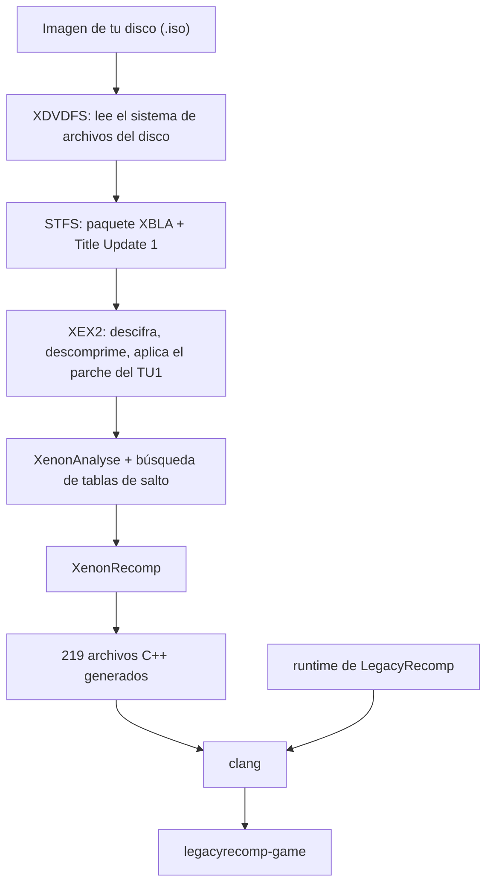

[English](README.md) · [Português (Brasil)](README.pt-BR.md) · **Español** · [Français](README.fr.md) · [Italiano](README.it.md) · [Deutsch](README.de.md) · [简体中文](README.zh-CN.md)

<p align="center">
  
</p>

<p align="center">
  Una recompilación estática y de código abierto de Minecraft: Xbox 360 Edition que se ejecuta de forma nativa en Linux.
</p>

<p align="center">
  <a href="LICENSE"></a>
  
  
  
</p>

<p align="center">
  
</p>

> [!IMPORTANT]
> **Necesitas tu propia copia del juego.** LegacyRecomp no contiene ni descarga código ni archivos de Minecraft, y no proporciona, enlaza ni ayuda a conseguir imágenes del juego: crea la imagen a partir de un disco que sea tuyo. No apoyamos la piratería, y las issues que pidan ISOs se cerrarán.

## Qué es

Minecraft: Xbox 360 Edition se hizo para el procesador PowerPC de la Xbox 360. LegacyRecomp traduce ese código máquina a C++ por adelantado, función a función, y compila el resultado para x86-64 con Clang. Lo que sale es un ejecutable de Linux normal y corriente. No hay ningún emulador debajo: el trabajo que un emulador hace instrucción a instrucción mientras juegas se hace una sola vez, al compilar.

Esa traducción se hace en tu equipo. El launcher lee la imagen de tu propio disco, extrae el juego, aplica el Title Update, lo recompila todo y genera el ejecutable. Este repositorio distribuye las herramientas y un runtime que sustituye las partes del sistema de la Xbox 360 con las que habla el juego. Nunca distribuye código del juego.

## Código abierto

LegacyRecomp es software libre con licencia MIT. Las contribuciones son bienvenidas, desde informes de errores y notas de ingeniería inversa hasta código. En [AGENTS.md](AGENTS.md) están los comandos de compilación y las normas del proyecto, y en [docs/](docs/) las notas de diseño, las notas sobre formatos de archivo y los registros de decisiones (en portugués).

## Estado

Todavía no se puede jugar. No se dibuja nada en pantalla.

| Hito | Alcance | Estado |
|---|---|---|
| M1 | Pipeline del disco al ejecutable nativo, esqueleto del runtime | Hecho |
| M2 | Emulación del kernel: memoria, hilos, archivos, sincronización | Hecho |
| M3 | Gráficos: renderizador Vulkan, shaders traducidos con XenosRecomp | Siguiente |
| M4 | Audio, mandos, partidas guardadas | Previsto |
| M5 | Jugable: menú principal y mundos | Previsto |

El launcher convierte tu disco en `legacyrecomp-game`, y `legacyrecomp run` arranca el juego recompilado. Con el M2 terminado, el runtime emula las partes del kernel de la Xbox que el juego necesita para arrancar: memoria, hilos, archivos, sincronización, temporizadores y los servicios de XAM que pide al inicio. Ahora el juego ejecuta su arranque hasta su primera llamada gráfica, `VdInitializeEngines`, que crearía la GPU, y entonces termina con el código 3 y un informe que indica esa llamada. De las 459 funciones del sistema que el juego importa de xboxkrnl (el kernel) y XAM, 163 están implementadas y 29 son stubs; las gráficas son el trabajo del M3. Sin embargo, antes de llegar a la GPU el juego real usa solo 27 de esas importaciones, en un único hilo, así que la mayor parte del kernel del M2 (hilos, esperas, archivos, temporizadores, descompresión LZX y más) por ahora solo la ejercitan pruebas unitarias y un juego falso de prueba.

Las instrucciones PowerPC que la versión fijada de XenonRecomp no admitía (`bdzf`, `stfsu`, `lfsu`, `vsel128` y otras) ahora están cubiertas por parches guardados en este repositorio (`thirdparty/patches/xenonrecomp/`), y la recompilación termina con 0 avisos.

## Cómo funciona

La instalación es una cadena de siete etapas con caché. Si una falla o la cancelas, la siguiente ejecución vuelve a empezar desde esa etapa, y una ejecución en la que ya está todo hecho tarda unos segundos.



El `Default.xex` del disco es solo un pequeño cargador. El juego de verdad está en un paquete XBLA dentro del disco, y el Title Update 1 también viene en el disco. XenonAnalyse no encuentra ninguna tabla de salto (jump table) en este ejecutable, así que el pipeline usa un buscador propio, que encuentra 221. En una máquina con 12 hilos, compilar el código generado lleva unos 4,5 minutos, y la primera instalación completa, unos 5,5. El uso de memoria depende de cuántos archivos se compilan a la vez: el launcher lanza como mucho un proceso de compilación por hilo de la CPU y por cada 2 GiB de RAM, y con `--jobs` puedes fijar el número a mano.

## Primeros pasos

Necesitas una CPU x86-64 con AVX, unos 8 GB libres en disco y una imagen de tu propio disco de Minecraft: Xbox 360 Edition (title ID `584111F7`). Los datos del juego van a `~/.local/share/legacyrecomp` (o a `$XDG_DATA_HOME/legacyrecomp` si `XDG_DATA_HOME` está definida); elige otra carpeta con `--root <carpeta>` o con la variable de entorno `LEGACYRECOMP_ROOT` (`--root` tiene prioridad). No pongas esa carpeta en un tmpfs en RAM: la compilación escribe varios gigabytes en ella.

### AppImage

El AppImage trae su propio compilador (Zig), CMake, Ninja y SDL2, así que no hace falta instalar nada: compila el juego en tu máquina con lo que lleva dentro. Debería funcionar con glibc 2.29 o más reciente (Ubuntu 20.04, Debian 11 y posteriores); por ahora solo se ha probado en una distro basada en Arch con glibc 2.44. Todavía no hay descarga; genéralo desde un clon del repositorio (con los submódulos):

```sh
packaging/appimage/build.sh        # genera packaging/appimage/out/LegacyRecomp-x86_64.AppImage
```

[docs/packaging.md](docs/packaging.md) indica qué necesita la máquina que lo genera y qué va dentro. Después:

```sh
cd packaging/appimage/out
chmod +x LegacyRecomp-x86_64.AppImage
./LegacyRecomp-x86_64.AppImage                                    # abre el launcher
./LegacyRecomp-x86_64.AppImage install --iso ~/Juegos/minecraft.iso
./LegacyRecomp-x86_64.AppImage run
```

Por ahora la interfaz del launcher solo está en portugués. Arrastra la ISO a la ventana (o usa **Procurar…**), pulsa **Instalar** y, cuando terminen todas las etapas, **Jogar**.

### Compilar desde el código fuente

Necesitas Clang 18 o posterior, CMake 3.25 o posterior, Ninja, SDL2 y pkg-config.

```sh
# Arch, Manjaro
sudo pacman -S --needed clang cmake ninja sdl2 pkgconf git
# Debian, Ubuntu
sudo apt install clang cmake ninja-build libsdl2-dev pkg-config git
# Fedora
sudo dnf install clang cmake ninja-build SDL2-devel pkgconf git
```

```sh
git clone --recursive https://github.com/KauanDev1/legacy-launcher.git legacyrecomp
cd legacyrecomp
cmake --preset release
cmake --build --preset release
```

Los binarios quedan en `build/release/bin`:

```sh
build/release/bin/legacyrecomp doctor                              # comprueba compilador, CPU y espacio en disco
build/release/bin/legacyrecomp install --iso ~/Juegos/minecraft.iso
build/release/bin/legacyrecomp run
build/release/bin/legacyrecomp-gui                                 # el launcher gráfico
```

`legacyrecomp inspect --iso <archivo>` muestra el contenido del disco y las cabeceras del ejecutable sin instalar nada. En [docs/gui.md](docs/gui.md) se describen las opciones del launcher.

## Tecnologías

| Área | Qué usamos |
|---|---|
| Lenguaje y compilación | C++20, CMake, Ninja, Clang |
| Recompilador | XenonRecomp, XenonAnalyse y XenonUtils, de hedge-dev |
| Interfaz del launcher | SDL2, Dear ImGui, fuentes Inter y JetBrains Mono |
| Configuración y pruebas | toml++, Catch2 |
| Empaquetado | AppImage con un toolchain de Zig incluido |
| Hecho en el propio proyecto | Lectores de XDVDFS, STFS y XEX2, el pipeline de instalación, el runtime |

## Estructura del proyecto

```
src/common/        tipo de error, registro, SHA-256, rutas
src/formats/       lectores de XDVDFS, STFS y XEX2
src/pipeline/      etapas de instalación, caché de etapas, ejecución de herramientas externas
src/launcher/cli/  el comando legacyrecomp
src/launcher/gui/  legacyrecomp-gui (SDL2 + Dear ImGui)
src/runtime/       memoria del guest, cargador de XEX, imports del kernel, plantilla de compilación del juego
config/            ajustes del recompilador y hashes esperados de la versión compatible
tests/             pruebas unitarias y pruebas de integración que usan un disco real
tools/             scripts de apoyo para la ingeniería inversa
assets/fonts/      fuentes del launcher
thirdparty/        submódulos de git: XenonRecomp, Dear ImGui, Catch2
docs/              notas de formatos y de ingeniería inversa, registros de decisiones, specs y planes
```

## Uso de IA

Este proyecto se desarrolla con un uso intensivo de agentes de programación con IA. La mayor parte del código, las pruebas y la documentación la ha escrito Claude Code, con los modelos Claude de Anthropic, bajo la dirección del mantenedor.

El trabajo sigue una especificación de diseño y un plan de implementación escritos, ambos en [docs/superpowers/](docs/superpowers/). Cada tarea del plan la implementa un agente y luego la revisa otro agente distinto. Cada commit tiene que pasar las pruebas unitarias, y las pruebas de integración ejecutan el pipeline completo con un disco real. El mantenedor decide el alcance, toma las decisiones de diseño y revisa el resultado.

Las especificaciones, los planes y el historial de commits son públicos, así que se puede ver cómo se hizo cada parte. Los commits escritos por un agente lo indican con una línea `Co-Authored-By`.

## Aviso legal

LegacyRecomp no está afiliado a Mojang Studios, Microsoft ni 4J Studios, ni cuenta con su respaldo. Minecraft es una marca registrada de Mojang Synergies AB.

Tienes que tener Minecraft: Xbox 360 Edition y crear tú mismo la imagen del disco. Este repositorio no contiene código ni recursos del juego, y el launcher no descarga ninguno: todo lo que recompila sale de tu disco y se queda en tu equipo.

## Créditos

- [hedge-dev](https://github.com/hedge-dev), por XenonRecomp y XenosRecomp, y por UnleashedRecomp, que usamos como referencia de cómo se organiza un juego recompilado.
- El equipo de [Xenia](https://github.com/xenia-project/xenia), cuyo emulador es la mejor documentación pública del funcionamiento interno de la Xbox 360.
- La wiki de [free60](https://free60.org), por sus notas sobre los formatos de archivo de la consola.
- [Dear ImGui](https://github.com/ocornut/imgui), [SDL](https://www.libsdl.org), [Catch2](https://github.com/catchorg/Catch2) y [toml++](https://github.com/marzer/tomlplusplus).
- [Inter](https://rsms.me/inter/), de Rasmus Andersson, y [JetBrains Mono](https://www.jetbrains.com/lp/mono/), de JetBrains.

## Licencia

El código de LegacyRecomp se distribuye bajo la [licencia MIT](LICENSE). Las fuentes de `assets/fonts/` tienen la SIL Open Font License 1.1, y los submódulos conservan sus propias licencias; [docs/adr/0002-license.md](docs/adr/0002-license.md) las enumera una por una.
