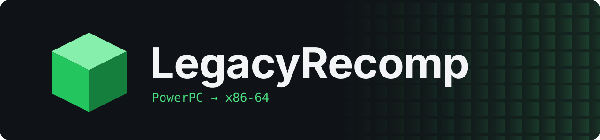
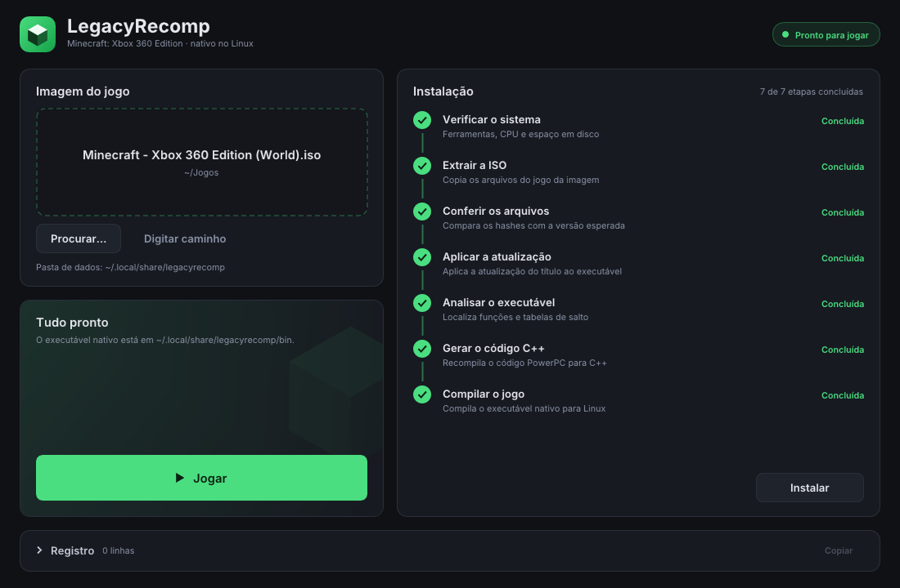
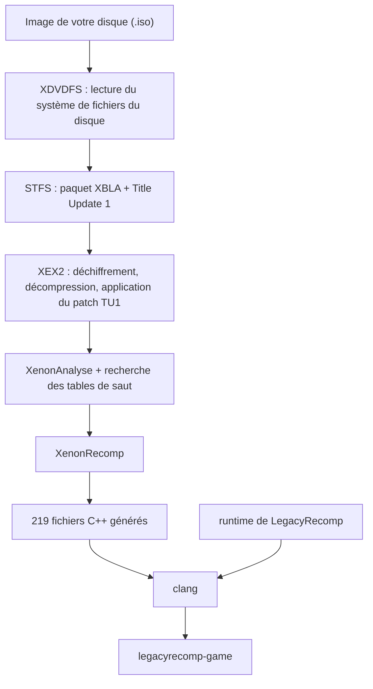

[English](README.md) · [Português (Brasil)](README.pt-BR.md) · [Español](README.es.md) · **Français** · [Italiano](README.it.md) · [Deutsch](README.de.md) · [简体中文](README.zh-CN.md)

<p align="center">
  
</p>

<p align="center">
  Une recompilation statique et open source de Minecraft: Xbox 360 Edition, qui tourne nativement sous Linux.
</p>

<p align="center">
  <a href="LICENSE"></a>
  
  
  
</p>

<p align="center">
  
</p>

## Présentation

Minecraft: Xbox 360 Edition a été écrit pour le processeur PowerPC de la Xbox 360. LegacyRecomp traduit ce code machine en C++ à l'avance, fonction par fonction, puis compile le résultat pour x86-64 avec Clang. On obtient un exécutable Linux tout ce qu'il y a de plus ordinaire. Aucun émulateur ne tourne en dessous : le travail qu'un émulateur fait instruction par instruction pendant la partie est fait une seule fois, à la compilation.

Cette traduction a lieu sur votre machine. Le launcher lit l'image de votre propre disque, extrait le jeu, applique le Title Update, recompile le tout et produit l'exécutable. Ce dépôt fournit les outils et un runtime qui remplace les parties du logiciel système de la Xbox 360 avec lesquelles le jeu communique. Il ne distribue jamais le moindre code du jeu.

## Open source

LegacyRecomp est un logiciel libre sous licence MIT. Les contributions sont les bienvenues, qu'il s'agisse de rapports de bugs, de notes de rétro-ingénierie ou de code. [AGENTS.md](AGENTS.md) donne les commandes de compilation et les règles du projet, et [docs/](docs/) contient les notes de conception, les notes sur les formats de fichiers et les décisions d'architecture (rédigées en portugais).

## État d'avancement

Le jeu n'est pas encore jouable. Rien ne s'affiche à l'écran.

| Étape | Contenu | État |
|---|---|---|
| M1 | Pipeline du disque à l'exécutable natif, squelette du runtime | Terminé |
| M2 | Émulation du noyau : mémoire, threads, fichiers, synchronisation | Prochaine étape |
| M3 | Graphismes : rendu Vulkan, shaders traduits avec XenosRecomp | Prévu |
| M4 | Audio, manettes, sauvegardes | Prévu |
| M5 | Jouable : menu principal et mondes | Prévu |

Avec M1 terminé, le launcher transforme votre disque en `legacyrecomp-game`, et `legacyrecomp run` lance le point d'entrée recompilé. Le code du jeu s'exécute jusqu'à son premier appel au noyau de la Xbox que le runtime ne fournit pas encore, `NtAllocateVirtualMemory`, puis s'arrête avec le code 3 et un rapport qui nomme cet appel. Le jeu importe 459 fonctions système de xboxkrnl (le noyau) et de XAM, et aucune n'est implémentée pour l'instant. C'est le travail de M2.

Un obstacle est déjà connu pour la suite : la version épinglée de XenonRecomp ne gère pas certaines instructions PowerPC utilisées par le jeu (`bdzf`, `stfsu`, `lfsu`, `vsel128` et d'autres), ce qui se traduit par 3 279 avertissements pendant la recompilation.

## Fonctionnement

L'installation enchaîne sept étapes mises en cache. Si l'une d'elles échoue ou que vous l'annulez, l'exécution suivante reprend à cette étape, et une exécution où tout est déjà fait prend quelques secondes.



Le `Default.xex` du disque n'est qu'un petit chargeur. Le vrai jeu se trouve dans un paquet XBLA sur le disque, et le Title Update 1 est lui aussi sur le disque. XenonAnalyse ne trouve aucune table de saut (jump table) dans cet exécutable, donc le pipeline utilise son propre scanner, qui en trouve 221. Sur une machine à 12 threads, la compilation du code généré prend environ 4,5 minutes, et la première installation complète à peu près 5,5. La mémoire utilisée dépend du nombre de fichiers compilés en parallèle : le launcher lance au plus une tâche de compilation par thread du processeur et par tranche de 2 Gio de RAM, et `--jobs` permet de fixer ce nombre à la main.

## Démarrage

Il vous faut un processeur x86-64 avec AVX, environ 8 Go d'espace disque libre et une image de votre propre disque de Minecraft: Xbox 360 Edition (title ID `584111F7`). Les données du jeu vont dans `~/.local/share/legacyrecomp` (ou `$XDG_DATA_HOME/legacyrecomp` si `XDG_DATA_HOME` est définie) ; choisissez un autre dossier avec `--root <dossier>` ou la variable d'environnement `LEGACYRECOMP_ROOT` (`--root` est prioritaire). Ne mettez pas ce dossier sur un tmpfs en RAM : la compilation y écrit plusieurs gigaoctets.

### AppImage

L'AppImage embarque son propre compilateur (Zig), CMake, Ninja et SDL2 : il n'y a rien à installer, elle compile le jeu sur votre machine avec ce qu'elle contient. Elle devrait fonctionner avec une glibc 2.29 ou plus récente (Ubuntu 20.04, Debian 11 et suivantes) ; pour l'instant, elle n'a été testée que sur une distribution basée sur Arch avec la glibc 2.44. Il n'y a pas encore de téléchargement ; générez-la depuis un clone du dépôt (avec ses sous-modules) :

```sh
packaging/appimage/build.sh        # écrit packaging/appimage/out/LegacyRecomp-x86_64.AppImage
```

[docs/packaging.md](docs/packaging.md) indique ce dont la machine de build a besoin et ce que contient l'image. Ensuite :

```sh
cd packaging/appimage/out
chmod +x LegacyRecomp-x86_64.AppImage
./LegacyRecomp-x86_64.AppImage                                    # ouvre le launcher
./LegacyRecomp-x86_64.AppImage install --iso ~/Jeux/minecraft.iso
./LegacyRecomp-x86_64.AppImage run
```

Pour l'instant, l'interface du launcher n'existe qu'en portugais. Déposez l'ISO sur la fenêtre (ou utilisez **Procurar…**), cliquez sur **Instalar** puis, une fois toutes les étapes terminées, sur **Jogar**.

### Compiler depuis les sources

Il vous faut Clang 18 ou plus récent, CMake 3.25 ou plus récent, Ninja, SDL2 et pkg-config.

```sh
# Arch, Manjaro
sudo pacman -S --needed clang cmake ninja sdl2 pkgconf git
# Debian, Ubuntu
sudo apt install clang cmake ninja-build libsdl2-dev pkg-config git
# Fedora
sudo dnf install clang cmake ninja-build SDL2-devel pkgconf git
```

```sh
git clone --recursive https://github.com/KauanDev1/legacy-launcher.git legacyrecomp
cd legacyrecomp
cmake --preset release
cmake --build --preset release
```

Les binaires se trouvent dans `build/release/bin` :

```sh
build/release/bin/legacyrecomp doctor                              # vérifie le compilateur, le CPU et l'espace disque
build/release/bin/legacyrecomp install --iso ~/Jeux/minecraft.iso
build/release/bin/legacyrecomp run
build/release/bin/legacyrecomp-gui                                 # le launcher graphique
```

`legacyrecomp inspect --iso <fichier>` affiche le contenu du disque et les en-têtes de l'exécutable sans rien installer. Les options du launcher sont décrites dans [docs/gui.md](docs/gui.md).

## Technologies

| Domaine | Ce que nous utilisons |
|---|---|
| Langage et compilation | C++20, CMake, Ninja, Clang |
| Recompilateur | XenonRecomp, XenonAnalyse et XenonUtils, de hedge-dev |
| Interface du launcher | SDL2, Dear ImGui, polices Inter et JetBrains Mono |
| Configuration et tests | toml++, Catch2 |
| Distribution | AppImage avec une toolchain Zig intégrée |
| Écrit dans le projet | Lecteurs XDVDFS, STFS et XEX2, le pipeline d'installation, le runtime |

## Organisation du dépôt

```
src/common/        type d'erreur, journalisation, SHA-256, chemins
src/formats/       lecteurs XDVDFS, STFS et XEX2
src/pipeline/      étapes d'installation, cache des étapes, lancement des outils externes
src/launcher/cli/  la commande legacyrecomp
src/launcher/gui/  legacyrecomp-gui (SDL2 + Dear ImGui)
src/runtime/       mémoire invitée, chargeur XEX, imports du noyau, modèle de compilation du jeu
config/            réglages du recompilateur et hashes attendus pour la version prise en charge
tests/             tests unitaires et tests d'intégration sur un vrai disque
tools/             scripts d'aide à la rétro-ingénierie
assets/fonts/      polices du launcher
thirdparty/        sous-modules git : XenonRecomp, Dear ImGui, Catch2
docs/              notes sur les formats et la rétro-ingénierie, décisions d'architecture, specs et plans
```

## Utilisation de l'IA

Ce projet est développé en s'appuyant largement sur des agents de programmation IA. L'essentiel du code, des tests et de la documentation a été écrit par Claude Code, avec les modèles Claude d'Anthropic, sous la direction du mainteneur.

Le travail suit une spécification de conception et un plan d'implémentation écrits, tous deux dans [docs/superpowers/](docs/superpowers/). Chaque tâche du plan est implémentée par un agent, puis relue par un autre agent. Chaque commit doit passer les tests unitaires, et les tests d'intégration exécutent tout le pipeline sur un vrai disque. Le mainteneur fixe le périmètre, prend les décisions de conception et relit le résultat.

Les spécifications, les plans et l'historique des commits sont publics : on peut voir comment chaque partie a été produite. Les commits écrits par un agent le signalent par une ligne `Co-Authored-By`.

## Mentions légales

LegacyRecomp n'est ni affilié à Mojang Studios, Microsoft ou 4J Studios, ni approuvé par eux. Minecraft est une marque déposée de Mojang Synergies AB.

Vous devez posséder Minecraft: Xbox 360 Edition et réaliser vous-même l'image du disque. Ce dépôt ne contient ni code ni ressources du jeu, et le launcher n'en télécharge aucun : tout ce qu'il recompile vient de votre disque et reste sur votre machine.

## Remerciements

- [hedge-dev](https://github.com/hedge-dev), pour XenonRecomp et XenosRecomp, ainsi que pour UnleashedRecomp, qui nous sert de référence sur l'organisation d'un jeu recompilé.
- L'équipe de [Xenia](https://github.com/xenia-project/xenia), dont l'émulateur est la meilleure documentation publique sur le fonctionnement interne de la Xbox 360.
- Le wiki [free60](https://free60.org), pour ses notes sur les formats de fichiers de la console.
- [Dear ImGui](https://github.com/ocornut/imgui), [SDL](https://www.libsdl.org), [Catch2](https://github.com/catchorg/Catch2) et [toml++](https://github.com/marzer/tomlplusplus).
- [Inter](https://rsms.me/inter/), de Rasmus Andersson, et [JetBrains Mono](https://www.jetbrains.com/lp/mono/), de JetBrains.

## Licence

Le code de LegacyRecomp est sous [licence MIT](LICENSE). Les polices de `assets/fonts/` sont sous SIL Open Font License 1.1, et les sous-modules gardent leurs propres licences ; [docs/adr/0002-license.md](docs/adr/0002-license.md) les détaille une par une.
