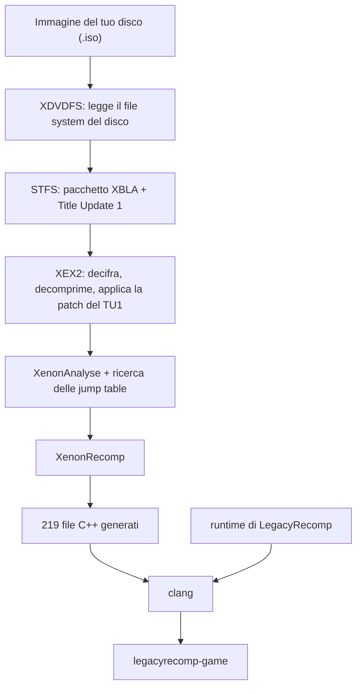

[English](README.md) · [Português (Brasil)](README.pt-BR.md) · [Español](README.es.md) · [Français](README.fr.md) · **Italiano** · [Deutsch](README.de.md) · [简体中文](README.zh-CN.md)

<p align="center">
  
</p>

<p align="center">
  Una ricompilazione statica e open source di Minecraft: Xbox 360 Edition che gira in modo nativo su Linux.
</p>

<p align="center">
  <a href="LICENSE"></a>
  
  
  
</p>

<p align="center">
  
</p>

## Che cos'è

Minecraft: Xbox 360 Edition è stato scritto per il processore PowerPC della Xbox 360. LegacyRecomp traduce quel codice macchina in C++ in anticipo, una funzione alla volta, e compila il risultato per x86-64 con Clang. Quello che ne esce è un normalissimo eseguibile Linux. Sotto non gira nessun emulatore: il lavoro che un emulatore svolge istruzione per istruzione mentre giochi viene fatto una volta sola, in fase di compilazione.

La traduzione avviene sul tuo computer. Il launcher legge l'immagine del tuo disco, estrae il gioco, applica il Title Update, ricompila tutto e crea l'eseguibile. Questo repository contiene gli strumenti e un runtime che sostituisce le parti del software di sistema della Xbox 360 con cui il gioco dialoga. Non distribuisce mai codice del gioco.

## Open source

LegacyRecomp è software libero con licenza MIT. I contributi sono benvenuti, che si tratti di segnalazioni di bug, appunti di reverse engineering o codice. In [AGENTS.md](AGENTS.md) trovi i comandi di build e le regole del progetto, e in [docs/](docs/) le note di progettazione, le note sui formati dei file e i registri delle decisioni (in portoghese).

## Stato del progetto

Il gioco non è ancora giocabile. Sullo schermo non compare nulla.

| Traguardo | Contenuto | Stato |
|---|---|---|
| M1 | Pipeline dal disco all'eseguibile nativo, scheletro del runtime | Completato |
| M2 | Emulazione del kernel: memoria, thread, file, sincronizzazione | Il prossimo |
| M3 | Grafica: renderer Vulkan, shader tradotti con XenosRecomp | Previsto |
| M4 | Audio, controller, salvataggi | Previsto |
| M5 | Giocabile: menu principale e mondi | Previsto |

Con M1 completato, il launcher trasforma il tuo disco in `legacyrecomp-game`, e `legacyrecomp run` avvia il punto di ingresso ricompilato. Il codice del gioco gira fino alla prima chiamata al kernel della Xbox che il runtime non fornisce ancora, `NtAllocateVirtualMemory`, poi termina con codice 3 e un report che indica quella chiamata. Il gioco importa 459 funzioni di sistema da xboxkrnl (il kernel) e XAM, e per ora nessuna è implementata. È il lavoro di M2.

C'è già un ostacolo noto per i traguardi successivi: la versione fissata di XenonRecomp non gestisce alcune istruzioni PowerPC usate dal gioco (`bdzf`, `stfsu`, `lfsu`, `vsel128` e altre), e durante la ricompilazione questo si vede in 3.279 avvisi.

## Come funziona

L'installazione è una catena di sette fasi con cache. Se una fallisce o la annulli, l'esecuzione successiva riparte da quella fase, e un'esecuzione in cui è già tutto fatto richiede pochi secondi.



Il `Default.xex` del disco è solo un piccolo loader. Il gioco vero e proprio sta in un pacchetto XBLA sul disco, e anche il Title Update 1 è sul disco. XenonAnalyse non trova nessuna jump table in questo eseguibile, quindi la pipeline usa uno scanner tutto suo, che ne trova 221. Su una macchina con 12 thread, la compilazione del codice generato richiede circa 4,5 minuti e la prima installazione completa circa 5,5. La memoria usata dipende da quanti file vengono compilati in parallelo: il launcher avvia al massimo un processo di compilazione per thread della CPU e per ogni 2 GiB di RAM, e con `--jobs` puoi impostare il numero a mano.

## Per iniziare

Ti servono una CPU x86-64 con AVX, circa 8 GB di spazio libero su disco e un'immagine del tuo disco di Minecraft: Xbox 360 Edition (title ID `584111F7`). I dati del gioco finiscono in `~/.local/share/legacyrecomp` (o in `$XDG_DATA_HOME/legacyrecomp` se `XDG_DATA_HOME` è impostata); scegli un'altra cartella con `--root <cartella>` o con la variabile d'ambiente `LEGACYRECOMP_ROOT` (`--root` ha la precedenza). Non mettere quella cartella su un tmpfs in RAM: la compilazione ci scrive diversi gigabyte.

### AppImage

L'AppImage porta con sé il proprio compilatore (Zig), CMake, Ninja e SDL2, quindi non c'è niente da installare: compila il gioco sulla tua macchina con quello che contiene. Dovrebbe funzionare con glibc 2.29 o più recente (Ubuntu 20.04, Debian 11 e successive); finora è stata provata solo su una distribuzione basata su Arch con glibc 2.44. Non c'è ancora un download; generala da un clone del repository (con i sottomoduli):

```sh
packaging/appimage/build.sh        # scrive packaging/appimage/out/LegacyRecomp-x86_64.AppImage
```

[docs/packaging.md](docs/packaging.md) elenca cosa serve sulla macchina di build e cosa finisce nell'immagine. Poi:

```sh
cd packaging/appimage/out
chmod +x LegacyRecomp-x86_64.AppImage
./LegacyRecomp-x86_64.AppImage                                    # apre il launcher
./LegacyRecomp-x86_64.AppImage install --iso ~/Giochi/minecraft.iso
./LegacyRecomp-x86_64.AppImage run
```

Per ora l'interfaccia del launcher è solo in portoghese. Trascina la ISO nella finestra (oppure usa **Procurar…**), premi **Instalar** e, quando tutte le fasi sono concluse, **Jogar**.

### Compilare dai sorgenti

Ti servono Clang 18 o successivo, CMake 3.25 o successivo, Ninja, SDL2 e pkg-config.

```sh
# Arch, Manjaro
sudo pacman -S --needed clang lld llvm cmake ninja sdl2 pkgconf git
# Debian, Ubuntu
sudo apt install clang lld llvm cmake ninja-build libsdl2-dev pkg-config git
# Fedora
sudo dnf install clang lld llvm cmake ninja-build SDL2-devel pkgconf git
```

```sh
# <URL del repository> è un segnaposto: il progetto non ha ancora un repository pubblico
git clone --recursive <URL del repository> legacyrecomp
cd legacyrecomp
cmake --preset release
cmake --build --preset release
```

I binari finiscono in `build/release/bin`:

```sh
build/release/bin/legacyrecomp doctor                              # controlla compilatore, CPU e spazio su disco
build/release/bin/legacyrecomp install --iso ~/Giochi/minecraft.iso
build/release/bin/legacyrecomp run
build/release/bin/legacyrecomp-gui                                 # il launcher grafico
```

`legacyrecomp inspect --iso <file>` mostra il contenuto del disco e le intestazioni dell'eseguibile senza installare nulla. Le opzioni del launcher sono descritte in [docs/gui.md](docs/gui.md).

## Tecnologie

| Ambito | Cosa usiamo |
|---|---|
| Linguaggio e build | C++20, CMake, Ninja, Clang |
| Ricompilatore | XenonRecomp, XenonAnalyse e XenonUtils di hedge-dev |
| Interfaccia del launcher | SDL2, Dear ImGui, font Inter e JetBrains Mono |
| Configurazione e test | toml++, Catch2 |
| Pacchetti | AppImage con toolchain Zig incluso |
| Scritto nel progetto | Lettori XDVDFS, STFS e XEX2, la pipeline di installazione, il runtime |

## Struttura del progetto

```
src/common/        tipo di errore, log, SHA-256, percorsi
src/formats/       lettori XDVDFS, STFS e XEX2
src/pipeline/      fasi di installazione, cache delle fasi, avvio degli strumenti esterni
src/launcher/cli/  il comando legacyrecomp
src/launcher/gui/  legacyrecomp-gui (SDL2 + Dear ImGui)
src/runtime/       memoria guest, loader XEX, import del kernel, template di build del gioco
config/            impostazioni del ricompilatore e hash attesi per la versione supportata
tests/             test unitari e test di integrazione su un disco reale
tools/             script di supporto per il reverse engineering
assets/fonts/      font del launcher
thirdparty/        sottomoduli git: XenonRecomp, Dear ImGui, Catch2
docs/              note sui formati e sul reverse engineering, registri delle decisioni, specifiche e piani
```

## Uso dell'IA

Questo progetto è sviluppato con un uso massiccio di agenti di programmazione basati sull'IA. La maggior parte del codice, dei test e della documentazione è stata scritta da Claude Code, con i modelli Claude di Anthropic, sotto la guida del maintainer.

Il lavoro segue una specifica di progettazione e un piano di implementazione scritti, entrambi in [docs/superpowers/](docs/superpowers/). Ogni attività del piano viene implementata da un agente e poi rivista da un altro agente, distinto dal primo. Ogni commit deve superare i test unitari, e i test di integrazione eseguono l'intera pipeline su un disco reale. Il maintainer decide il perimetro, prende le decisioni di progettazione e rivede il risultato.

Specifiche, piani e cronologia dei commit sono pubblici, quindi si può vedere come è stata fatta ogni parte. I commit scritti da un agente lo dichiarano con una riga `Co-Authored-By`.

## Note legali

LegacyRecomp non è affiliato a Mojang Studios, Microsoft o 4J Studios, né approvato da loro. Minecraft è un marchio registrato di Mojang Synergies AB.

Devi possedere Minecraft: Xbox 360 Edition e creare tu stesso l'immagine del disco. Questo repository non contiene codice né risorse del gioco, e il launcher non ne scarica: tutto ciò che ricompila viene dal tuo disco e resta sul tuo computer.

## Riconoscimenti

- [hedge-dev](https://github.com/hedge-dev), per XenonRecomp e XenosRecomp, e per UnleashedRecomp, che usiamo come riferimento su come si organizza un gioco ricompilato.
- Il team di [Xenia](https://github.com/xenia-project/xenia), il cui emulatore è la migliore documentazione pubblica sul funzionamento interno della Xbox 360.
- La wiki di [free60](https://free60.org), per le note sui formati dei file della console.
- [Dear ImGui](https://github.com/ocornut/imgui), [SDL](https://www.libsdl.org), [Catch2](https://github.com/catchorg/Catch2) e [toml++](https://github.com/marzer/tomlplusplus).
- [Inter](https://rsms.me/inter/) di Rasmus Andersson e [JetBrains Mono](https://www.jetbrains.com/lp/mono/) di JetBrains.

## Licenza

Il codice di LegacyRecomp è distribuito con [licenza MIT](LICENSE). I font in `assets/fonts/` sono sotto SIL Open Font License 1.1, e i sottomoduli mantengono le proprie licenze; [docs/adr/0002-license.md](docs/adr/0002-license.md) le elenca una per una.
