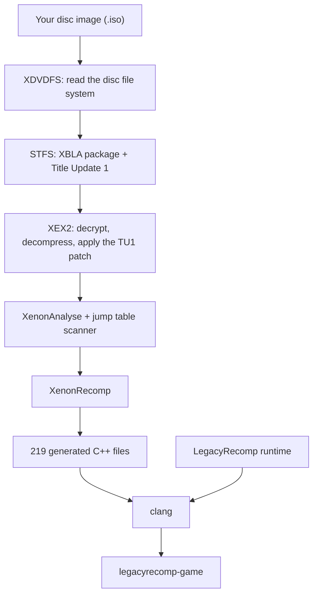

**English** · [Português (Brasil)](README.pt-BR.md) · [Español](README.es.md) · [Français](README.fr.md) · [Italiano](README.it.md) · [Deutsch](README.de.md) · [简体中文](README.zh-CN.md)

<p align="center">
  
</p>

<p align="center">
  An open-source static recompilation of Minecraft: Xbox 360 Edition that runs natively on Linux.
</p>

<p align="center">
  <a href="LICENSE"></a>
  
  
  
</p>

<p align="center">
  
</p>

## What it is

Minecraft: Xbox 360 Edition was built for the Xbox 360's PowerPC processor. LegacyRecomp translates that machine code into C++ ahead of time, function by function, and compiles the result for x86-64 with Clang. What comes out is an ordinary Linux executable. No emulator runs underneath it: the work an emulator does instruction by instruction while you play happens once, at build time.

That translation happens on your computer. The launcher reads your own disc image, extracts the game, applies the Title Update, recompiles everything and builds the executable. This repository ships the tools and a runtime that replaces the parts of the Xbox 360 system software the game talks to. It never ships any of the game's code.

## Open source

LegacyRecomp is free software under the MIT license. Contributions are welcome, from bug reports and reverse-engineering notes to code. [AGENTS.md](AGENTS.md) has the build commands and the project rules, and [docs/](docs/) has the design notes, file format notes and decision records (written in Portuguese).

## Status

The game is not playable yet. Nothing is drawn on screen.

| Milestone | Scope | State |
|---|---|---|
| M1 | Pipeline from disc to native executable, runtime skeleton | Done |
| M2 | Kernel emulation: memory, threads, files, synchronization | Next |
| M3 | Graphics: Vulkan renderer, shaders translated with XenosRecomp | Planned |
| M4 | Audio, input, saves | Planned |
| M5 | Playable: main menu and worlds | Planned |

With M1 done, the launcher turns your disc into `legacyrecomp-game`, and `legacyrecomp run` starts the recompiled entry point. The game's code runs until its first call into the Xbox kernel that the runtime does not provide yet, `NtAllocateVirtualMemory`, and then exits with code 3 and a report naming that call. The game imports 459 system functions from xboxkrnl (the kernel) and XAM, and none of them are implemented so far. That is the work of M2.

One known obstacle for later milestones: the pinned XenonRecomp version does not handle some PowerPC instructions this game uses (`bdzf`, `stfsu`, `lfsu`, `vsel128` and others), which shows up as 3,279 warnings during recompilation.

## How it works

The install is a chain of seven cached stages. If one fails or you cancel it, the next run starts from that stage, and a run where everything is already done takes a few seconds.



The disc's own `Default.xex` is only a small loader. The real game sits in an XBLA package on the disc, and Title Update 1 is on the disc too. XenonAnalyse finds no jump tables in this executable, so the pipeline runs its own scanner, which finds 221. On a 12-thread machine, compiling the generated code takes about 4.5 minutes and the whole first install around 5.5. Memory use depends on how many files compile at once: the launcher runs at most one compile job per CPU thread and per 2 GiB of RAM, and `--jobs` sets the number by hand.

## Getting started

You need an x86-64 CPU with AVX, about 8 GB of free disk space and your own image of the Minecraft: Xbox 360 Edition disc (title ID `584111F7`). Game data goes to `~/.local/share/legacyrecomp` unless you pass `--root`. Keep that folder off a RAM-backed tmpfs: the build writes several gigabytes there.

### AppImage

The AppImage carries its own compiler (Zig), CMake, Ninja and SDL2, so there is nothing to install: it compiles the game on your machine with what it brings along. It needs glibc 2.29 or newer (Debian 11, Ubuntu 20.04 and later). There is no download yet, so build it from a clone of the repository (with its submodules):

```sh
packaging/appimage/build.sh        # writes packaging/appimage/out/LegacyRecomp-x86_64.AppImage
```

[docs/packaging.md](docs/packaging.md) lists what the build machine needs and what goes into the image. Then:

```sh
chmod +x LegacyRecomp-x86_64.AppImage
./LegacyRecomp-x86_64.AppImage                                    # opens the launcher
./LegacyRecomp-x86_64.AppImage install --iso ~/Games/minecraft.iso
./LegacyRecomp-x86_64.AppImage run
```

The launcher's interface is only in Portuguese for now. Drop the ISO onto the window (or use **Procurar…**), press **Instalar**, and once every stage is done, **Jogar**.

### Build from source

You need Clang 18 or newer, CMake 3.25 or newer, Ninja, SDL2 and pkg-config.

```sh
# Arch, Manjaro
sudo pacman -S --needed clang lld llvm cmake ninja sdl2 pkgconf git
# Debian, Ubuntu
sudo apt install clang lld llvm cmake ninja-build libsdl2-dev pkg-config git
# Fedora
sudo dnf install clang lld llvm cmake ninja-build SDL2-devel pkgconf git
```

```sh
git clone --recursive <repository URL> legacyrecomp
cd legacyrecomp
cmake --preset release
cmake --build --preset release
```

The binaries end up in `build/release/bin`:

```sh
build/release/bin/legacyrecomp doctor                              # checks compiler, CPU and disk space
build/release/bin/legacyrecomp install --iso ~/Games/minecraft.iso
build/release/bin/legacyrecomp run
build/release/bin/legacyrecomp-gui                                 # the graphical launcher
```

`legacyrecomp inspect --iso <file>` lists the disc contents and the executable headers without installing anything. [docs/gui.md](docs/gui.md) describes the launcher's options.

## Tech stack

| Area | What we use |
|---|---|
| Language and build | C++20, CMake, Ninja, Clang |
| Recompiler | XenonRecomp, XenonAnalyse and XenonUtils from hedge-dev |
| Launcher UI | SDL2, Dear ImGui, Inter and JetBrains Mono fonts |
| Config and tests | toml++, Catch2 |
| Packaging | AppImage with a bundled Zig toolchain |
| Written in-house | XDVDFS, STFS and XEX2 readers, the install pipeline, the runtime |

## Project layout

```
src/common/        error type, logging, SHA-256, paths
src/formats/       XDVDFS, STFS and XEX2 readers
src/pipeline/      install stages, stage cache, external tool runner
src/launcher/cli/  the legacyrecomp command
src/launcher/gui/  legacyrecomp-gui (SDL2 + Dear ImGui)
src/runtime/       guest memory, XEX loader, kernel imports, game build template
config/            recompiler settings and expected file hashes for the supported version
tests/             unit tests and integration tests that use a real disc
tools/             reverse-engineering helper scripts
assets/fonts/      launcher fonts
thirdparty/        git submodules: XenonRecomp, Dear ImGui, Catch2
docs/              format notes, reverse-engineering notes, decision records, specs and plans
```

## Use of AI

This project is developed with heavy use of AI coding agents. Most of the code, tests and documentation were written by Claude Code, using Anthropic's Claude models, under the direction of the maintainer.

The work follows a written design spec and an implementation plan, both in [docs/superpowers/](docs/superpowers/). Each task in the plan is implemented by one agent and then reviewed by a separate agent. Every commit has to pass the unit tests, and the integration tests run the whole pipeline against a real disc. The maintainer sets the scope, makes the design decisions and reviews the result.

The specs, plans and commit history are all public, so you can see how each part was made. Commits written by an agent say so in a `Co-Authored-By` line.

## Legal

LegacyRecomp is not affiliated with or endorsed by Mojang Studios, Microsoft or 4J Studios. Minecraft is a trademark of Mojang Synergies AB.

You must own Minecraft: Xbox 360 Edition and make the disc image yourself. This repository contains no game code or assets, and the launcher downloads none: everything it recompiles comes from your disc and stays on your machine.

## Credits

- [hedge-dev](https://github.com/hedge-dev) for XenonRecomp and XenosRecomp, and for UnleashedRecomp, which we use as a reference for how a recompiled game fits together.
- The [Xenia](https://github.com/xenia-project/xenia) team, whose emulator is the best public documentation of the Xbox 360 internals.
- The [free60](https://free60.org) wiki, for its notes on the console's file formats.
- [Dear ImGui](https://github.com/ocornut/imgui), [SDL](https://www.libsdl.org), [Catch2](https://github.com/catchorg/Catch2) and [toml++](https://github.com/marzer/tomlplusplus).
- [Inter](https://rsms.me/inter/) by Rasmus Andersson and [JetBrains Mono](https://www.jetbrains.com/lp/mono/) by JetBrains.

## License

LegacyRecomp's own code is under the [MIT license](LICENSE). The fonts in `assets/fonts/` are under the SIL Open Font License 1.1, and the submodules keep their own licenses; [docs/adr/0002-license.md](docs/adr/0002-license.md) lists each one.
