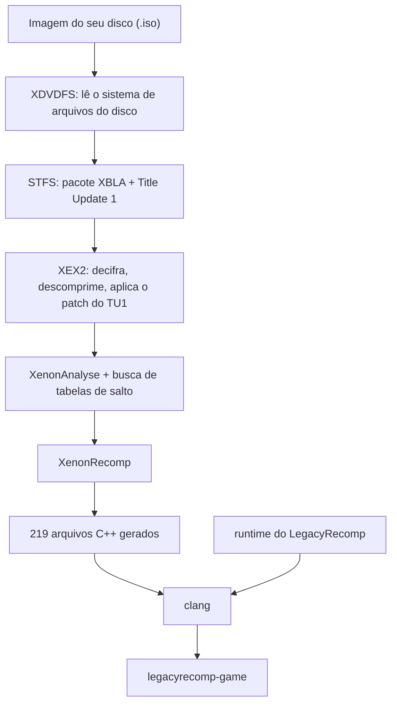

[English](README.md) · **Português (Brasil)** · [Español](README.es.md) · [Français](README.fr.md) · [Italiano](README.it.md) · [Deutsch](README.de.md) · [简体中文](README.zh-CN.md)

<p align="center">
  
</p>

<p align="center">
  Uma recompilação estática e de código aberto do Minecraft: Xbox 360 Edition que roda nativamente no Linux.
</p>

<p align="center">
  <a href="LICENSE"></a>
  
  
  
</p>

<p align="center">
  
</p>

## O que é

O Minecraft: Xbox 360 Edition foi feito para o processador PowerPC do Xbox 360. O LegacyRecomp traduz esse código de máquina para C++ antes da execução, função por função, e compila o resultado para x86-64 com o Clang. O que sai disso é um executável comum de Linux. Não tem emulador rodando por baixo: o trabalho que um emulador faz instrução por instrução enquanto você joga acontece uma vez só, na hora de compilar.

Essa tradução acontece no seu computador. O launcher lê a imagem do seu próprio disco, extrai o jogo, aplica o Title Update, recompila tudo e gera o executável. Este repositório distribui as ferramentas e um runtime que substitui as partes do sistema do Xbox 360 com que o jogo conversa. Nenhum código do jogo é distribuído.

## Código aberto

O LegacyRecomp é software livre, sob a licença MIT. Contribuições são bem-vindas, de relatos de bugs e anotações de engenharia reversa a código. O [AGENTS.md](AGENTS.md) traz os comandos de build e as regras do projeto, e a pasta [docs/](docs/) tem as notas de design, as notas sobre formatos de arquivo e os registros de decisão (em português).

## Estado atual

O jogo ainda não dá para jogar. Nada aparece na tela.

| Marco | Escopo | Situação |
|---|---|---|
| M1 | Pipeline do disco até o executável nativo, esqueleto do runtime | Concluído |
| M2 | Emulação do kernel: memória, threads, arquivos, sincronização | Próximo |
| M3 | Gráficos: renderizador Vulkan, shaders traduzidos com o XenosRecomp | Planejado |
| M4 | Áudio, controles, saves | Planejado |
| M5 | Jogável: menu principal e mundos | Planejado |

Com o M1 pronto, o launcher transforma o seu disco no `legacyrecomp-game`, e o `legacyrecomp run` inicia o ponto de entrada recompilado. O código do jogo roda até a primeira chamada ao kernel do Xbox que o runtime ainda não oferece, `NtAllocateVirtualMemory`, e aí termina com código 3 e um relatório que aponta essa chamada. O jogo importa 459 funções de sistema do xboxkrnl (o kernel) e do XAM, e nenhuma delas está implementada ainda. Esse é o trabalho do M2.

Um obstáculo já conhecido para os próximos marcos: a versão fixada do XenonRecomp não trata algumas instruções PowerPC que o jogo usa (`bdzf`, `stfsu`, `lfsu`, `vsel128` e outras), o que aparece como 3.279 avisos durante a recompilação.

## Como funciona

A instalação é uma sequência de sete etapas com cache. Se uma delas falhar ou você cancelar, a próxima execução recomeça daquela etapa, e uma execução em que tudo já está pronto leva poucos segundos.



O `Default.xex` do disco é só um carregador pequeno. O jogo de verdade fica num pacote XBLA dentro do disco, e o Title Update 1 também vem no disco. O XenonAnalyse não encontra nenhuma tabela de salto (jump table) nesse executável, então o pipeline usa um scanner próprio, que encontra 221. Numa máquina com 12 threads, compilar o código gerado leva cerca de 4,5 minutos, e a primeira instalação inteira, por volta de 5,5. O uso de memória depende de quantos arquivos compilam ao mesmo tempo: o launcher roda no máximo um job de compilação por thread da CPU e por 2 GiB de RAM, e o `--jobs` define esse número manualmente.

## Primeiros passos

Você precisa de uma CPU x86-64 com AVX, cerca de 8 GB livres em disco e uma imagem do seu próprio disco do Minecraft: Xbox 360 Edition (title ID `584111F7`). Os dados do jogo vão para `~/.local/share/legacyrecomp`, a não ser que você passe `--root`. Não coloque essa pasta num tmpfs em RAM: a compilação grava vários gigabytes nela.

### AppImage

O AppImage traz o próprio compilador (Zig), o CMake, o Ninja e o SDL2, então não é preciso instalar nada: ele compila o jogo na sua máquina com o que leva dentro. Precisa da glibc 2.29 ou mais nova (Debian 11, Ubuntu 20.04 e posteriores). Ainda não há download; gere-o a partir de um clone do repositório (com os submódulos):

```sh
packaging/appimage/build.sh        # gera packaging/appimage/out/LegacyRecomp-x86_64.AppImage
```

O [docs/packaging.md](docs/packaging.md) diz o que a máquina que gera o AppImage precisa ter e o que vai dentro dele. Depois:

```sh
chmod +x LegacyRecomp-x86_64.AppImage
./LegacyRecomp-x86_64.AppImage                                    # abre o launcher
./LegacyRecomp-x86_64.AppImage install --iso ~/Jogos/minecraft.iso
./LegacyRecomp-x86_64.AppImage run
```

No launcher, arraste a ISO para a janela (ou use **Procurar…**), clique em **Instalar** e, quando todas as etapas terminarem, em **Jogar**.

### Compilar a partir do código-fonte

Você precisa do Clang 18 ou mais novo, do CMake 3.25 ou mais novo, do Ninja, da SDL2 e do pkg-config.

```sh
# Arch, Manjaro
sudo pacman -S --needed clang lld llvm cmake ninja sdl2 pkgconf git
# Debian, Ubuntu
sudo apt install clang lld llvm cmake ninja-build libsdl2-dev pkg-config git
# Fedora
sudo dnf install clang lld llvm cmake ninja-build SDL2-devel pkgconf git
```

```sh
git clone --recursive <URL do repositório> legacyrecomp
cd legacyrecomp
cmake --preset release
cmake --build --preset release
```

Os binários ficam em `build/release/bin`:

```sh
build/release/bin/legacyrecomp doctor                              # confere compilador, CPU e espaço em disco
build/release/bin/legacyrecomp install --iso ~/Jogos/minecraft.iso
build/release/bin/legacyrecomp run
build/release/bin/legacyrecomp-gui                                 # o launcher gráfico
```

O `legacyrecomp inspect --iso <arquivo>` lista o conteúdo do disco e os cabeçalhos do executável sem instalar nada. O [docs/gui.md](docs/gui.md) descreve as opções do launcher.

## Tecnologias

| Área | O que usamos |
|---|---|
| Linguagem e build | C++20, CMake, Ninja, Clang |
| Recompilador | XenonRecomp, XenonAnalyse e XenonUtils, da hedge-dev |
| Interface do launcher | SDL2, Dear ImGui, fontes Inter e JetBrains Mono |
| Configuração e testes | toml++, Catch2 |
| Empacotamento | AppImage com toolchain Zig embutido |
| Feito no próprio projeto | Leitores de XDVDFS, STFS e XEX2, o pipeline de instalação, o runtime |

## Estrutura do projeto

```
src/common/        tipo de erro, log, SHA-256, caminhos
src/formats/       leitores de XDVDFS, STFS e XEX2
src/pipeline/      etapas da instalação, cache das etapas, execução de ferramentas externas
src/launcher/cli/  o comando legacyrecomp
src/launcher/gui/  legacyrecomp-gui (SDL2 + Dear ImGui)
src/runtime/       memória do guest, carregador de XEX, imports do kernel, template de build do jogo
config/            configuração do recompilador e hashes esperados da versão suportada
tests/             testes unitários e testes de integração que usam um disco de verdade
tools/             scripts de apoio à engenharia reversa
assets/fonts/      fontes do launcher
thirdparty/        submódulos git: XenonRecomp, Dear ImGui, Catch2
docs/              notas de formatos e de engenharia reversa, registros de decisão, specs e planos
```

## Uso de IA

Este projeto é desenvolvido com uso intenso de agentes de programação com IA. A maior parte do código, dos testes e da documentação foi escrita pelo Claude Code, com os modelos Claude da Anthropic, sob a direção do mantenedor.

O trabalho segue uma especificação de design e um plano de implementação escritos, os dois em [docs/superpowers/](docs/superpowers/). Cada tarefa do plano é implementada por um agente e depois revisada por outro agente, separado. Todo commit precisa passar nos testes unitários, e os testes de integração rodam o pipeline inteiro com um disco de verdade. O mantenedor define o escopo, toma as decisões de design e revisa o resultado.

As especificações, os planos e o histórico de commits são públicos, então dá para ver como cada parte foi feita. Os commits escritos por um agente indicam isso numa linha `Co-Authored-By`.

## Aviso legal

O LegacyRecomp não tem ligação com a Mojang Studios, a Microsoft ou a 4J Studios, nem é endossado por elas. Minecraft é uma marca registrada da Mojang Synergies AB.

Você precisa ter o Minecraft: Xbox 360 Edition e gerar a imagem do disco por conta própria. Este repositório não contém código nem arquivos do jogo, e o launcher não baixa nada disso: tudo o que ele recompila vem do seu disco e fica na sua máquina.

## Créditos

- [hedge-dev](https://github.com/hedge-dev), pelo XenonRecomp e pelo XenosRecomp, e pelo UnleashedRecomp, que usamos como referência de como um jogo recompilado se organiza.
- A equipe do [Xenia](https://github.com/xenia-project/xenia), cujo emulador é a melhor documentação pública do funcionamento interno do Xbox 360.
- A wiki [free60](https://free60.org), pelas anotações sobre os formatos de arquivo do console.
- [Dear ImGui](https://github.com/ocornut/imgui), [SDL](https://www.libsdl.org), [Catch2](https://github.com/catchorg/Catch2) e [toml++](https://github.com/marzer/tomlplusplus).
- [Inter](https://rsms.me/inter/), de Rasmus Andersson, e [JetBrains Mono](https://www.jetbrains.com/lp/mono/), da JetBrains.

## Licença

O código do LegacyRecomp é distribuído sob a [licença MIT](LICENSE). As fontes em `assets/fonts/` estão sob a SIL Open Font License 1.1, e os submódulos mantêm as próprias licenças; o [docs/adr/0002-license.md](docs/adr/0002-license.md) lista cada uma.
