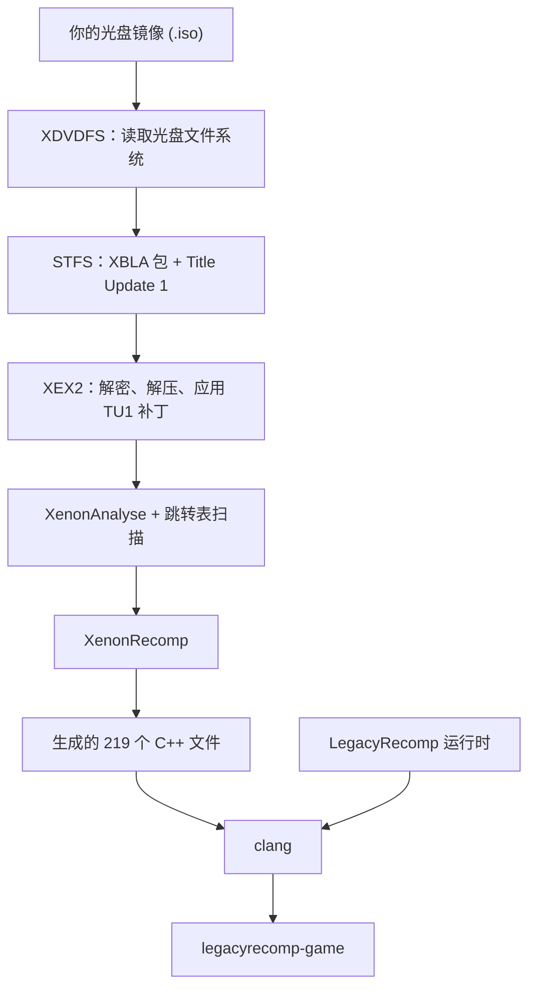

[English](README.md) · [Português (Brasil)](README.pt-BR.md) · [Español](README.es.md) · [Français](README.fr.md) · [Italiano](README.it.md) · [Deutsch](README.de.md) · **简体中文**

<p align="center">
  
</p>

<p align="center">
  Minecraft: Xbox 360 Edition 的开源静态重编译项目，在 Linux 上原生运行。
</p>

<p align="center">
  <a href="LICENSE"></a>
  
  
  
</p>

<p align="center">
  
</p>

## 这是什么

Minecraft: Xbox 360 Edition 是为 Xbox 360 的 PowerPC 处理器编写的。LegacyRecomp 预先把这些机器码逐个函数翻译成 C++，再用 Clang 编译成 x86-64 程序，得到的就是一个普通的 Linux 可执行文件。运行时底层并没有模拟器：模拟器在游戏过程中逐条指令做的工作，在这里只在构建时做一次。

翻译过程在你自己的电脑上完成。启动器读取你自己的光盘镜像，提取游戏、应用 Title Update、完成重编译并生成可执行文件。本仓库提供的是这些工具，以及一个运行时，用来替代游戏所调用的那部分 Xbox 360 系统软件。仓库从不分发任何游戏代码。

## 开源

LegacyRecomp 是自由软件，采用 MIT 许可证。欢迎任何形式的贡献，无论是问题报告、逆向工程笔记还是代码。构建命令和项目规则见 [AGENTS.md](AGENTS.md)，设计笔记、文件格式笔记和决策记录见 [docs/](docs/)（用葡萄牙语撰写）。

## 当前状态

游戏目前还不能玩，屏幕上什么也不会显示。

| 里程碑 | 内容 | 状态 |
|---|---|---|
| M1 | 从光盘到原生可执行文件的完整流程，运行时骨架 | 已完成 |
| M2 | 内核模拟：内存、线程、文件、同步 | 下一步 |
| M3 | 图形：Vulkan 渲染器，用 XenosRecomp 翻译着色器 | 计划中 |
| M4 | 音频、手柄输入、存档 | 计划中 |
| M5 | 可游玩：主菜单和世界 | 计划中 |

M1 完成后，启动器可以把你的光盘变成 `legacyrecomp-game`，`legacyrecomp run` 会启动重编译后的入口点。游戏代码会一直运行，直到第一次调用运行时尚未提供的 Xbox 内核函数 `NtAllocateVirtualMemory`，随后以退出码 3 结束，并输出一份指明该调用的报告。游戏一共从 xboxkrnl（内核）和 XAM 导入了 459 个系统函数，目前一个都还没有实现，这正是 M2 要做的事。

后续里程碑有一个已知的障碍：当前固定版本的 XenonRecomp 不支持游戏用到的部分 PowerPC 指令（`bdzf`、`stfsu`、`lfsu`、`vsel128` 等），重编译时会因此产生 3279 条警告。

## 工作原理

安装过程由七个带缓存的阶段组成。某个阶段失败或被你取消后，下次运行会从这个阶段重新开始；如果所有阶段都已完成，再次运行只需几秒钟。



光盘上的 `Default.xex` 只是一个小小的加载器，真正的游戏在光盘里的一个 XBLA 包中，Title Update 1 也在光盘上。XenonAnalyse 在这个可执行文件里一个跳转表（jump table）都找不到，所以流程里用了我们自己写的扫描器，它找到了 221 个。在一台 12 线程的机器上，编译生成的代码大约需要 4.5 分钟，第一次完整安装大约需要 5.5 分钟。内存占用取决于同时编译的文件数量：启动器同时运行的编译任务数既不超过 CPU 线程数，也不超过内存容量除以 2 GiB；也可以用 `--jobs` 手动指定。

## 快速开始

你需要一颗支持 AVX 的 x86-64 CPU、大约 8 GB 的可用磁盘空间，以及你自己的 Minecraft: Xbox 360 Edition 光盘镜像（title ID `584111F7`）。游戏数据默认存放在 `~/.local/share/legacyrecomp`，可以用 `--root` 指定其他位置。不要把这个目录放在基于内存的 tmpfs 上，构建过程会往里面写入好几 GB 的数据。

### AppImage

AppImage 自带编译器（Zig）、CMake、Ninja 和 SDL2，不需要安装任何东西：它用自带的工具在你的机器上编译游戏。应该能在 glibc 2.29 或更新版本上运行（Ubuntu 20.04、Debian 11 及之后的版本）；目前只在一台 glibc 2.44 的 Arch 系发行版上测试过。目前还没有下载地址，请从仓库的克隆（包含子模块）自行构建：

```sh
packaging/appimage/build.sh        # 生成 packaging/appimage/out/LegacyRecomp-x86_64.AppImage
```

[docs/packaging.md](docs/packaging.md) 说明了构建机器需要什么，以及镜像里包含什么。然后：

```sh
cd packaging/appimage/out
chmod +x LegacyRecomp-x86_64.AppImage
./LegacyRecomp-x86_64.AppImage                                    # 打开启动器
./LegacyRecomp-x86_64.AppImage install --iso ~/Games/minecraft.iso
./LegacyRecomp-x86_64.AppImage run
```

启动器界面暂时只有葡萄牙语。把 ISO 拖进窗口（或点击 **Procurar…** 选择文件），点击 **Instalar**，等所有阶段完成后再点击 **Jogar**。

### 从源码构建

需要 Clang 18 或更新版本、CMake 3.25 或更新版本、Ninja、SDL2 和 pkg-config。

```sh
# Arch、Manjaro
sudo pacman -S --needed clang lld llvm cmake ninja sdl2 pkgconf git
# Debian、Ubuntu
sudo apt install clang lld llvm cmake ninja-build libsdl2-dev pkg-config git
# Fedora
sudo dnf install clang lld llvm cmake ninja-build SDL2-devel pkgconf git
```

```sh
# <仓库地址> 是占位符：项目目前还没有公开仓库
git clone --recursive <仓库地址> legacyrecomp
cd legacyrecomp
cmake --preset release
cmake --build --preset release
```

生成的程序位于 `build/release/bin`：

```sh
build/release/bin/legacyrecomp doctor                              # 检查编译器、CPU 和磁盘空间
build/release/bin/legacyrecomp install --iso ~/Games/minecraft.iso
build/release/bin/legacyrecomp run
build/release/bin/legacyrecomp-gui                                 # 图形启动器
```

`legacyrecomp inspect --iso <文件>` 可以在不安装的情况下列出光盘内容和可执行文件的头信息。启动器的选项说明见 [docs/gui.md](docs/gui.md)。

## 技术栈

| 方面 | 使用的技术 |
|---|---|
| 语言与构建 | C++20、CMake、Ninja、Clang |
| 重编译器 | hedge-dev 的 XenonRecomp、XenonAnalyse 和 XenonUtils |
| 启动器界面 | SDL2、Dear ImGui、Inter 和 JetBrains Mono 字体 |
| 配置与测试 | toml++、Catch2 |
| 打包 | AppImage，内置 Zig 工具链 |
| 自行实现 | XDVDFS、STFS 和 XEX2 读取器，安装流程，运行时 |

## 项目结构

```
src/common/        错误类型、日志、SHA-256、路径
src/formats/       XDVDFS、STFS 和 XEX2 读取器
src/pipeline/      安装阶段、阶段缓存、外部工具调用
src/launcher/cli/  legacyrecomp 命令
src/launcher/gui/  legacyrecomp-gui（SDL2 + Dear ImGui）
src/runtime/       客户机内存、XEX 加载器、内核导入、游戏构建模板
config/            重编译器配置以及所支持版本的预期哈希值
tests/             单元测试，以及使用真实光盘的集成测试
tools/             逆向工程辅助脚本
assets/fonts/      启动器字体
thirdparty/        git 子模块：XenonRecomp、Dear ImGui、Catch2
docs/              格式与逆向工程笔记、决策记录、设计规格和计划
```

## AI 的使用

本项目在开发中大量使用了 AI 编程智能体。在维护者的主导下，大部分代码、测试和文档由 Claude Code（使用 Anthropic 的 Claude 模型）编写。

开发工作遵循书面的设计规格和实现计划，两者都在 [docs/superpowers/](docs/superpowers/) 中。计划里的每项任务先由一个智能体实现，再由另一个独立的智能体审查。每次提交都必须通过单元测试，集成测试会用真实光盘跑完整个流程。项目范围、设计决策由维护者决定，最终结果也由维护者审查。

设计规格、计划和提交历史都是公开的，每一部分是怎么做出来的都可以查到。由智能体编写的提交会在 `Co-Authored-By` 行中注明。

## 法律声明

LegacyRecomp 与 Mojang Studios、Microsoft 和 4J Studios 没有任何关联，也未获得它们的认可。Minecraft 是 Mojang Synergies AB 的商标。

你必须拥有 Minecraft: Xbox 360 Edition，并自行制作光盘镜像。本仓库不包含任何游戏代码或资源，启动器也不会下载这些内容：它重编译的所有东西都来自你的光盘，并且只留在你的电脑上。

## 致谢

- [hedge-dev](https://github.com/hedge-dev)：XenonRecomp 和 XenosRecomp，以及 UnleashedRecomp。我们把 UnleashedRecomp 作为重编译游戏如何组织的参考。
- [Xenia](https://github.com/xenia-project/xenia) 团队：他们的模拟器是关于 Xbox 360 内部机制最好的公开资料。
- [free60](https://free60.org) wiki：关于主机文件格式的资料。
- [Dear ImGui](https://github.com/ocornut/imgui)、[SDL](https://www.libsdl.org)、[Catch2](https://github.com/catchorg/Catch2) 和 [toml++](https://github.com/marzer/tomlplusplus)。
- Rasmus Andersson 设计的 [Inter](https://rsms.me/inter/) 字体，以及 JetBrains 的 [JetBrains Mono](https://www.jetbrains.com/lp/mono/) 字体。

## 许可证

LegacyRecomp 自身的代码采用 [MIT 许可证](LICENSE)。`assets/fonts/` 中的字体采用 SIL Open Font License 1.1，各子模块保留各自的许可证，详见 [docs/adr/0002-license.md](docs/adr/0002-license.md)。
