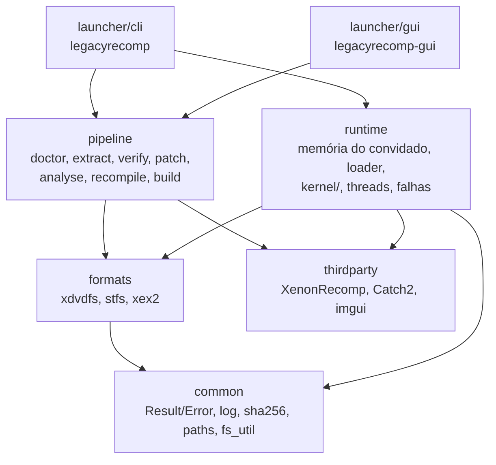

# Arquitetura

## Unidades e direção das dependências



A seta aponta de quem depende para quem é dependido; nada em `common` conhece as camadas acima. Namespaces:
`lr`, `lr::formats`, `lr::pipeline`, `lr::runtime`, `lr::kernel`.

| Unidade | Responsabilidade |
|---|---|
| `common` | `Result<T>`/`Error`, log, SHA-256, caminhos da pasta de dados, utilitários de arquivo |
| `formats` | Leitores de XDVDFS (ISO), STFS (pacotes LIVE/CON) e cabeçalhos XEX2; sem I/O além de `IReader` |
| `pipeline` | As sete etapas, o executor com cache (`state.toml`), execução de ferramentas externas (`posix_spawn`, grupo de processos próprio), gerador dos thunks de importação |
| `runtime` | Memória do convidado, carregador da imagem, tabela de funções, threads, handler de falhas, registro de importações do kernel, variáveis do kernel; lê o cabeçalho XEX2 via `formats/xex2` (o único código de `formats` que entra na biblioteca do jogo) |
| `launcher/cli`, `launcher/gui` | Frentes de uso: ambas chamam `pipeline::run` e `pipeline::launch` |

Regras: APIs públicas devolvem `lr::Result<T>` e nenhuma exceção atravessa módulos (só duas exceções,
lançadas e capturadas dentro do runtime: `lr::kernel::UnimplementedImport` e `lr::kernel::GuestThreadExit`, ver
ADR 0004).

## O runtime e o binário do jogo

O `legacyrecomp-game` é um executável compilado na máquina do usuário na etapa `build`. Ele junta:

- o C++ gerado pelo XenonRecomp (`work/generated/`);
- os thunks das importações (um por nome `__imp__*`, gerado a partir de `ppc_recomp_shared.h`; ver "Kernel");
- as bibliotecas pré-compiladas do runtime (`lr_runtime_core`, XenonUtils), numa variante sem sanitizers;
- o `main.cpp` do runtime, copiado como **fonte** e compilado junto do código gerado.

O `main.cpp` não pode ser uma biblioteca pré-compilada porque usa `PPC_IMAGE_BASE`, `PPC_CODE_SIZE`,
`PPC_CODE_BASE` e `PPCFuncMappings`, que só existem depois do `recompile`, e constrói o `PPCContext` com o
layout definido no `ppc_config.h` gerado (rulings R2 e R16, `docs/adr/0003-m1-plan-deviations.md`). O resto do
runtime nunca toca `PPCContext`: as threads do convidado (inclusive a principal, `run_main_thread`) entram no código
recompilado pela cola `GuestGlue` que o `main.cpp` instala (ver "Kernel").

Linha de comando do jogo: `legacyrecomp-game --image <xex> [--data <dir>] [--headless] [--coverage] [--strict-memory]`.
`--coverage` imprime a tabela de importações (ver `docs/kernel-coverage.md`); `--headless` não inicia SDL;
`--strict-memory` liga o modo estrito de memória (`KernelConfig.strict_memory`, ver abaixo).

## Mapa de memória do convidado

Um único mapeamento anônimo `MAP_NORESERVE` leitura/escrita de `4 GiB + 2 x PPC_CODE_SIZE` bytes. O endereço
convidado `G` fica em `base() + G`. Regiões fixas (spec M2 §6.1; constantes em `src/runtime/memory_map.h`):

| Faixa | Uso |
|---|---|
| `0x00000000`–`0x0000FFFF` | Guarda de ponteiro nulo, `PROT_NONE` desde `init_kernel` |
| `0x00010000`–`0x3FFFFFFF` | Heap virtual de páginas de 4 KiB: `NtAllocateVirtualMemory`, pool do kernel, corpos de objetos, PCR/KTHREAD/TLS |
| `0x40000000`–`0x6FFFFFFF` | Heap virtual de páginas de 64 KiB (`MEM_LARGE_PAGES`) |
| `0x70000000`–`0x7EFFFFFF` | Pilhas das threads do convidado, com página de guarda |
| `0x7F000000`–`0x7FFFFFFF` | Reservada para MMIO e write-back da GPU (M3) |
| `0x80000000`–`0x81FFFFFF` | Dados do kernel (`Kernel::kernel_data_alloc`, alocação sequencial, nunca liberada): cópia do cabeçalho XEX (sempre em `0x80000000`), `LDR_DATA_TABLE_ENTRY`, blocos das variáveis exportadas, páginas `PROT_NONE` de variáveis faltando |
| `0x82000000`–`~0x8659FFFF` | Imagem do jogo (`PPC_IMAGE_BASE`, `PPC_IMAGE_SIZE = 0x032D0000`, código em `0x82200000`) e tabela de funções em `PPC_IMAGE_BASE + PPC_IMAGE_SIZE` (`2 x PPC_CODE_SIZE`, um slot de 8 bytes por instrução). Nunca entregue por um heap |
| `0xA0000000`–`0xFFFFFFFF` | Vistas físicas: `0xA0` (64 KiB), `0xC0` (16 MiB), `0xE0` (4 KiB) |

Os blocos fixos do M1 em `0x7FFD0000`–`0x7FFF0000` (KTHREAD, TLS e KPCR da única thread) não existem mais: essa
faixa é da GPU. KPCR, KTHREAD e TLS são alocados por thread no pool do kernel e as pilhas vêm do heap de pilhas
(ver "Threads").

Valores em big-endian (formato do convidado); o código gerado converte nos acessos.

### Alocadores e importações de memória

O `Kernel` tem quatro alocadores: `heap4k()` e `heap64k()` (`PageHeap`, só contabilidade de endereços),
`stacks()` (`PageHeap` de páginas de 4 KiB sobre `0x70000000`–`0x7EFFFFFF`, as pilhas das threads; as importações
de memória também o consultam, então `NtQueryVirtualMemory`/`MmQueryAddressProtect` respondem por pilhas) e
`physical()` (`PhysicalHeap`, 512 MiB de páginas físicas, sem espelhamento entre vistas). As importações ficam em
`src/runtime/kernel/exports/memory.cpp`, com a semântica do `xboxkrnl_memory.cc` do Xenia (só referência):
`NtAllocateVirtualMemory`/`NtFreeVirtualMemory`/`NtProtectVirtualMemory`/`NtQueryVirtualMemory` (ponteiros de
base e tamanho de entrada e saída em big-endian), `MmAllocatePhysicalMemoryEx` e afins, e o pool
(`ExAllocatePool*`, `XamAlloc*`, `ExFreePool`, `XamFree`), que é feito de alocações inteiras de páginas de 4 KiB,
confirmadas leitura/escrita e zeradas. `MmMapIoSpace` fica faltando até o M3.

O gancho de confirmação dos heaps virtuais zera as páginas recém-confirmadas (salvo `MEM_NOZERO`) com
`GuestMemory::zero`, que devolve páginas inteiras ao host com `madvise(MADV_DONTNEED)` em vez de escrevê-las.
Memória física também é zerada ao ser alocada.

**Modo estrito** (`--strict-memory`): no `init_kernel` os dois heaps virtuais e o de pilhas ficam `PROT_NONE`
(`GuestMemory::protect`, `mprotect` por página de 4 KiB do host); o gancho deixa leitura/escrita as páginas
confirmadas e volta a `PROT_NONE` as desconfirmadas ou liberadas. Assim um acesso perdido falha com o endereço do
convidado (`SIGSEGV at guest 0x...`, saída 4) em vez de ler zeros. Sem o modo estrito, só a guarda de ponteiro
nulo é `PROT_NONE`. Proteções do convidado (`PAGE_READONLY` etc.) não viram proteção do host no M2.


## Threads

Cada thread do convidado, inclusive a principal, é uma thread do host (`runtime/kernel/threads.h`): pilha de
16 MiB (`kHostStackSize`, criada por `start_host_thread` em `runtime/guest_thread.h`) e pilha alternativa de sinal
(`install_thread_altstack()`). Na memória do convidado ela tem (layouts `X_KPCR`/`X_KTHREAD` do Xenia, conferidos
com `static_assert` em `guest_structs.h`; semântica do `xthread.cc`, só referência):

- um bloco do pool do kernel com KTHREAD (`0xAB0` bytes; cabeçalho de despachante tipo 6, pilha `+0x5C`/`+0x60`,
  TLS `+0x68`, id `+0x14C`, endereço de início `+0x150`, último erro `+0x160`), KPCR (`0x2D8` bytes, o `r13`:
  `tls_ptr` `+0x00`, `pcr_ptr` `+0x30`, topo da pilha `+0x70`, fundo `+0x74`, `current_thread` `+0x100`,
  `current_cpu` `+0x10C`) e o bloco TLS: cópia do modelo TLS do XEX (cabeçalho `0x00020104`: dados brutos de
  `raw_data_address`, completados com zeros até `data_size`) seguida dos slots de `KeTlsAlloc` (`be<uint32_t>`,
  no mínimo 64, ou o `slot_count` do cabeçalho se maior; bitmap de slots do processo). O `main.cpp` passa o
  cabeçalho a `Threads::set_image`, que o valida (no máximo 4096 slots e 4 MiB de dados, `raw_data_size` <=
  `data_size`, dados brutos dentro da imagem carregada; tamanhos calculados em 64 bits): um cabeçalho inválido é erro
  de carga (saída 2). `set_image` é recusado depois que existe alguma thread, então o layout de TLS é fixo. `tls_ptr` e
  `tls_address` apontam para a cópia do modelo, como o `tls_static_address` do Xenia;
- uma pilha do heap de pilhas (`Kernel::stacks()`), arredondada a 4 KiB, mínimo 16 KiB, com uma página de guarda
  reservada e `PROT_NONE` logo abaixo. A thread começa com `r1` = topo - `0x80`.

O KTHREAD é o objeto da thread: é o `guest_header()` do `KObject`, então `ObReferenceObjectByHandle`, as esperas
por handle e `KeWaitForSingleObject` no KTHREAD funcionam. A identidade da thread no despachante
(`current_thread_token`) é o endereço do KTHREAD, e o pseudo-handle `kCurrentThread` resolve para a thread atual.
Ids são inteiros crescentes a partir de 1 (a principal). A memória (bloco do pool e pilha) é liberada quando sai a
última referência (handles, referências do kernel, a própria thread do host em execução).

Início: toda thread entra no código recompilado pela cola (`call_guest_on_frame(início, args, r1, r13)`), que
carrega o `fpscr` do host. Com rotina de início XAPI chama `xapi(início, contexto)` e o código de saída é 0; sem
ela, `início(contexto)` e o código de saída é o r3 devolvido. `ExTerminateThread(código)` lança
`GuestThreadExit`, capturada no topo da thread (a segunda e última exceção permitida, ADR 0004). Ao terminar, o
`signal_state` do KTHREAD vira 1 e `Dispatcher::signal` acorda quem espera; APCs pendentes são descartadas e
`Dispatcher::thread_exited` apaga o despertar de APC pendente e abandona os mutantes que a thread ainda possui (quem
os adquire depois recebe `STATUS_ABANDONED_WAIT_0`), para que nada passe a uma thread nova cujo KTHREAD reutilize o
mesmo endereço.

No topo de cada thread: `UnimplementedImport` imprime o relatório com uma linha `Thread: <id>` (spec §11) e
encerra o processo inteiro com `_exit(3)`; qualquer outra exceção dá `_exit(4)`; falha real (SIGSEGV, SIGILL,
inclusive estouro de pilha na página de guarda) é tratada pelo handler de sinais (saída 4). `run_main_thread(entrada,
tamanho_da_pilha)` cria a thread principal pelo mesmo caminho (tamanho de pilha do cabeçalho XEX `0x00020200`,
256 KiB por padrão) e espera seu KTHREAD; quando ela termina, o `main.cpp` sai com 0 via `_exit`, derrubando as
outras threads. Com janela, o SDL roda na thread principal do host e a espera numa thread auxiliar, como antes.

Suspensão: o contador fica na `GuestThread`. Criação suspensa (bit 0 das flags) e auto-suspensão
(`NtSuspendThread` na própria thread) bloqueiam na hora; suspender outra thread em execução é cooperativo: o
gancho de entrada de importação (`set_import_entry_hook`, chamado por `trace` em todo thunk; uma leitura atômica)
bloqueia a thread na próxima importação. `NtResumeThread`/`KeResumeThread` decrementam. Prioridade e afinidade
(`KeSetBasePriorityThread`, `KeSetAffinityThread`, máscara de CPU no byte alto das flags, gravada em
`current_cpu`) são registradas, não aplicadas.

APCs: `NtQueueApcThread(handle, rotina, contexto, arg1, arg2)` põe `(rotina, contexto, arg1, arg2)` na fila da
thread e chama `Dispatcher::wake_for_apc`. Uma espera alertável (`KeWaitFor*`, `NtWaitFor*Ex`,
`NtSignalAndWaitForSingleObjectEx`, `KeDelayExecutionThread`; nesta, um ponteiro de intervalo nulo vale 0, um
yield, em vez de espera infinita) que volta com `STATUS_USER_APC` executa antes as APCs
da fila com `call_guest(rotina, {contexto, arg1, arg2})`, salvo dentro de `KeEnterCriticalRegion` (contador de
APCs desabilitadas; ao sair da região, APCs pendentes rearmam a próxima espera alertável). `queue_apc` chama
`wake_for_apc` sob o mutex da thread, o mesmo sob o qual `finish` marca a thread como terminada: ou a APC chega antes
e `thread_exited` apaga o despertar, ou ela vê a thread terminada e não faz nada, então nenhum despertar pendente
sobrevive à thread (ordem de travas: mutex da thread, depois o do despachante). `NtAlertThread` não é
importado pelo jogo, então `STATUS_ALERTED` nunca é produzido.

Outras importações (`exports/threads.cpp`): `KeTlsAlloc`/`KeTlsFree`/`KeTlsGetValue`/`KeTlsSetValue`,
`ObLookupThreadByThreadId` (KTHREAD com referência do kernel), `KeGetCurrentProcessType`/`KeSetCurrentProcessType`
(padrão 1), `ExRegisterTitleTerminateNotification` (registrada, nunca chamada no M2), `NtYieldExecution`,
`KiApcNormalRoutineNop`; stubs: `KeSetDisableBoostThread`, `KeSaveFloatingPointState`,
`KeRestoreFloatingPointState`, `KeEnableFpuExceptions`.

### Tempo, timers, DPCs e spinlocks

Relógios (`runtime/kernel/timers.h`, importações em `exports/time.cpp`): o XenonRecomp traduz a leitura do
timebase (`mftb`) para `__rdtsc()`, então o contador de desempenho do convidado **é o TSC do host**.
`KeQueryPerformanceFrequency` devolve a frequência do TSC medida **na inicialização** (`init_kernel` grava em `Timers::tsc_hz()` o valor de
`process_tsc_hz()`, que mede uma vez por processo com `calibrate_tsc_hz()`: três amostras de ~16 ms dentro de 50 ms,
cada leitura de `CLOCK_MONOTONIC` entre duas leituras de `__rdtsc()`, vence a amostra de colchetes mais estreitos),
como valor de 64 bits, e não os 50 MHz do console. `KeQuerySystemTime` grava o relógio de tempo real do host como FILETIME (100 ns
desde 1601-01-01 UTC, BE). `RtlTimeToTimeFields`/`RtlTimeFieldsToTime` convertem para o calendário gregoriano
proléptico (`X_TIME_FIELDS` do Xenia: oito `be<int16_t>`, dia da semana por último, 0 = domingo); campos fora da
faixa devolvem FALSE.

Thread de trabalho do kernel: uma por kernel, roda as expirações de timers, as rotinas de DPC e a atualização de
`KeTimeStampBundle`. Como rotinas de DPC são código do convidado, ela é uma thread interna do convidado
(`create_internal_guest_thread`): KTHREAD, KPCR e pilha do convidado próprios (64 KiB), id `0x10000` fora da
sequência do convidado (a thread principal continua sendo a 1), sem handle, fora de `Threads::live()` e de
`wait_for_guest_threads_for_tests`; ela espera numa variável de condição própria, nunca no despachante, então o
detector de impasse não a conta como thread do convidado (ele deve consultar `Timers::has_pending_work()`: timer
armado ou DPC na fila conta como trabalho pendente). Seu bloco de TLS copia o modelo de TLS do XEX como o de qualquer thread, e criá-la congela o layout
(`set_image` falha depois); por isso o `main.cpp` chama `set_image` antes de `resolve_variable_imports`, que pode
iniciá-la. Ela nasce sob demanda (primeiro timer armado, primeiro DPC na fila ou importação de `KeTimeStampBundle`),
roda em `DISPATCH_LEVEL` e chama o convidado por `call_guest` (a cola, com o FPSCR do host). O destrutor do `Kernel`
(e `reset_kernel_for_tests`, antes de soltar a instância) a para e faz `join`. Uma `UnimplementedImport` dentro de
um DPC sai com 3 e o relatório; qualquer outra exceção, inclusive `ExTerminateThread`, sai com 4.

Timers: `NtCreateTimer(handle*, atributos, tipo)` aloca um `X_KTIMER` (0x28 bytes, layout do KTIMER do NT; o Xenia
não declara um) no pool com cabeçalho tipo 8 (notificação, tipo 0) ou 9 (sincronização, tipo 1, consumido pela
espera). `NtSetTimerEx(handle, vencimento*, rotina_apc, modo, contexto_apc, resume, período_ms, estado_anterior*)`
(ordem do Xenia) zera o `signal_state` e arma o timer: vencimento negativo = relativo em 100 ns, senão FILETIME
absoluto; período negativo devolve `STATUS_INVALID_PARAMETER` (o `Period` do NT é `LONG`); `resume` devolve `STATUS_TIMER_RESUME_IGNORED` como no Xenia. Ao vencer, a thread de trabalho põe
`signal_state` em 1 e chama `Dispatcher::signal`, enfileira a APC `rotina(contexto, FILETIME baixo, alto)` na
thread do convidado que armou o timer (semântica do Xbox/Xenia, não roda na thread de trabalho) e rearma o timer
periódico (períodos perdidos são pulados). `NtCancelTimer` desarma e informa o estado atual. Fechar o último handle
desarma o timer antes de liberar o corpo. Prazo, período e APC ficam no host, indexados pelo endereço do cabeçalho.

DPCs: `KeInitializeDpc(dpc*, rotina, contexto)` grava o `XDPC` do Xenia (tipo 19 no byte alto da primeira palavra,
rotina `+0xC`, contexto `+0x10`, argumentos `+0x14`/`+0x18`). `KeInsertQueueDpc(dpc*, arg1, arg2)` devolve FALSE se
o DPC já está na fila; senão grava os argumentos e a thread de trabalho chama `rotina(dpc, contexto, arg1, arg2)`.
O DPC sai da fila antes de a rotina rodar, então pode ser reenfileirado (o Xenia nunca despacha DPCs). Um DPC com rotina 0 é erro fatal do convidado (`guest_fatal`, saída 5), no
`KeInsertQueueDpc` ou na thread de trabalho.

`KeTimeStampBundle` (`X_TIME_STAMP_BUNDLE`, 24 bytes): tempo de interrupção (100 ns desde o início do kernel), tempo
do sistema (FILETIME) e contagem de ticks em ms em `+0x10` (o único campo que o Xenia atualiza). O bloco é preenchido
na alocação; só quando o jogo importa a variável (`resolve_variable_imports`) a thread de trabalho passa a
atualizá-lo a cada 1 ms. Agora é `implemented` no `--coverage`.

Spinlocks e IRQL: a IRQL é um valor por thread do host (logo por thread do convidado, `current_irql()`).
`KfAcquireSpinLock(lock*)` adquire e sobe para `DISPATCH_LEVEL` (2), devolvendo a IRQL anterior;
`KfReleaseSpinLock(lock*, irql_antiga)` restaura a IRQL e libera. `KeAcquireSpinLockAtRaisedIrql` /
`KeReleaseSpinLockFromRaisedIrql` não mexem na IRQL. A palavra do lock (BE, na memória do convidado) vale 0 livre ou
o endereço do KTHREAD do dono (1 fora de threads do convidado); a aquisição é um CAS atômico do host sobre ela,
compatível com o `lwarx`/`stwcx.` do código gerado, com `pause` por 1000 voltas e depois `sched_yield` (o Xenia usa
0/1 e gira sem ceder em `KeAcquireSpinLockAtRaisedIrql`).

Códigos de saída do jogo (`runtime/guest_thread.h`): 0 normal, 2 uso/carga (`kExitUsage`), 3 importação
faltando (`kExitUnimplementedImport`), 4 falha (`kExitFault`), 5 erro fatal do convidado (`kExitGuestFatal`,
ver `guest_fatal` abaixo) e 6 impasse (`kExitDeadlock`, ver "Diagnóstico" abaixo).

## Kernel

O kernel é escrito no `lr_runtime_core` pré-compilado, que nunca vê o `PPCContext` (R16). A ponte entre o
código gerado e o kernel tem três partes:

- **ABI fixa** (`runtime/kernel/abi.h`): `GuestCall` tem layout próprio, independente do `ppc_config.h`:
  `base`, `gpr[8]` (r3..r10), `fpr[13]` (f1..f13), `r1`, `r13`, `lr` e o retorno (`ret_gpr` para r3,
  `ret_fpr` para f1 quando `has_fpr_return`). Toda implementação tem a forma `KernelFn = void(GuestCall&)`.
- **Registro** (`runtime/kernel/registry`): nome → (estado, `KernelFn`). Estados (`ImportState`):
  `Implemented`, `Stub` e `Missing` (nada registrado). `LR_KERNEL(Nome)`, em escopo global num `.cpp`,
  registra `marshal<&exports::Nome>` como `Implemented`; `marshal` (`runtime/kernel/marshal.h`) converte o
  `GuestCall` nos parâmetros tipados da função C++ `lr::kernel::exports::Nome` e escreve o retorno.
  `LR_KERNEL_STUB(Nome, valor)` registra um `Stub` que só devolve a constante em r3 (com a mesma extensão de
  sinal de `marshal`); cada uso leva um comentário dizendo por que a constante basta. Os registros são
  inicializadores estáticos; o template liga o `lr_runtime_core` com `--whole-archive` só para que eles não
  sejam descartados. Registrar o mesmo nome duas vezes aborta na inicialização.
- **Thunks** (gerados por `lr::pipeline::render_import_thunks` em `work/generated/import_stubs.cpp` e
  compilados junto com o jogo): um `PPC_FUNC(__imp__Nome)` por importação. Na primeira chamada o thunk
  guarda `find_import("Nome")` num `static` local; em toda chamada registra o nome na trilha (`trace`) e copia
  r3..r10, f1..f13, r1, r13 e lr para um `GuestCall`. Se não há função, registra a chamada no trace de importações
  (`trace_import_missing`) e chama `unimplemented_import`. Senão guarda r1/r13 como o quadro atual do convidado
  nesta thread (`set_current_frame`, usado por `call_guest`), chama a função, registra a chamada com o retorno
  (`trace_import_return`) e escreve de volta r3 (e f1). A cópia está num único helper no topo do
  arquivo, não repetida 459 vezes. É o único código do kernel que toca o `PPCContext`.

**Estado do kernel** (`runtime/kernel/kernel.h`): `init_kernel(memória, KernelConfig)` cria, uma vez por
processo, a instância única `Kernel` (acessada por `kernel()`), da qual pendem os subsistemas do kernel
(memória do convidado e configuração: `game_dir`, `user_dir`, `language`, `strict_memory`, `trace_imports`,
`trace_file`, `deadlock_seconds`).
Uma segunda chamada devolve `Error{Internal}`. A instância, assim como a tabela do registro e seu mutex, é
vazada de propósito (nunca destruída), para que threads que ainda chamam thunks durante o fim do processo não
toquem memória destruída. Só os testes (`tests/support/kernel_fixture.h`) usam `reset_kernel_for_tests()`
para criar um kernel novo por fixture.

**`guest_fatal(o_quê)`**: erro irrecuperável do convidado (`KeBugCheck`, exceção do convidado sem tratamento,
chamada a endereço sem função recompilada). Escreve `Guest fatal: <o_quê>` e a linha de trilha da thread
(mesmo formato `Trail (last N): ...` do relatório de saída 3) em stderr, esvazia o stdio e o trace de importações
e sai com `_exit(5)`. Toda condição fatal que não é importação faltando passa por ela.

**Chamadas do kernel para o convidado** (`runtime/kernel/glue.h`): rotinas de início de thread, APCs, DPCs e
callbacks são funções recompiladas, mas o `lr_runtime_core` não conhece o `PPCContext`. O `main.cpp`
(compilado com o jogo) instala no início uma cola `GuestGlue` com dois ponteiros: `call` monta um
`PPCContext` novo (r3.. = argumentos, r1, r13) e chama a função por `PPC_LOOKUP_FUNC`; `has_function`
confere primeiro se o endereço está em `[PPC_CODE_BASE, PPC_CODE_BASE + PPC_CODE_SIZE)` e alinhado a 4, e só
então lê a entrada da tabela de funções (não nula). `call_guest(endereço, args)` usa o quadro atual da thread
(gravado pelo thunk): a função chamada roda com `r1 = (r1 atual - 0x100) & ~0xF` e o mesmo r13, e o quadro
de quem chamou é restaurado na volta, inclusive quando uma exceção atravessa a chamada. O `PPCContext` novo
(também o da entrada de cada thread do convidado) carrega o `fpscr` do MXCSR real do host (`loadFromHost`), com
todas as exceções SSE mascaradas; a cola restaura o MXCSR de quem chamou depois do callback. Endereço sem função recompilada (ou mais de 8 argumentos, ou thread
sem quadro) termina com `guest_fatal` citando o endereço do convidado, nunca com salto para o endereço 0 do
host.

Como todo thunk passa por `trace`, a trilha do relatório de saída 3 (`Trail (last N): ...`, últimas 32
chamadas da thread) lista todas as importações chamadas antes da que falta, inclusive stubs, terminando
nela. `--coverage` imprime `| Import | Kind | Status |` para as 459 importações (tipo `function`; estado
`implemented`, `stub` ou `missing`; com `--image <xex>`, também as importações de variável, tipo `variable`) e
termina com `Implemented: a, stub: b, missing: c / N functions + M variables` (ver
`docs/kernel-coverage.md`). Esse modelo substitui o do M1 (`LR_KERNEL_EXPORT` forte contra stub fraco), que
não funcionava com o runtime pré-compilado: ver `docs/adr/0004-m2-plan-deviations.md`.

### Objetos, handles e esperas

`Kernel::objects()` (`runtime/kernel/objects.h`) é a tabela de handles (`0xF8000000 + 4·slot`). Um `KObject`
pode ter um corpo no convidado (`guest_header()`, o `DISPATCHER_HEADER`); `ObReferenceObjectByHandle` recusa
objetos sem endereço no convidado (nem cabeçalho nem corpo) com `STATUS_OBJECT_TYPE_MISMATCH`, sem escrever nada e sem fixar
referência.

`Kernel::dispatcher()` (`runtime/kernel/dispatcher.h`) é o motor de espera. A memória do convidado é a fonte da
verdade: ele trabalha só com endereços de `DISPATCHER_HEADER` (tipo `+0`, `signal_state` `+4`), então eventos que
o próprio jogo inicializa (o `KeInitializeEvent` é inline) funcionam sem handle. Um mutex global serializa tudo;
`signal_state` é lido e escrito com operações atômicas sobre a palavra big-endian, coerentes com o
`lwarx`/`stwcx.` do código gerado. Os esperadores ficam numa lista FIFO por endereço de cabeçalho, cada um com sua
variável de condição, e quem sinaliza (set, pulse, release) já os satisfaz e consome sob o mutex, então um pulso
ou um evento de reset automático nunca perde o despertar. Tipos: evento de notificação (0) e de sincronização (1,
consumido), mutante (2: `signal_state` 1 livre, desce a cada aquisição, recursão pelo dono; dono em `+0x18`),
semáforo (5, limite em `+0x10`), thread (6) e timers (8, 9 = reset automático). WaitAll adquire tudo ou nada.
Tempo limite: nulo = infinito, 0 = consulta, negativo = relativo em 100 ns, positivo = FILETIME absoluto contra o
relógio real; as esperas usam prazos do `steady_clock`. `wake_for_apc(thread)` faz uma espera alertável devolver
`STATUS_USER_APC` (ou a próxima, se a thread não está esperando). A identidade da thread vem de
`current_thread_token()`: o endereço do KTHREAD numa thread do convidado, um número por thread do host nas outras.
`snapshot()` lista as esperas em curso para o detector de impasse, cada uma com `apc_pending` (há um
`wake_for_apc` pendente para aquela thread); `activity()` conta entradas e saídas de espera. Um convidado que muda `signal_state` com
escrita comum, sem importação, só acorda alguém na próxima operação do despachante naquele cabeçalho.

As importações (`exports/sync.cpp`, semântica do `xboxkrnl_threading.cc` do Xenia, só referência) são
`KeSetEvent`/`KeResetEvent`, `KeInitializeMutant`/`KeReleaseMutant` (assinaturas do NT; liberar sem ser dono
devolve `STATUS_MUTANT_NOT_OWNED` em vez de levantar exceção), `KeWaitForSingleObject`,
`KeWaitForMultipleObjects`, `NtCreateEvent`, `NtSetEvent`, `NtClearEvent`, `NtPulseEvent`, `NtCreateSemaphore`,
`NtReleaseSemaphore`, `NtWaitForSingleObjectEx`, `NtWaitForMultipleObjectsEx` e
`NtSignalAndWaitForSingleObjectEx` (sinal e espera atômicos). Os `Nt*Create*` alocam o corpo no pool do kernel,
liberado quando o objeto morre; nomes e atributos de objeto são ignorados (objetos nomeados não existem no M2).
Esperar num handle sem cabeçalho devolve `STATUS_OBJECT_TYPE_MISMATCH`.

Um objeto que não é esperável pode ter só um corpo (`guest_body()`): `guest_object()` devolve o cabeçalho ou, na
falta dele, o corpo, e `by_guest_header` acha o objeto pelos dois. Assim `ObReferenceObjectByHandle` funciona com
handles de arquivo, enquanto as esperas continuam recusando-os (o `guest_header()` deles é 0).

### Arquivos

`Kernel::vfs()` (`runtime/kernel/vfs.h`) traduz caminhos do convidado (`game:\...`, `\??\...`,
`\Device\Cdrom0\...`, `cache:\...`) para caminhos do host, sem diferenciar maiúsculas; `game:` é só leitura e
`cache:` fica em `<user>/cache`. As importações de arquivo (`exports/files.cpp`, semântica do
`xboxkrnl_io.cc`/`xboxkrnl_io_info.cc`/`xfile.cc` do Xenia, só referência) usam o `resolve()` dele:

- **`FileObject`** (`runtime/kernel/files.h`): um descritor do host aberto com `O_CLOEXEC` (arquivo ou
  diretório), posição atual, estado de enumeração e um corpo de 0x40 bytes zerado no pool (o `guest_body()`),
  liberado junto com o objeto. O descritor é fechado no destrutor; com "apagar ao fechar" o arquivo do host é
  removido nessa hora, ou seja, quando o objeto daquele handle é destruído (último handle fechado e nenhuma
  referência do kernel pendente), não no `NtClose` de outro handle do mesmo arquivo.
- **`NtCreateFile`** (9 argumentos, o 9º na pilha) e **`NtOpenFile`** (`FILE_OPEN`; `share_access` antes de
  `open_options`, como no xenia-canary): disposições `FILE_SUPERSEDE` 0 … `FILE_OVERWRITE_IF` 5;
  `IO_STATUS_BLOCK.information` = `FILE_SUPERSEDED` 0 / `FILE_OPENED` 1 / `FILE_CREATED` 2 / `FILE_OVERWRITTEN` 3.
  `root_directory` (diferente de 0 e de `0xFFFFFFFD`) é um handle de diretório aberto, e o nome é relativo a ele.
  Nome faltando → `STATUS_OBJECT_NAME_NOT_FOUND`; diretório intermediário faltando ou dispositivo desconhecido →
  `STATUS_OBJECT_PATH_NOT_FOUND`; criar, substituir ou truncar num ponto só leitura → `STATUS_ACCESS_DENIED`. Pedir
  acesso de escrita a um arquivo só leitura abre só para leitura (como o Xenia); a escrita por esse handle é
  recusada. Em pontos graváveis a máscara de acesso não é aplicada (leniente, como o Xenia): todo handle de
  arquivo pode ler e escrever. `FILE_DIRECTORY_FILE` (0x1) cria um diretório (ou recusa um arquivo com `STATUS_NOT_A_DIRECTORY`);
  `FILE_NON_DIRECTORY_FILE` (0x40) num diretório → `STATUS_FILE_IS_A_DIRECTORY`. Em falha o handle de saída recebe
  `0xFFFFFFFF`.
- **`NtReadFile`**, **`NtReadFileScatter`** (uma página de 4 KiB por segmento) e **`NtWriteFile`**: síncronos
  (`pread`/`pwrite`). O deslocamento é `*byte_offset`, ou a posição atual quando o ponteiro é nulo ou vale -1 ou
  -2 (`FILE_USE_FILE_POINTER_POSITION`); outro valor negativo → `STATUS_INVALID_PARAMETER`; depois a posição fica
  em deslocamento + bytes (como no NT). Ler um handle de diretório → `STATUS_INVALID_DEVICE_REQUEST`. Ler no fim
  ou depois dele → `STATUS_END_OF_FILE` com 0 bytes. `IO_STATUS_BLOCK` nulo → `STATUS_INVALID_PARAMETER`, buffer
  fora da memória do convidado (`valid_range`) → `STATUS_ACCESS_VIOLATION`, ambos sem tocar em nada. Ao terminar:
  `{status, bytes}` no `IO_STATUS_BLOCK`, o evento (se houver) é sinalizado e a APC (se rotina e contexto não forem
  nulos, como no Xenia) é enfileirada na thread que chamou com `(apc_context, io_status_block, 0)`.
- **`NtQueryInformationFile`**: classes 5 (Standard), 6 (Internal: o inode do host), 14 (Position) e 34
  (NetworkOpen); as outras → `STATUS_INVALID_PARAMETER`, buffer curto → `STATUS_INFO_LENGTH_MISMATCH`.
  **`NtSetInformationFile`**: 13 (Disposition: apagar ao fechar), 14 (Position) e 20 (EndOfFile: `ftruncate`).
  **`NtQueryFullAttributesFile`** preenche `X_FILE_NETWORK_OPEN_INFORMATION`. Datas em FILETIME a partir do
  `mtime`/`atime` do host; tamanho alocado = tamanho arredondado para 4 KiB; atributos `0x10` (diretório) ou
  `0x80` (normal).
- **`NtQueryDirectoryFile`**: uma entrada `X_FILE_DIRECTORY_INFORMATION` (0x40 bytes + nome ANSI) por chamada,
  como no Xenia. O padrão (`*` e `?`, sem diferenciar maiúsculas; `*.*` casa tudo) vale na primeira consulta ou
  num `restart_scan`, que tiram um retrato ordenado do diretório. Sem nenhum nome → `STATUS_NO_SUCH_FILE`; fim da
  lista → `STATUS_NO_MORE_FILES`; buffer menor que 72 bytes → `STATUS_INFO_LENGTH_MISMATCH`.
- **`NtQueryVolumeInformationFile`** com valores fixos: classe 3 (`FileFsSizeInformation`: setores de 512 bytes,
  32 setores por unidade, 0x100000 unidades no total, 0x80000 livres, ou seja 16 GiB com 8 GiB livres) e classe 5
  (`FileFsAttributeInformation`: atributos 0, nome de até 42 caracteres, sistema `FATX`).
- Stubs: `NtDeviceIoControlFile` → `STATUS_NOT_IMPLEMENTED`; `FscGetCacheElementCount` → 0;
  `FscSetCacheElementCount` → `STATUS_SUCCESS` (os valores do Xenia). `NtWriteFileGather` e `NtFlushBuffersFile`
  continuam faltando (M4).

## Diagnóstico

Os modos de falha do ciclo "rodar, ver onde para, implementar" são importação faltando (saída 3), falha (4), erro
fatal pedido pelo convidado (5) e impasse (6). Além do relatório de cada um, há o trace de importações.

**Trace de importações** (`runtime/kernel/trace.h`): `legacyrecomp-game --trace-imports` (repassado por
`legacyrecomp run -- --trace-imports`) grava uma linha por chamada de importação:

```
[<tid>] <Nome> r3=0x%08X r4=0x%08X r5=0x%08X r6=0x%08X -> 0x%08X
```

com os 32 bits baixos de r3..r6 na entrada e de r3 no retorno; `tid` é o id da thread do convidado (0 fora de
uma). A linha é escrita depois que a importação volta; uma importação faltando é registrada com `-> missing` antes
do relatório de saída 3, e uma que nunca volta (`KeBugCheckEx`, `ExTerminateThread`, `HalReturnToFirmware`) não
tem linha. O destino é `--trace-file <caminho>` (diretórios criados; sem ele, stderr). O `legacyrecomp run`
(`pipeline::launch`) sempre passa `--trace-file <raiz>/work/logs/game-trace.log`, que sozinho não faz nada.
As linhas vão para um buffer de 64 KiB protegido por um spinlock (uma flag atômica) e são escritas com `write(2)`
quando ele enche, a cada segundo pelo detector de impasse (quando ele roda), na saída normal (`atexit` e o
`_exit` do `main.cpp`) e em todo caminho fatal: saída 3 (topo da
thread), 5 (`guest_fatal`), 6 (detector) e `HalReturnToFirmware`. O handler de falhas (saída 4) só tenta o
spinlock, sem bloquear (seguro em sinal): se a própria thread que falhou estava escrevendo uma linha, as linhas no
buffer se perdem. Desligado, cada thunk paga uma leitura atômica.

**Detector de impasse** (`runtime/kernel/deadlock.h`): uma thread do host (não do convidado), iniciada com a
primeira thread do convidado quando `KernelConfig::deadlock_seconds` > 0 (o `main.cpp` usa 10 s, ou a variável
de ambiente `LR_DEADLOCK_SECONDS`; 0 desliga; os testes usam 1). A cada segundo ela observa: todas as threads
vivas do convidado (`Threads::live()`, sem o worker interno nem a espera de `run_main_thread`, que é do host)
estão numa espera do despachante infinita e não alertável-com-APC-pendente, e não há timer armado nem DPC na fila
ou rodando (`Timers::has_pending_work()`). Uma thread fora de uma espera do despachante (rodando código,
suspensa, começando) significa que não há impasse. A observação só vale se `Dispatcher::activity()` não mudou
durante ela, e o impasse exige o mesmo `activity()` por pelo menos N segundos seguidos. Então o detector imprime
em stderr

```
Deadlock: every guest thread is blocked in an infinite wait (no timer, DPC or APC pending) for N s
Thread <id>: waiting on 0x<cabeçalho> (<tipo>)
Trail (last K): ...
```

para cada thread (tipo do `KObject` dono do cabeçalho, ou o byte de tipo do cabeçalho quando o próprio convidado
o inicializou; várias esperas com `(any)`/`(all)`), esvazia o stdio e o trace e sai com `_exit(6)`. A trilha de
cada thread é lida pelo handle da sua trilha (`current_trail_handle`/`trail_of`), seguro porque a thread está
bloqueada.

O único sinalizador do lado do host hoje é o worker de timers/DPCs (e as APCs). Todo sinalizador futuro do host que
possa acordar uma thread do convidado (E/S assíncrona, notificações da XAM, interrupções emuladas) precisa contar
como trabalho pendente para o detector, senão uma espera legítima por ele vira falso impasse (saída 6). Se a thread
do detector não puder ser criada, o jogo avisa em stderr e roda sem ele. Antes de sair, o detector repete a
observação depois de montar o relatório: se algo mudou nesse meio tempo, descarta o relatório e continua observando.

**Importações de depuração** (`exports/debug.cpp`, semântica do `xboxkrnl_debug.cc`/`xboxkrnl_hal.cc` do Xenia,
só referência): `DbgPrint` imprime a string de formato literal com prefixo `[guest] ` (até o interpretador de
`printf`); `DbgBreakPoint` registra e continua; `KeBugCheck(código)`/`KeBugCheckEx(código, p1..p4)` →
`guest_fatal("KeBugCheckEx 0x%08X (0x..., ...)")`; `HalReturnToFirmware` esvazia o trace e sai com 0;
`RtlCaptureContext` preenche o `X_CONTEXT` do convidado (`guest_structs.h`, 0xA40 bytes; o Xenia não define
esse tipo, o layout é o do `CONTEXT` público do Xbox 360) escrevendo só os campos conhecidos (`ContextFlags` = controle | inteiros, `iar` = lr, lr, r1, r3..r10 e r13) e
nada mais: como o layout não foi conferido, zerar 0xA40 bytes poderia sobrescrever a pilha de quem chamou; `RtlRaiseException` → `guest_fatal` com o código da exceção, exceto
`0x406D1388` (o `SetThreadName` do MSVC, que o Xenia também trata e retorna); `RtlUnwind` e
`__C_specific_handler` → `guest_fatal` com o nome (sem SEH do convidado). Stubs com sucesso:
`EtxProducerRegister`/`Unregister`/`Log`, `KeLockL2`/`KeUnlockL2`.
