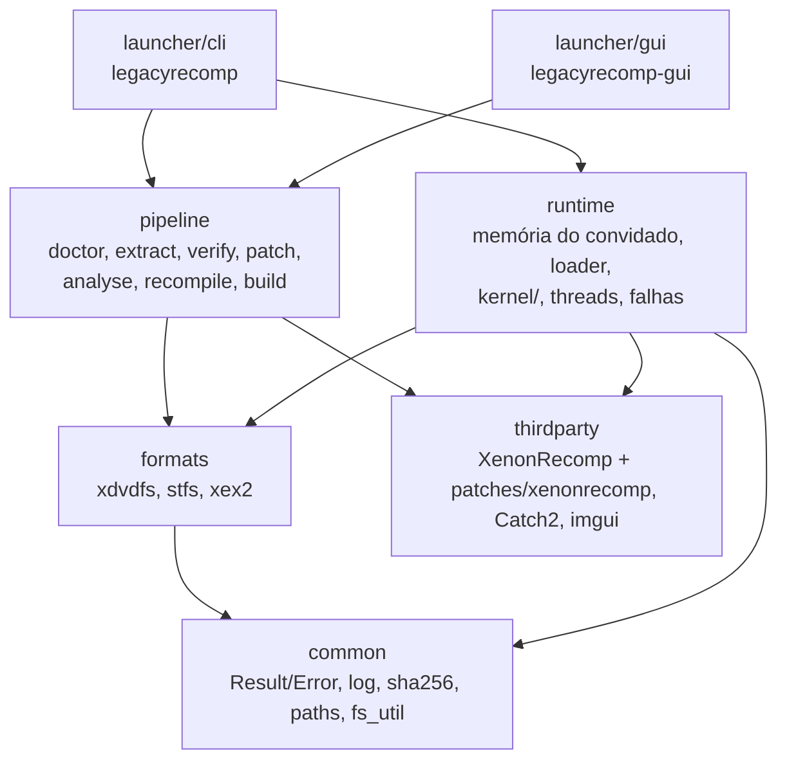

# Arquitetura

## Unidades e direção das dependências



A seta aponta de quem depende para quem é dependido; nada em `common` conhece as camadas acima. Namespaces:
`lr`, `lr::formats`, `lr::pipeline`, `lr::runtime`, `lr::kernel`.

| Unidade | Responsabilidade |
|---|---|
| `common` | `Result<T>`/`Error`, log, SHA-256, caminhos da pasta de dados, utilitários de arquivo |
| `formats` | Leitores de XDVDFS (ISO), STFS (pacotes LIVE/CON) e cabeçalhos XEX2; sem I/O além de `IReader` |
| `pipeline` | As sete etapas, o executor com cache (`state.toml`), execução de ferramentas externas (`posix_spawn`, grupo de processos próprio), gerador dos thunks de importação |
| `runtime` | Memória do convidado, carregador da imagem, tabela de funções, threads, handler de falhas, registro de importações do kernel, variáveis do kernel; lê o cabeçalho XEX2 via `formats/xex2` (o único código de `formats` que entra na biblioteca do jogo) |
| `launcher/cli`, `launcher/gui` | Frentes de uso: ambas chamam `pipeline::run` e `pipeline::launch` |

Regras: APIs públicas devolvem `lr::Result<T>` e nenhuma exceção atravessa módulos (só duas exceções,
lançadas e capturadas dentro do runtime: `lr::kernel::UnimplementedImport` e `lr::kernel::GuestThreadExit`, ver
ADR 0004).

## O runtime e o binário do jogo

O `legacyrecomp-game` é um executável compilado na máquina do usuário na etapa `build`. Ele junta:

- o C++ gerado pelo XenonRecomp (`work/generated/`);
- os thunks das importações (um por nome `__imp__*`, gerado a partir de `ppc_recomp_shared.h`; ver "Kernel");
- as bibliotecas pré-compiladas do runtime (`lr_runtime_core`, `lr_vulkan` e XenonUtils), numa variante sem
  sanitizers (`share/legacyrecomp/runtime/lib/`: `liblr_runtime_core.a`, `liblr_vulkan.a` com o volk, o VMA e os
  shaders internos já dentro, e `libXenonUtils.a`; regra R-stage);
- o `main.cpp` do runtime, copiado como **fonte** e compilado junto do código gerado.

O `main.cpp` não pode ser uma biblioteca pré-compilada porque usa `PPC_IMAGE_BASE`, `PPC_CODE_SIZE`,
`PPC_CODE_BASE` e `PPCFuncMappings`, que só existem depois do `recompile`, e constrói o `PPCContext` com o
layout definido no `ppc_config.h` gerado (rulings R2 e R16, `docs/adr/0003-m1-plan-deviations.md`). O resto do
runtime nunca toca `PPCContext`: as threads do convidado (inclusive a principal, `run_main_thread`) entram no código
recompilado pela cola `GuestGlue` que o `main.cpp` instala (ver "Kernel").

Linha de comando do jogo:
`legacyrecomp-game --image <xex> [--data <dir>] [--headless] [--gpu vulkan|null] [--coverage] [--strict-memory]
[--screenshot-after <n> <png>] ...` (a lista completa está no começo do `src/runtime/main.cpp`). `--coverage`
imprime a tabela de importações (ver `docs/kernel-coverage.md`); `--headless` não inicia SDL; `--gpu` escolhe o
backend (ver "Renderizador Vulkan"); `--strict-memory` liga o modo estrito de memória (`KernelConfig.strict_memory`,
ver abaixo). Contagens (`--exit-after-swaps`, `--screenshot-after`) aceitam só dígitos decimais: sinal, espaços,
`0x` ou 0 são erro de uso (saída 2).

## Mapa de memória do convidado

Um único mapeamento anônimo `MAP_NORESERVE` leitura/escrita de `4 GiB + 2 x PPC_CODE_SIZE` bytes. O endereço
convidado `G` fica em `base() + G`. Regiões fixas (spec M2 §6.1; constantes em `src/runtime/memory_map.h`):

| Faixa | Uso |
|---|---|
| `0x00000000`–`0x0000FFFF` | Guarda de ponteiro nulo, `PROT_NONE` desde `init_kernel` |
| `0x00010000`–`0x3FFFFFFF` | Heap virtual de páginas de 4 KiB: `NtAllocateVirtualMemory`, pool do kernel, corpos de objetos, PCR/KTHREAD/TLS |
| `0x40000000`–`0x6FFFFFFF` | Heap virtual de páginas de 64 KiB (`MEM_LARGE_PAGES`) |
| `0x70000000`–`0x7EFFFFFF` | Pilhas das threads do convidado, com página de guarda |
| `0x7F000000`–`0x7FFFFFFF` | Reservada para MMIO e write-back da GPU (M3); janela MMIO em `0x7FC80000`–`0x7FCFFFFF` |
| `0x80000000`–`0x81FFFFFF` | Dados do kernel (`Kernel::kernel_data_alloc`, alocação sequencial, nunca liberada): cópia do cabeçalho XEX (sempre em `0x80000000`), `LDR_DATA_TABLE_ENTRY`, blocos das variáveis exportadas, páginas `PROT_NONE` de variáveis faltando |
| `0x82000000`–`~0x8659FFFF` | Imagem do jogo (`PPC_IMAGE_BASE`, `PPC_IMAGE_SIZE = 0x032D0000`, código em `0x82200000`) e tabela de funções em `PPC_IMAGE_BASE + PPC_IMAGE_SIZE` (`2 x PPC_CODE_SIZE`, um slot de 8 bytes por instrução). Nunca entregue por um heap |
| `0xA0000000`–`0xFFFFFFFF` | Vistas físicas: `0xA0` (64 KiB), `0xC0` (16 MiB), `0xE0` (4 KiB) |

Os blocos fixos do M1 em `0x7FFD0000`–`0x7FFF0000` (KTHREAD, TLS e KPCR da única thread) não existem mais: essa
faixa é da GPU. KPCR, KTHREAD e TLS são alocados por thread no pool do kernel e as pilhas vêm do heap de pilhas
(ver "Threads").

Valores em big-endian (formato do convidado); o código gerado converte nos acessos.

### Alocadores e importações de memória

O `Kernel` tem quatro alocadores: `heap4k()` e `heap64k()` (`PageHeap`, só contabilidade de endereços),
`stacks()` (`PageHeap` de páginas de 4 KiB sobre `0x70000000`–`0x7EFFFFFF`, as pilhas das threads; as importações
de memória também o consultam, então `NtQueryVirtualMemory`/`MmQueryAddressProtect` respondem por pilhas) e
`physical()` (`PhysicalHeap`, 512 MiB de páginas físicas, sem espelhamento entre vistas). As importações ficam em
`src/runtime/kernel/exports/memory.cpp`, com a semântica do `xboxkrnl_memory.cc` do Xenia (só referência):
`NtAllocateVirtualMemory`/`NtFreeVirtualMemory`/`NtProtectVirtualMemory`/`NtQueryVirtualMemory` (ponteiros de
base e tamanho de entrada e saída em big-endian), `MmAllocatePhysicalMemoryEx` e afins, e o pool
(`ExAllocatePool*`, `XamAlloc*`, `ExFreePool`, `XamFree`), que é feito de alocações inteiras de páginas de 4 KiB,
confirmadas leitura/escrita e zeradas. `MmMapIoSpace` (M3) devolve o próprio endereço recebido, como o Xenia: a janela
MMIO da GPU já está no seu endereço do convidado.

O gancho de confirmação dos heaps virtuais zera as páginas recém-confirmadas (salvo `MEM_NOZERO`) com
`GuestMemory::zero`, que devolve páginas inteiras ao host com `madvise(MADV_DONTNEED)` em vez de escrevê-las.
Memória física também é zerada ao ser alocada.

### Janela MMIO da GPU e tradução física para convidado (M3)

O XenonRecomp não emula MMIO: o jogo lê e escreve registradores da GPU como memória comum. A janela
`0x7FC80000`–`0x7FCFFFFF` (dentro da faixa reservada à GPU) é confirmada leitura/escrita por `Kernel::setup_memory`
(`gpu::init_mmio_window`, `src/runtime/gpu/mmio.{h,cpp}`). O registrador de índice `i` fica em `0x7FC80000 + 4 * i`,
em big-endian. Tudo lê 0, exceto os valores iniciais abaixo, que fazem a GPU parecer ociosa:

| Registrador | Índice | Valor inicial | Motivo |
|---|---|---|---|
| `RBBM_STATUS` | `0x05D0` (palpite) | `0x00000040` | status ocioso presumido: bit 31 ("GUI active") e bits de ocupado limpos, `CMDFIFO_AVAIL` (bits 0-6) = 64; índice e valor NÃO confirmados |
| `CP_RB_WPTR` | `0x01C5` | `0` | ponteiro de escrita do ring buffer; a thread da GPU o lê daqui |
| `COHER_STATUS_HOST` | `0x0A31` | `0` | nenhuma sincronização de cache pendente (bit 31 limpo) |
| `RB_EDRAM_TIMING` | `0x0F00` | `0x08100748` | valor fixo que o Xenia devolve na leitura (`GraphicsSystem::ReadRegister`) |
| `RB_BC_CONTROL` | `0x0F01` | `0x0000200E` | idem |
| `D1MODE_V_COUNTER` | `0x194C` | `0x000002D0` | idem |
| interrupção (status) | `0x1951` | `1` | idem |
| `D1MODE_VIEWPORT_SIZE` | `0x1961` | `0x050002D0` | idem; 1280x720 |

Os cinco últimos valores são constantes que o `GraphicsSystem::ReadRegister` do Xenia devolve (fatos de hardware; só referência, sem cópia de código). O `RBBM_STATUS` é um palpite não confirmado a partir do mapa R5xx: nem `RBBM_STATUS` nem `CP_RB_WPTR` estão no `register_table.inc` do Xenia, que devolve 0 em leituras não tratadas. Pergunta em aberto: `0x05D0` é índice de dword ou deslocamento em bytes (deslocamento / 4 = `0x174`)? A conferir quando o jogo real rodar (Tarefa 12).

`PhysicalHeap::guest_from_physical(phys)` converte um endereço físico no endereço de vista da alocação dona da
página (linear dentro da alocação; `nullopt` se não alocado). Cada página física pertence a uma única vista
(decisão do M2), então a resposta não é ambígua; na vista `0xE0` vale o deslocamento de `0x1000`.
`Kernel::gpu_memory_access()` monta o `gpu::MemoryAccess` do processador de comandos sobre essa conversão.

**Modo estrito** (`--strict-memory`): no `init_kernel` os dois heaps virtuais e o de pilhas ficam `PROT_NONE`
(`GuestMemory::protect`, `mprotect` por página de 4 KiB do host); o gancho deixa leitura/escrita as páginas
confirmadas e volta a `PROT_NONE` as desconfirmadas ou liberadas. Assim um acesso perdido falha com o endereço do
convidado (`SIGSEGV at guest 0x...`, saída 4) em vez de ler zeros. Sem o modo estrito, só a guarda de ponteiro
nulo é `PROT_NONE`. Proteções do convidado (`PAGE_READONLY` etc.) não viram proteção do host no M2.


## Threads

Cada thread do convidado, inclusive a principal, é uma thread do host (`runtime/kernel/threads.h`): pilha de
16 MiB (`kHostStackSize`, criada por `start_host_thread` em `runtime/guest_thread.h`) e pilha alternativa de sinal
(`install_thread_altstack()`). Na memória do convidado ela tem (layouts `X_KPCR`/`X_KTHREAD` do Xenia, conferidos
com `static_assert` em `guest_structs.h`; semântica do `xthread.cc`, só referência):

- um bloco do pool do kernel com KTHREAD (`0xAB0` bytes; cabeçalho de despachante tipo 6, pilha `+0x5C`/`+0x60`,
  TLS `+0x68`, id `+0x14C`, endereço de início `+0x150`, último erro `+0x160`), KPCR (`0x2D8` bytes, o `r13`:
  `tls_ptr` `+0x00`, `pcr_ptr` `+0x30`, topo da pilha `+0x70`, fundo `+0x74`, `current_thread` `+0x100`,
  `current_cpu` `+0x10C`) e o bloco TLS: cópia do modelo TLS do XEX (cabeçalho `0x00020104`: dados brutos de
  `raw_data_address`, completados com zeros até `data_size`) seguida dos slots de `KeTlsAlloc` (`be<uint32_t>`, no
  mínimo 64, ou o `slot_count` do cabeçalho se maior; bitmap de slots do processo). O `main.cpp` passa o cabeçalho
  a `Threads::set_image`, que o valida (no máximo 4096 slots e 4 MiB de dados, `raw_data_size` <= `data_size`,
  dados brutos dentro da imagem carregada; tamanhos calculados em 64 bits): um cabeçalho inválido é erro de carga
  (saída 2). `set_image` é recusado depois que existe alguma thread, então o layout de TLS é fixo. `tls_ptr` e
  `tls_address` apontam para a cópia do modelo, como o `tls_static_address` do Xenia;
- uma pilha do heap de pilhas (`Kernel::stacks()`), arredondada a 4 KiB, mínimo 16 KiB, com uma página de guarda
  reservada e `PROT_NONE` logo abaixo. A thread começa com `r1` = topo - `0x80`.

O KTHREAD é o objeto da thread: é o `guest_header()` do `KObject`, então `ObReferenceObjectByHandle`, as esperas
por handle e `KeWaitForSingleObject` no KTHREAD funcionam. A identidade da thread no despachante
(`current_thread_token`) é o endereço do KTHREAD, e o pseudo-handle `kCurrentThread` resolve para a thread atual.
Ids são inteiros crescentes a partir de 1 (a principal). A memória (bloco do pool e pilha) é liberada quando sai a
última referência (handles, referências do kernel, a própria thread do host em execução).

Início: toda thread entra no código recompilado pela cola (`call_guest_on_frame(início, args, r1, r13)`), que
carrega o `fpscr` do host. Com rotina de início XAPI chama `xapi(início, contexto)` e o código de saída é 0; sem
ela, `início(contexto)` e o código de saída é o r3 devolvido. `ExTerminateThread(código)` lança
`GuestThreadExit`, capturada no topo da thread (a segunda e última exceção permitida, ADR 0004). Ao terminar, o
`signal_state` do KTHREAD vira 1 e `Dispatcher::signal` acorda quem espera; APCs pendentes são descartadas e
`Dispatcher::thread_exited` apaga o despertar de APC pendente e abandona os mutantes que a thread ainda possui (quem
os adquire depois recebe `STATUS_ABANDONED_WAIT_0`), para que nada passe a uma thread nova cujo KTHREAD reutilize o
mesmo endereço.

No topo de cada thread: `UnimplementedImport` imprime o relatório com uma linha `Thread: <id>` (spec §11) e
encerra o processo inteiro com `_exit(3)`; qualquer outra exceção dá `_exit(4)`; falha real (SIGSEGV, SIGILL,
inclusive estouro de pilha na página de guarda) é tratada pelo handler de sinais (saída 4). `run_main_thread(entrada,
tamanho_da_pilha)` cria a thread principal pelo mesmo caminho (tamanho de pilha do cabeçalho XEX `0x00020200`,
256 KiB por padrão) e espera seu KTHREAD; quando ela termina, o `main.cpp` sai com 0 via `_exit`, derrubando as
outras threads. Com janela, o SDL roda na thread principal do host e a espera numa thread auxiliar, como antes.

Chamada indireta (`bctr`/`bctrl`, ponteiro de função) para um endereço sem função recompilada: o código gerado não passa
pelo `main.cpp`; o template o compila com `-include runtime/indirect_call.h` (staged; o `lr_fake_game`
usa o mesmo include forçado), que redefine `PPC_CALL_INDIRECT_FUNC` antes de `ppc_context.h`. O caminho rápido é uma
checagem de faixa `[PPC_CODE_BASE, PPC_CODE_BASE + PPC_CODE_SIZE)`, alinhamento e a leitura do slot; fora disso ou
com slot nulo, `lr::kernel::bad_indirect_call(alvo, ctx.lr)` imprime `Indirect call to 0x... without a recompiled
function (from 0x...)` com a trilha de importações e sai com 4 (em vez de saltar para o endereço de host 0 e dar
`SIGSEGV at host 0x0`). Num `bctr` de cauda, `ctx.lr` é o retorno da própria função envolvente.

Suspensão: o contador fica na `GuestThread`. Criação suspensa (bit 0 das flags) e auto-suspensão
(`NtSuspendThread` na própria thread) bloqueiam na hora; suspender outra thread em execução é cooperativo: o
gancho de entrada de importação (`set_import_entry_hook`, chamado por `trace` em todo thunk; uma leitura atômica)
bloqueia a thread na próxima importação. `NtResumeThread`/`KeResumeThread` decrementam. Prioridade e afinidade
(`KeSetBasePriorityThread`, `KeSetAffinityThread`, máscara de CPU no byte alto das flags, gravada em
`current_cpu`) são registradas, não aplicadas.

APCs: `NtQueueApcThread(handle, rotina, contexto, arg1, arg2)` põe `(rotina, contexto, arg1, arg2)` na fila da
thread e chama `Dispatcher::wake_for_apc`. Uma espera alertável (`KeWaitFor*`, `NtWaitFor*Ex`,
`NtSignalAndWaitForSingleObjectEx`, `KeDelayExecutionThread`; nesta, um ponteiro de intervalo nulo vale 0, um
yield, em vez de espera infinita) que volta com `STATUS_USER_APC` executa antes as APCs
da fila com `call_guest(rotina, {contexto, arg1, arg2})`, salvo dentro de `KeEnterCriticalRegion` (contador de
APCs desabilitadas; ao sair da região, APCs pendentes rearmam a próxima espera alertável). `queue_apc` chama
`wake_for_apc` sob o mutex da thread, o mesmo sob o qual `finish` marca a thread como terminada: ou a APC chega antes
e `thread_exited` apaga o despertar, ou ela vê a thread terminada e não faz nada, então nenhum despertar pendente
sobrevive à thread (ordem de travas: mutex da thread, depois o do despachante). `NtAlertThread` não é
importado pelo jogo, então `STATUS_ALERTED` nunca é produzido.

Outras importações (`exports/threads.cpp`): `KeTlsAlloc`/`KeTlsFree`/`KeTlsGetValue`/`KeTlsSetValue`,
`ObLookupThreadByThreadId` (KTHREAD com referência do kernel), `KeGetCurrentProcessType`/`KeSetCurrentProcessType`
(padrão 1), `ExRegisterTitleTerminateNotification` (registrada, nunca chamada no M2), `NtYieldExecution`,
`KiApcNormalRoutineNop`; stubs: `KeSetDisableBoostThread`, `KeSaveFloatingPointState`,
`KeRestoreFloatingPointState`, `KeEnableFpuExceptions`.

### Tempo, timers, DPCs e spinlocks

Relógios (`runtime/kernel/timers.h`, importações em `exports/time.cpp`): o XenonRecomp traduz a leitura do timebase
(`mftb`) para `__rdtsc()`, então o contador de desempenho do convidado **é o TSC do host**.
`KeQueryPerformanceFrequency` devolve a frequência do TSC medida **na inicialização** (`init_kernel` grava em
`Timers::tsc_hz()` o valor de `process_tsc_hz()`, que mede uma vez por processo com `calibrate_tsc_hz()`: três
amostras de ~16 ms dentro de 50 ms, cada leitura de `CLOCK_MONOTONIC` entre duas leituras de `__rdtsc()`, vence a
amostra de colchetes mais estreitos), como valor de 64 bits, e não os 50 MHz do console. `KeQuerySystemTime` grava
o relógio de tempo real do host como FILETIME (100 ns desde 1601-01-01 UTC, BE).
`RtlTimeToTimeFields`/`RtlTimeFieldsToTime` convertem para o calendário gregoriano proléptico (`X_TIME_FIELDS` do
Xenia: oito `be<int16_t>`, dia da semana por último, 0 = domingo); campos fora da faixa devolvem FALSE.

Thread de trabalho do kernel: uma por kernel, roda as expirações de timers, as rotinas de DPC e a atualização de
`KeTimeStampBundle`. Como rotinas de DPC são código do convidado, ela é uma thread interna do convidado
(`create_internal_guest_thread`): KTHREAD, KPCR e pilha do convidado próprios (64 KiB), id `0x10000` fora da
sequência do convidado (a thread principal continua sendo a 1), sem handle, fora de `Threads::live()` e de
`wait_for_guest_threads_for_tests`; ela espera numa variável de condição própria, nunca no despachante, então o
detector de impasse não a conta como thread do convidado (ele deve consultar `Timers::has_pending_work()`: timer
armado ou DPC na fila conta como trabalho pendente). Seu bloco de TLS copia o modelo de TLS do XEX como o de
qualquer thread, e criá-la congela o layout (`set_image` falha depois); por isso o `main.cpp` chama `set_image`
antes de `resolve_variable_imports`, que pode iniciá-la. Ela nasce sob demanda (primeiro timer armado, primeiro DPC
na fila ou importação de `KeTimeStampBundle`), roda em `DISPATCH_LEVEL` e chama o convidado por `call_guest` (a
cola, com o FPSCR do host). O destrutor do `Kernel` (e `reset_kernel_for_tests`, antes de soltar a instância) a
para e faz `join`. Uma `UnimplementedImport` dentro de um DPC sai com 3 e o relatório; qualquer outra exceção,
inclusive `ExTerminateThread`, sai com 4.

Timers: `NtCreateTimer(handle*, atributos, tipo)` aloca um `X_KTIMER` (0x28 bytes, layout do KTIMER do NT; o Xenia
não declara um) no pool com cabeçalho tipo 8 (notificação, tipo 0) ou 9 (sincronização, tipo 1, consumido pela
espera). `NtSetTimerEx(handle, vencimento*, rotina_apc, modo, contexto_apc, resume, período_ms, estado_anterior*)`
(ordem do Xenia) zera o `signal_state` e arma o timer: vencimento negativo = relativo em 100 ns, senão FILETIME
absoluto; período negativo devolve `STATUS_INVALID_PARAMETER` (o `Period` do NT é `LONG`); `resume` devolve
`STATUS_TIMER_RESUME_IGNORED` como no Xenia. Ao vencer, a thread de trabalho põe `signal_state` em 1 e chama
`Dispatcher::signal`, enfileira a APC `rotina(contexto, FILETIME baixo, alto)` na thread do convidado que armou o
timer (semântica do Xbox/Xenia, não roda na thread de trabalho) e rearma o timer periódico (períodos perdidos são
pulados). `NtCancelTimer` desarma e informa o estado atual. Fechar o último handle desarma o timer antes de liberar
o corpo. Prazo, período e APC ficam no host, indexados pelo endereço do cabeçalho.

DPCs: `KeInitializeDpc(dpc*, rotina, contexto)` grava o `XDPC` do Xenia (tipo 19 no byte alto da primeira palavra,
rotina `+0xC`, contexto `+0x10`, argumentos `+0x14`/`+0x18`). `KeInsertQueueDpc(dpc*, arg1, arg2)` devolve FALSE se
o DPC já está na fila; senão grava os argumentos e a thread de trabalho chama `rotina(dpc, contexto, arg1, arg2)`.
O DPC sai da fila antes de a rotina rodar, então pode ser reenfileirado (o Xenia nunca despacha DPCs). Um DPC com
rotina 0 é erro fatal do convidado (`guest_fatal`, saída 5), no `KeInsertQueueDpc` ou na thread de trabalho.

`KeTimeStampBundle` (`X_TIME_STAMP_BUNDLE`, 24 bytes): tempo de interrupção (100 ns desde o início do kernel), tempo
do sistema (FILETIME) e contagem de ticks em ms em `+0x10` (o único campo que o Xenia atualiza). O bloco é preenchido
na alocação; só quando o jogo importa a variável (`resolve_variable_imports`) a thread de trabalho passa a
atualizá-lo a cada 1 ms. Agora é `implemented` no `--coverage`.

Spinlocks e IRQL: a IRQL é um valor por thread do host (logo por thread do convidado, `current_irql()`).
`KfAcquireSpinLock(lock*)` adquire e sobe para `DISPATCH_LEVEL` (2), devolvendo a IRQL anterior;
`KfReleaseSpinLock(lock*, irql_antiga)` restaura a IRQL e libera. `KeAcquireSpinLockAtRaisedIrql` /
`KeReleaseSpinLockFromRaisedIrql` não mexem na IRQL. A palavra do lock (BE, na memória do convidado) vale 0 livre ou
o endereço do KTHREAD do dono (1 fora de threads do convidado); a aquisição é um CAS atômico do host sobre ela,
compatível com o `lwarx`/`stwcx.` do código gerado, com `pause` por 1000 voltas e depois `sched_yield` (o Xenia usa
0/1 e gira sem ceder em `KeAcquireSpinLockAtRaisedIrql`).

Códigos de saída do jogo (`runtime/guest_thread.h`): 0 normal, 2 uso/carga (`kExitUsage`), 3 importação
faltando (`kExitUnimplementedImport`), 4 falha (`kExitFault`), 5 erro fatal do convidado (`kExitGuestFatal`,
ver `guest_fatal` abaixo) e 6 impasse (`kExitDeadlock`, ver "Diagnóstico" abaixo).

## Kernel

O kernel é escrito no `lr_runtime_core` pré-compilado, que nunca vê o `PPCContext` (R16). A ponte entre o
código gerado e o kernel tem três partes:

- **ABI fixa** (`runtime/kernel/abi.h`): `GuestCall` tem layout próprio, independente do `ppc_config.h`:
  `base`, `gpr[8]` (r3..r10), `fpr[13]` (f1..f13), `r1`, `r13`, `lr` e o retorno (`ret_gpr` para r3,
  `ret_fpr` para f1 quando `has_fpr_return`). Toda implementação tem a forma `KernelFn = void(GuestCall&)`.
- **Registro** (`runtime/kernel/registry`): nome → (estado, `KernelFn`). Estados (`ImportState`):
  `Implemented`, `Stub` e `Missing` (nada registrado). `LR_KERNEL(Nome)`, em escopo global num `.cpp`,
  registra `marshal<&exports::Nome>` como `Implemented`; `marshal` (`runtime/kernel/marshal.h`) converte o
  `GuestCall` nos parâmetros tipados da função C++ `lr::kernel::exports::Nome` e escreve o retorno.
  `LR_KERNEL_STUB(Nome, valor)` registra um `Stub` que só devolve a constante em r3 (com a mesma extensão de
  sinal de `marshal`); cada uso leva um comentário dizendo por que a constante basta. Os registros são
  inicializadores estáticos; o template liga o `lr_runtime_core` com `--whole-archive` só para que eles não
  sejam descartados. Registrar o mesmo nome duas vezes aborta na inicialização.
- **Thunks** (gerados por `lr::pipeline::render_import_thunks` em `work/generated/import_stubs.cpp` e
  compilados junto com o jogo): um `PPC_FUNC(__imp__Nome)` por importação. Na primeira chamada o thunk
  guarda `find_import("Nome")` num `static` local; em toda chamada registra o nome na trilha (`trace`) e copia
  r3..r10, f1..f13, r1, r13 e lr para um `GuestCall`. Se não há função, registra a chamada no trace de importações
  (`trace_import_missing`) e chama `unimplemented_import`. Senão guarda r1/r13 como o quadro atual do convidado
  nesta thread (`set_current_frame`, usado por `call_guest`), chama a função, registra a chamada com o retorno
  (`trace_import_return`) e escreve de volta r3 (e f1). A cópia está num único helper no topo do
  arquivo, não repetida 459 vezes. É o único código do kernel que toca o `PPCContext`.

**Estado do kernel** (`runtime/kernel/kernel.h`): `init_kernel(memória, KernelConfig)` cria, uma vez por
processo, a instância única `Kernel` (acessada por `kernel()`), da qual pendem os subsistemas do kernel
(memória do convidado e configuração: `game_dir`, `user_dir`, `language`, `strict_memory`, `trace_imports`,
`trace_file`, `deadlock_seconds`).
Uma segunda chamada devolve `Error{Internal}`. A instância, assim como a tabela do registro e seu mutex, é
vazada de propósito (nunca destruída), para que threads que ainda chamam thunks durante o fim do processo não
toquem memória destruída. Só os testes (`tests/support/kernel_fixture.h`) usam `reset_kernel_for_tests()`
para criar um kernel novo por fixture.

**`guest_fatal(o_quê)`**: erro irrecuperável do convidado (`KeBugCheck`, exceção do convidado sem tratamento,
chamada a endereço sem função recompilada). Escreve `Guest fatal: <o_quê>` e a linha de trilha da thread
(mesmo formato `Trail (last N): ...` do relatório de saída 3) em stderr, esvazia o stdio e o trace de importações
e sai com `_exit(5)`. Toda condição fatal que não é importação faltando passa por ela.

**Chamadas do kernel para o convidado** (`runtime/kernel/glue.h`): rotinas de início de thread, APCs, DPCs e
callbacks são funções recompiladas, mas o `lr_runtime_core` não conhece o `PPCContext`. O `main.cpp` (compilado com
o jogo) instala no início uma cola `GuestGlue` com dois ponteiros: `call` monta um `PPCContext` novo (r3.. =
argumentos, r1, r13) e chama a função por `PPC_LOOKUP_FUNC`; `has_function` confere primeiro se o endereço está em
`[PPC_CODE_BASE, PPC_CODE_BASE + PPC_CODE_SIZE)` e alinhado a 4, e só então lê a entrada da tabela de funções (não
nula). `call_guest(endereço, args)` usa o quadro atual da thread (gravado pelo thunk): a função chamada roda com
`r1 = (r1 atual - 0x100) & ~0xF` e o mesmo r13, e o quadro de quem chamou é restaurado na volta, inclusive quando
uma exceção atravessa a chamada. O `PPCContext` novo (também o da entrada de cada thread do convidado) carrega o
`fpscr` do MXCSR real do host (`loadFromHost`), com todas as exceções SSE mascaradas; a cola restaura o MXCSR de
quem chamou depois do callback. Endereço sem função recompilada (ou mais de 8 argumentos, ou thread sem quadro)
termina com `guest_fatal` citando o endereço do convidado, nunca com salto para o endereço 0 do host.

Como todo thunk passa por `trace`, a trilha do relatório de saída 3 (`Trail (last N): ...`, últimas 32
chamadas da thread) lista todas as importações chamadas antes da que falta, inclusive stubs, terminando
nela. `--coverage` imprime `| Import | Kind | Status |` para as 459 importações (tipo `function`; estado
`implemented`, `stub` ou `missing`; com `--image <xex>`, também as importações de variável, tipo `variable`) e
termina com duas linhas de contagem, `Functions: implemented a, stub b, missing c / N` e `Variables: ... / M` (ver
`docs/kernel-coverage.md`). Esse modelo substitui o do M1 (`LR_KERNEL_EXPORT` forte contra stub fraco), que
não funcionava com o runtime pré-compilado: ver `docs/adr/0004-m2-plan-deviations.md`.

### Objetos, handles e esperas

`Kernel::objects()` (`runtime/kernel/objects.h`) é a tabela de handles (`0xF8000000 + 4·slot`). Um `KObject` pode
ter um corpo no convidado (`guest_header()`, o `DISPATCHER_HEADER`); `ObReferenceObjectByHandle` recusa objetos sem
endereço no convidado (nem cabeçalho nem corpo) com `STATUS_OBJECT_TYPE_MISMATCH`, sem escrever nada e sem fixar
referência.

`Kernel::dispatcher()` (`runtime/kernel/dispatcher.h`) é o motor de espera. A memória do convidado é a fonte da
verdade: ele trabalha só com endereços de `DISPATCHER_HEADER` (tipo `+0`, `signal_state` `+4`), então eventos que o
próprio jogo inicializa (o `KeInitializeEvent` é inline) funcionam sem handle. Um mutex global serializa tudo;
`signal_state` é lido e escrito com operações atômicas sobre a palavra big-endian, coerentes com o `lwarx`/`stwcx.`
do código gerado. Os esperadores ficam numa lista FIFO por endereço de cabeçalho, cada um com sua variável de
condição, e quem sinaliza (set, pulse, release) já os satisfaz e consome sob o mutex, então um pulso ou um evento
de reset automático nunca perde o despertar. Tipos: evento de notificação (0) e de sincronização (1, consumido),
mutante (2: `signal_state` 1 livre, desce a cada aquisição, recursão pelo dono; dono em `+0x18`), semáforo (5,
limite em `+0x10`), thread (6) e timers (8, 9 = reset automático). WaitAll adquire tudo ou nada. Tempo limite: nulo
= infinito, 0 = consulta, negativo = relativo em 100 ns, positivo = FILETIME absoluto contra o relógio real; as
esperas usam prazos do `steady_clock`. `wake_for_apc(thread)` faz uma espera alertável devolver `STATUS_USER_APC`
(ou a próxima, se a thread não está esperando). A identidade da thread vem de `current_thread_token()`: o endereço
do KTHREAD numa thread do convidado, um número por thread do host nas outras. `snapshot()` lista as esperas em
curso para o detector de impasse, cada uma com `apc_pending` (há um `wake_for_apc` pendente para aquela thread);
`activity()` conta entradas e saídas de espera. Um convidado que muda `signal_state` com escrita comum, sem
importação, só acorda alguém na próxima operação do despachante naquele cabeçalho.

As importações (`exports/sync.cpp`, semântica do `xboxkrnl_threading.cc` do Xenia, só referência) são
`KeSetEvent`/`KeResetEvent`, `KeInitializeMutant`/`KeReleaseMutant` (assinaturas do NT; liberar sem ser dono
devolve `STATUS_MUTANT_NOT_OWNED` em vez de levantar exceção), `KeWaitForSingleObject`,
`KeWaitForMultipleObjects`, `NtCreateEvent`, `NtSetEvent`, `NtClearEvent`, `NtPulseEvent`, `NtCreateSemaphore`,
`NtReleaseSemaphore`, `NtWaitForSingleObjectEx`, `NtWaitForMultipleObjectsEx` e
`NtSignalAndWaitForSingleObjectEx` (sinal e espera atômicos). Os `Nt*Create*` alocam o corpo no pool do kernel,
liberado quando o objeto morre; nomes e atributos de objeto são ignorados (objetos nomeados não existem no M2).
Esperar num handle sem cabeçalho devolve `STATUS_OBJECT_TYPE_MISMATCH`.

Um objeto que não é esperável pode ter só um corpo (`guest_body()`): `guest_object()` devolve o cabeçalho ou, na
falta dele, o corpo, e `by_guest_header` acha o objeto pelos dois. Assim `ObReferenceObjectByHandle` funciona com
handles de arquivo, enquanto as esperas continuam recusando-os (o `guest_header()` deles é 0).

### Arquivos

`Kernel::vfs()` (`runtime/kernel/vfs.h`) traduz caminhos do convidado (`game:\...`, `\??\...`,
`\Device\Cdrom0\...`, `cache:\...`) para caminhos do host, sem diferenciar maiúsculas; `game:` é só leitura e
`cache:` fica em `<user>/cache`. `update:` (o conteúdo do title update, que o jogo usa em caminhos como
`UPDATE:\res\1_2_2\gui\items.png`) aponta para a mesma pasta de `game:`, porque a etapa `extract` grava os arquivos
do pacote do TU1 por cima dos do jogo. Os dispositivos de disco `\Device\Harddisk0\Partition0` (o disco inteiro) e
`\Device\Harddisk0\Partition1` (a partição de dados) também são montados, graváveis, na mesma pasta `<user>/cache`
que `\Device\Harddisk0\Cache0` (spec, seção 9): o jogo vê uma única pasta gravável qualquer que seja o dispositivo
que nomeia, e os saves ficam todos num lugar só. As importações de arquivo (`exports/files.cpp`, semântica do
`xboxkrnl_io.cc`/`xboxkrnl_io_info.cc`/`xfile.cc` do Xenia, só referência) usam o `resolve()` dele:

- **`FileObject`** (`runtime/kernel/files.h`): um descritor do host aberto com `O_CLOEXEC` (arquivo ou
  diretório), posição atual, estado de enumeração e um corpo de 0x40 bytes zerado no pool (o `guest_body()`),
  liberado junto com o objeto. O descritor é fechado no destrutor; com "apagar ao fechar" o arquivo do host é
  removido nessa hora, ou seja, quando o objeto daquele handle é destruído (último handle fechado e nenhuma
  referência do kernel pendente), não no `NtClose` de outro handle do mesmo arquivo.
- **`NtCreateFile`** (9 argumentos, o 9º na pilha) e **`NtOpenFile`** (`FILE_OPEN`; `share_access` antes de
  `open_options`, como no xenia-canary): disposições `FILE_SUPERSEDE` 0 … `FILE_OVERWRITE_IF` 5;
  `IO_STATUS_BLOCK.information` = `FILE_SUPERSEDED` 0 / `FILE_OPENED` 1 / `FILE_CREATED` 2 / `FILE_OVERWRITTEN` 3.
  `root_directory` (diferente de 0 e de `0xFFFFFFFD`) é um handle de diretório aberto, e o nome é relativo a ele.
  Nome faltando → `STATUS_OBJECT_NAME_NOT_FOUND`; diretório intermediário faltando ou dispositivo desconhecido →
  `STATUS_OBJECT_PATH_NOT_FOUND`; criar, substituir ou truncar num ponto só leitura → `STATUS_ACCESS_DENIED`. Pedir
  acesso de escrita a um arquivo só leitura abre só para leitura (como o Xenia); a escrita por esse handle é
  recusada. Em pontos graváveis a máscara de acesso não é aplicada (leniente, como o Xenia): todo handle de arquivo
  pode ler e escrever. `FILE_DIRECTORY_FILE` (0x1) cria um diretório (ou recusa um arquivo com
  `STATUS_NOT_A_DIRECTORY`); `FILE_NON_DIRECTORY_FILE` (0x40) num diretório → `STATUS_FILE_IS_A_DIRECTORY`. Em
  falha o handle de saída recebe `0xFFFFFFFF`.
- **`NtReadFile`**, **`NtReadFileScatter`** (uma página de 4 KiB por segmento) e **`NtWriteFile`**: síncronos
  (`pread`/`pwrite`). O deslocamento é `*byte_offset`, ou a posição atual quando o ponteiro é nulo ou vale -1 ou
  -2 (`FILE_USE_FILE_POINTER_POSITION`); outro valor negativo → `STATUS_INVALID_PARAMETER`; depois a posição fica
  em deslocamento + bytes (como no NT). Ler um handle de diretório → `STATUS_INVALID_DEVICE_REQUEST`. Ler no fim
  ou depois dele → `STATUS_END_OF_FILE` com 0 bytes. `IO_STATUS_BLOCK` nulo → `STATUS_INVALID_PARAMETER`, buffer
  fora da memória do convidado (`valid_range`) → `STATUS_ACCESS_VIOLATION`, ambos sem tocar em nada. Ao terminar:
  `{status, bytes}` no `IO_STATUS_BLOCK`, o evento (se houver) é sinalizado e a APC (se rotina e contexto não forem
  nulos, como no Xenia) é enfileirada na thread que chamou com `(apc_context, io_status_block, 0)`.
- **`NtQueryInformationFile`**: classes 5 (Standard), 6 (Internal: o inode do host), 14 (Position) e 34
  (NetworkOpen); as outras → `STATUS_INVALID_PARAMETER`, buffer curto → `STATUS_INFO_LENGTH_MISMATCH`.
  **`NtSetInformationFile`**: 13 (Disposition: apagar ao fechar), 14 (Position) e 20 (EndOfFile: `ftruncate`).
  **`NtQueryFullAttributesFile`** preenche `X_FILE_NETWORK_OPEN_INFORMATION`. Datas em FILETIME a partir do
  `mtime`/`atime` do host; tamanho alocado = tamanho arredondado para 4 KiB; atributos `0x10` (diretório) ou
  `0x80` (normal).
- **`NtQueryDirectoryFile`**: uma entrada `X_FILE_DIRECTORY_INFORMATION` (0x40 bytes + nome ANSI) por chamada,
  como no Xenia. O padrão (`*` e `?`, sem diferenciar maiúsculas; `*.*` casa tudo) vale na primeira consulta ou
  num `restart_scan`, que tiram um retrato ordenado do diretório. Sem nenhum nome → `STATUS_NO_SUCH_FILE`; fim da
  lista → `STATUS_NO_MORE_FILES`; buffer menor que 72 bytes → `STATUS_INFO_LENGTH_MISMATCH`.
- **`NtQueryVolumeInformationFile`** com valores fixos: classe 3 (`FileFsSizeInformation`: setores de 512 bytes,
  32 setores por unidade, 0x100000 unidades no total, 0x80000 livres, ou seja 16 GiB com 8 GiB livres) e classe 5
  (`FileFsAttributeInformation`: atributos 0, nome de até 42 caracteres, sistema `FATX`).
- Stubs: `NtDeviceIoControlFile` → `STATUS_NOT_IMPLEMENTED`; `FscGetCacheElementCount` → 0;
  `FscSetCacheElementCount` → `STATUS_SUCCESS` (os valores do Xenia). `NtWriteFileGather` e `NtFlushBuffersFile`
  continuam faltando (M4).

### Consultas ao XEX, configuração do console e criptografia

`exports/xex.cpp`, `exports/config.cpp` e `exports/crypto.cpp` (semântica do Xenia, sem copiar código).

- **Cabeçalho do XEX**: `RtlImageXexHeaderField(cabeçalho, chave)` percorre a tabela de cabeçalhos opcionais da
  cópia do cabeçalho no convidado (`kKernelDataBase`); chave com byte baixo `0x00`/`0x01` devolve o valor, as
  demais um ponteiro do convidado para os dados; chave ausente → 0. `XexCheckExecutablePrivilege` lê o bit
  indicado dos flags de sistema (`0x00030000`), `XamGetExecutionId` devolve o ponteiro para as informações de
  execução (`0x00040006`) e `XexGetModuleSection` procura em `0x000002FF`.
- **Módulos**: `XexGetModuleHandle` aceita NULL ou `default.xex` (a entrada LDR do executável) e
  `xboxkrnl.exe`/`xam.xex` (entradas LDR falsas, criadas na primeira consulta e guardadas no `Kernel`); outro nome
  → `*saída = 0`, `ERROR_NOT_FOUND`. `XexGetProcedureAddress(módulo, ordinal)` devolve o thunk da importação
  (`Kernel::import_thunks()`, preenchido por `resolve_variable_imports`); só existem ordinais que o executável
  importa, o resto (e a busca por nome) dá `0xC0000263`. `XexLoadImage` só "carrega" módulos já presentes
  (executável, `xboxkrnl.exe`, `xam.xex`: devolve o handle, como o Xenia; outro nome → `*saída = 0`,
  `STATUS_NO_SUCH_FILE`, carregar XEX do disco é M5); `XexUnloadImage` nunca descarrega (sucesso para módulos
  conhecidos). `XamLoaderLaunchTitle` encerra com `guest_fatal("the game asked to relaunch itself (XamLoaderLaunchTitle)")` (saída 5, M3). `XamLoaderGetLaunchData[Size]` → `ERROR_NOT_FOUND`;
  `XamLoaderTerminateTitle` sai com 0.
- **Valores fixos** (os padrões do Xenia): título `0x584111F7`; região do jogo (`XGetGameRegion`) `0xFFFF`
  (sem região); versão do dashboard (`XamGetSystemVersion`) 0; `ExGetXConfigSetting`: região AV
  (categoria 2, configuração 2) `0x00001000`, flags de vídeo do usuário `0x00040000`, país 103 (1 byte), fuso
  horário e flags de varejo 0; configuração ou categoria desconhecida → `0xC00000F0` / `0xC00000EF`, buffer
  pequeno → `STATUS_BUFFER_TOO_SMALL`; `*required_size` é sempre escrito (se o ponteiro for válido): o tamanho
  em caso de sucesso, 0 em qualquer erro, como no Xenia.
- **Idioma**: `main.cpp` copia `LC_ALL` (ou `LANG`) para `KernelConfig::language`; `XGetLanguage` e
  `USER_LANGUAGE` mapeiam o prefixo: en 1, ja 2, de 3, fr 4, es 5, it 6, ko 7, zh_TW/zh_HK 8, pt 9, outros zh 10,
  pl 11, ru 12; qualquer outro valor (incluindo `C`) → 1.
- **Criptografia**: `XeCryptShaInit/Update/Final`, `XeCryptSha` (até três buffers), `XeCryptSha256Init/Update/Final`
  e `XeCryptRandom` (`getrandom`). O estado fica todo na memória do convidado (`XECRYPT_SHA_STATE` de 0x58 bytes:
  contagem, 5 palavras, bloco de 64 bytes; versão SHA-256 de 0x64 bytes, tudo big-endian), porque o jogo copia
  estados; uma `lr::Sha1`/`lr::Sha256` é reconstruída a cada chamada (`load`/`store`). Diferença do Xenia:
  `XeCryptSha256Final` não sobrescreve o bloco do estado. `XeCryptRotSumSha` e os `XeKeys*` /
  `XeCryptBnQwBeSigVerify` continuam faltando (M4).

### XAM mínima, vídeo e rede

`exports/xam.cpp`, `exports/video.cpp` e `exports/net.cpp` (semântica do Xenia, sem copiar código; layouts em
`runtime/kernel/xam.h` com `static_assert`). Importações que só devolvem um valor fixo, mesmo escrevendo uma
estrutura, são registradas como `stub` (`LR_KERNEL_STUB` ou `LR_KERNEL_STUB_FN`).

- **XOVERLAPPED** (`XAM_OVERLAPPED`, 0x1C bytes): toda operação XAM conclui na hora. Com overlapped, preenche
  `result`, `length`, `context` (handle da thread atual), `extended_error` (HRESULT do resultado), sinaliza o
  evento (se o handle for de um evento; outro tipo de objeto, como um semáforo, é ignorado sem erro), enfileira a
  rotina de conclusão como APC na thread atual e devolve `ERROR_IO_PENDING`; sem overlapped devolve o resultado
  direto. `XamGetOverlappedResult(ov, length*, wait)`: resultado pronto → ele mesmo (`*length` só em sucesso);
  pendente sem evento ou sem `wait` → `ERROR_IO_INCOMPLETE`; senão espera o evento. Diferença do Xenia: ele adia
  `XamEnumerate` em 100 ms numa thread de trabalho.
- **Enumeradores**: objeto `Enumerator` cujo corpo no convidado (pool) é um `X_KENUMERATOR` (0x18 bytes) seguido
  dos bytes privados. `create_enumerator` (C++) cria um sobre itens fixos; `XamEnumerate` copia até
  `items_per_enumerate` itens por chamada, `ERROR_INSUFFICIENT_BUFFER` se o lote não cabe e `ERROR_NO_MORE_FILES`
  no fim.
  `XamCreateEnumeratorHandle(user_index, app_id, open_message, close_message, extra_size, items_per_enumerate, flags, handle*)`
  cria um enumerador vazio (no Xenia é um stub que falha; a ordem dos argumentos segue os campos de
  `XEnumerator::Initialize` e é suposição). `XamGetPrivateEnumStructureFromHandle` devolve o `X_KENUMERATOR` com
  uma referência de kernel liberada por `ObDereferenceObject` (ponteiro de saída inválido →
  `STATUS_INVALID_PARAMETER`, sem referência).
- **Tarefas**: `XamTaskSchedule(callback, mensagem, ?, handle*)` roda `callback(mensagem)` numa thread do convidado
  nova e escreve o handle real dela (o Xenia escreve um marcador).
- **Mensagens XMsg** (`exports/msg.cpp`): só existe o app XAM (`0xFE`), com as mensagens que o Xenia responde:
  `0x00022005` e `0x00021012` dão sucesso sem tocar o buffer, `0x00020021` escreve 0 no ponteiro em buffer+0x44;
  outra mensagem → `X_E_FAIL`, outro app → `X_E_NOTFOUND` (`X_E_INVALIDARG` em `XMsgStartIORequest`). Tudo
  conclui na hora (com overlapped: `ERROR_IO_PENDING`). O último erro da thread não é ajustado.
- **Notificações**: o listener é esperável (evento de notificação no pool, sinalizado enquanto há itens). Máscara de
  64 bits: o id `XNID` tem a área nos bits 25..30 e a versão nos bits 16..24; só entra o que tem a área na máscara
  e versão ≤ `max_version` (limitado a 10). Todo listener da área do sistema (bit 0) nasce com sign-in alterado
  (`0x0A`, parâmetro 1 = usuário 0) e dispositivos de armazenamento alterados (`0x0B`); `XNotifyGetNext` entrega
  cada um uma vez (o mais antigo, ou o primeiro com `match_id`) e depois FALSE. O Xenia só enfileira para o primeiro
  listener e também manda notificações de UI e de entrada.
- **Usuário**: um usuário local "Player", XUID offline `0xE000000000000001`, estado 1 (conectado localmente), só no
  índice 0. Outros índices: estado 0, `X_E_NO_SUCH_USER` (`0x80070525`); índice ≥ 4 → `X_E_INVALIDARG` em
  `XamUserGetXUID`, `XamUserGetName` e `XamUserGetSigninInfo`. `XamUserGetXUID` responde a qualquer bit de tipo
  (offline 1, online 2 e 4), como o perfil local do Xenia; máscara sem esses bits → `X_E_NO_SUCH_USER`.
  `XamUserReadProfileSettings` não tem perfil gravado: configurações int32/float com padrão no Xenia vêm com
  `from = 1` e o valor; o resto (strings, binários, desconhecidas) vem sem valor (`from = 0`, só o tipo). Buffer
  menor que o necessário → `*buffer_size` = necessário e `ERROR_INSUFFICIENT_BUFFER`; o necessário é 8 + por
  usuário 0x28 por configuração + o tamanho das strings/binários (o espaço que o Xenia reserva).
- **Conteúdo**: nenhum dispositivo de armazenamento no M2 (`XamContentGetDeviceState` →
  `ERROR_DEVICE_NOT_CONNECTED`, enumeração de dispositivos vazia com itens de 0x50 bytes) e licença completa
  (`0xFFFFFFFF`).
- **Vídeo** (só consultas): 1280x720, widescreen, progressivo, 60 Hz, NTSC (`X_VIDEO_MODE` de 0x30 bytes, com os
  valores desconhecidos `0x4A`/`0x01` do Xenia); `VdQueryVideoFlags` 3; `VdGetCurrentDisplayInformation` com
  escalonador 1:1 e overscan 320/180; gama tipo 2, potência 2.22222233; `XGetAVPack` 6 (o valor do Xenia; os jogos
  tratam qualquer valor fora de 3/4/6/8 como PAL); `VdIsHSIOTrainingSucceeded` 1. Os `Vd*` que criam ou usam a GPU são do M3 (seção "GPU emulada" abaixo).
- **Rede, UI, entrada, áudio**: os `NetDll_*` recebem o chamador em r3; `NetDll_WSAStartup` preenche o `WSADATA`
  (versão pedida, 100 sockets, datagramas de 1024 bytes) e devolve 0, `NetDll_XNetStartup` 0,
  `NetDll_XNetGetEthernetLinkStatus` 0 (sem link). `XamIsUIActive` 0, `XNotifyPositionUI` no-op,
  `XamInputGetCapabilities` `ERROR_DEVICE_NOT_CONNECTED`, `XAudioGetSpeakerConfig` estéreo (`0x00010001`) e
  `XamShowDirtyDiscErrorUI` encerra com `guest_fatal("dirty disc")` (saída 5).
- **M3 (áudio silencioso e UI)**: `exports/audio.cpp` — `XAudioRegisterRenderDriverClient` escreve o handle `0x41550000` e nunca chama o
  callback, `XAudioUnregisterRenderDriverClient`/`XAudioSubmitRenderDriverFrame` → 0 (quadro descartado),
  `XAudioGetVoiceCategoryVolume` escreve `1.0f`; `exports/xam_ui.cpp` — `XamShowMessageBoxUI` imprime
  `[game] message box: <título> — <texto> [<botões>]` no stderr, escreve resultado 0 (primeiro botão) e completa o overlapped
  (`ERROR_IO_PENDING`; sem overlapped, `ERROR_SUCCESS`).

## GPU emulada: ring buffer, write-back e interrupções (M3)

`gpu::GpuSystem` (`src/runtime/gpu/gpu_system.{h,cpp}`) é a GPU por trás das importações `Vd*`
(`src/runtime/kernel/exports/video.cpp`). O `Kernel` a cria no construtor (`Kernel::gpu()`), ligada por
`gpu::GpuHooks`: as interrupções vão para o worker do kernel (`Timers::queue_call`, que chama o callback do jogo com
`call_guest`), a memória de rascunho vem do pool do kernel e os erros fatais viram `guest_fatal` (saída 5). O
`~Kernel` (e o `reset_kernel_for_tests`) para a GPU antes do worker. O `kernel.h` só declara `gpu::GpuSystem`
adiantado, para os cabeçalhos do template do jogo continuarem pequenos.

- **Ring buffer**: `VdInitializeRingBuffer(físico, size_log2)` dá um anel de 2^(size_log2 + 3) bytes (o jogo real
  usa `0x1FFF4000`, log2 12 = 32 KiB) e inicia as threads. Uma thread do host ("GPU") lê `CP_RB_WPTR` na janela
  MMIO (índice em dwords, gravado pelo jogo como memória comum), executa `[RPTR, WPTR)` no `CommandProcessor` e, a
  cada passo, grava o RPTR (dwords, big-endian) no endereço de write-back (`VdEnableRingBufferRPtrWriteBack`,
  físico; o jogo real usa `0x1FFFD03C`) e em `CP_RB_RPTR` (`0x01C4`) na janela MMIO. Ociosa, a thread gira 200 vezes
  com `yield` e depois espera 0,5 ms por vez.
- **Volta do anel**: o `execute()` recebe um trecho contíguo: `[RPTR, WPTR)` ou, se o anel deu a volta,
  `[RPTR, fim)`. Um pacote que atravessa o fim é linearizado: o final `[RPTR, fim)` e o começo `[0, WPTR)` são
  copiados, em ordem, para uma área de rascunho do tamanho do anel **dentro da memória do convidado** (alocada no
  `VdInitializeRingBuffer`) e executados ali. Assim, endereços do convidado tirados do pacote (o microcódigo do
  `IM_LOAD_IMMEDIATE`) continuam válidos durante a chamada; os pacotes seguintes copiados também rodam da cópia, e
  o RPTR avança por tudo o que ela consumiu.
- **Anel malformado**: um passo que não consome nada embora todos os dwords até o WPTR tenham sido entregues (sem
  corte pela volta, ou na cópia linear) nunca vai progredir: `guest_fatal` com RPTR e WPTR na mensagem, nunca uma
  espera silenciosa. Também são fatais um erro do `execute()` (opcode desconhecido, pacote malformado) e um WPTR
  fora do anel. `stop()` chama `request_stop()`, então um `WAIT_REG_MEM` girando volta com `Cancelled`.
- **Interrupções**: `VdSetGraphicsInterruptCallback(fn, dado)` registra `fn(fonte, dado)`; fonte 0 = vblank,
  1 = interrupção do processador de comandos (pacote `INTERRUPT`, uma por bit da máscara de CPUs), a convenção do
  Xenia (`graphics_system.cc`/`command_processor.cc`, conferida). Cada interrupção também tem uma CPU, como no Xenia: o
  vblank vai para a CPU 2 e o `INTERRUPT`, para cada CPU da máscara. Durante a chamada, o KPCR do worker informa
  essa CPU (`current_cpu`): o callback do D3D apaga da máscara o bit da CPU em que roda, e a GPU espera essa máscara
  zerar (`WAIT_REG_MEM`); com a CPU errada, a GPU travava (achado na Task 12 do M3). Uma interrupção por vez no
  worker, na ordem em que foram geradas; sem callback, são descartadas (como no Xenia).
- **Ritmo do vblank** (spec, seção 11): com janela, `Realtime60Hz` (um vblank a cada 1/60 s do relógio; um vblank
  ainda não entregue absorve o seguinte). Headless (`--headless`, `KernelConfig::vblank_paced_by_swap`),
  `PacedBySwap`: um vblank por swap processado, nenhum descartado, mais um vblank de reserva quando passam 16 ms do
  relógio desde o último vblank **e** desde a última chamada ao backend (esse vblank de reserva é absorvido por
  outro ainda não entregue, como no modo de 60 Hz, para a fila não crescer sem limite). Um renderizador lento recebe então cerca de
  um vblank por quadro, e um jogo que espera vblanks antes do primeiro swap continua recebendo-os.
- **VdSwap**: argumentos como no Xenia: `(buffer*, fetch_constant*, unk2, unk3, unk4, frontbuffer*, formato*,
  espaço_de_cor*, largura*, altura*)`, os dois últimos na pilha do convidado. O D3D reserva 64 dwords no anel em
  `buffer`; primeiro os enchemos de NOPs tipo 2 (`0x80000000`), depois escrevemos um pacote tipo 0 de 7 dwords (os 6 dwords da fetch constant em
  `SHADER_CONSTANT_FETCH_00_0`, com o endereço base trocado pela página física do front buffer) e um `LR_SWAP`
  tipo 3 de 57 dwords que cobre o resto (`kSwapMagic`, front buffer físico, largura, altura e os NOPs como carga
  ignorada). Ponteiro inválido ou front buffer fora das vistas físicas: `guest_fatal` (saída 5) com o valor (o Xenia
  só registra, mas o quadro se perderia em silêncio). Endereço base da fetch constant diferente de `*frontbuffer`:
  aviso em stderr, como o assert do Xenia.
- **Demais importações e variáveis** (valores do Xenia e do experimento da seção 2 da spec):
  `VdInitializeEngines` 1, `VdGetSystemCommandBuffer` escreve `0xBEEF0000`/`0xBEEF0001`, `VdPersistDisplay` 1
  (e um bloco físico de 64 bytes no ponteiro opcional), `VdInitializeScalerCommandBuffer` enche o destino de NOPs
  tipo 2; os outros `Vd*` (desligar, buffer de comandos do sistema, EDRAM, modo de vídeo, clock gating,
  notificações) são stubs que devolvem 0. Variáveis: `VdGlobalDevice`/`VdGlobalXamDevice` 0, `VdGpuClockInMHz`
  500, `VdHSIOCalibrationLock` como seção crítica (spin 10000), `KeCertMonitorData` ponteiro nulo.
- **Impasse**: chamadas na fila do worker (as interrupções) contam como trabalho pendente
  (`Timers::has_pending_work`).

**Trace da GPU** (`--trace-gpu`, repassado por `legacyrecomp run -- --trace-gpu`): uma linha por pacote PM4
(`pm4 type3 DRAW_INDX_2 dwords=3`, `pm4 type0 dwords=7`), por draw (`draw prim=4 count=3`), por resolve e por swap
(`swap 1 fb=0x... 1280x720`), por microcódigo de shader na primeira vez que é carregado
(`shader load vs|ps 0x<hash> dwords=N`), por chave de shader na primeira vez que um draw a usa
(`shader vs|ps 0x<hash> dwords=N mod=0x<modificadores> translated|disk|failed: <motivo>`, ver "Shaders (M3, plano
B)"), e uma vez por segundo
`stats draws=N resolves=N textures=N swaps=N` (contagens daquele segundo). Destino: `--gpu-trace-file <caminho>` (sem ele, stderr); o `legacyrecomp run` sempre passa
`<raiz>/work/logs/gpu-trace.log`, que sozinho não faz nada. Escrito pela thread da GPU e descarregado a cada passo,
antes do write-back do RPTR (um jogo que viu o RPTR andar também vê as linhas no disco) e em todo caminho de saída
que descarrega o trace de importações (`set_trace_flush_hook`: saída normal, 3, 5 e 6; não no handler de falhas,
saída 4, porque não é seguro em sinal); limite de 64 MiB, com uma
linha final `gpu trace capped at 64 MiB`.

**Saída depois de N swaps** (`--exit-after-swaps <n>`, `KernelConfig::exit_after_swaps`): quando a GPU termina o
`n`-ésimo swap, a thread da GPU escreve `[gpu] exit after <n> swaps` no stderr, descarrega os traces e encerra o
processo com código 0. Serve ao teste de integração do M3 (`tests/test_integration_m3.cpp`), que roda o jogo até 60
swaps e espera saída 0.

**Resumo dos shaders na saída**: depois que o jogo inicia a GPU, todo caminho de saída menos o handler de falhas
(saída normal e janela fechada, `--exit-after-swaps`, `HalReturnToFirmware`, `XamLoaderTerminateTitle`, saídas 3, 5
e 6, e a chamada indireta sem função, 4) escreve uma linha no stderr, calculada de `ShaderLoadStats` e não do trace
(que tem limite de 64 MiB): `[gpu] shaders: keys=N vs=N ps=N translated=N disk=N failed=N new_last_100_swaps=N`
(`format_shader_summary`). `new_last_100_swaps` conta as chaves cujo primeiro draw foi nos últimos 100 swaps (todas,
antes do swap 100): se não cai a zero, o jogo ainda está carregando shaders novos. O mecanismo é o
`set_exit_report_hook` de `kernel/trace.h`: o `main.cpp` registra a função, e `flush_at_exit` (chamada por todos esses
caminhos logo antes do `_exit`) a roda uma vez (`std::call_once`: uma thread que perde a corrida espera o resumo da
vencedora) e depois descarrega os traces.

## Shaders (M3, plano B)

Os shaders do jogo não são traduzidos na instalação: o runtime traduz o microcódigo que o jogo carrega
(`IM_LOAD`/`IM_LOAD_IMMEDIATE`, identificado por `microcode_hash`, XXH3-64 dos bytes big-endian) para SPIR-V na
primeira vez que um draw o usa (ADR 0005, M8). O fork do XenosRecomp está no histórico do git (`0523eda`..`3b15c74`).

**Integração com a GPU emulada** (Tarefa 15.10; `runtime/gpu/shader_cache.h`, `shader/shader_key.h`,
`shader/disk_cache.h`, `gpu_system.h`):
- `IM_LOAD`/`IM_LOAD_IMMEDIATE`: o `GpuSystem` copia o microcódigo, calcula o hash e o decodifica durante o pacote
  (o ponteiro de um `IM_LOAD_IMMEDIATE` só vale durante o pacote); um erro de decodificação fica guardado e aparece na
  tradução. O último microcódigo carregado por estágio é o ativo (o modelo do Xenia). Um `IM_LOAD` com o campo
  `start` (dword 1, bits 16..31) diferente de 0 carregaria só parte de um programa, o que o runtime não modela: é o
  erro `IM_LOAD start 0x.... is not supported` (saída 5), nunca ignorado.
- Em cada draw, o proxy do backend monta as duas `ShaderKey` (hash, dwords e modificadores tirados dos registradores
  e do draw, ver "Chave e opções") e traduz a chave nova: da memória, senão do cache em disco, senão pelo tradutor,
  na thread da GPU, com qualquer backend (então uma execução com o `NullBackend` mede a tradução). Falhas também
  ficam na memória: uma tradução por chave, nunca uma por draw. O resultado vai ao backend em
  `Backend::draw(regs, info, const ActiveShaders&)` (`vs`/`ps` nulos: sem microcódigo ou tradução falhou).
- Microcódigo que o tradutor não trata vira `GpuHooks::fatal("shader microcode 0x... (<estágio>, N dwords) cannot be
  translated: <motivo>")` (`guest_fatal`, saída 5) **só** com um backend cujo `binds_shaders()` é verdadeiro (o
  renderizador Vulkan). Com o `NullBackend`, que não desenha nada, a falha só é informada: uma linha `[gpu] ...` no
  stderr por chave, a linha do trace e a contagem `failed` do resumo de saída; o draw segue com `ps`/`vs` nulo.
- Cache em disco: `--shader-cache-dir <pasta>` (o `legacyrecomp run` passa `<raiz>/work/shaders/runtime`; sem a flag,
  só memória). Um arquivo por chave, `v<kTranslatorVersion>-<vs|ps>-<hash:016x>-<dwords>-<mod:016x>.spv`, com um
  cabeçalho de 48 bytes (`LRSV`, a versão do tradutor, estágio, dwords, hash, modificadores, palavras de SPIR-V e um
  XXH3-64 do resto do arquivo), o microcódigo (para detectar colisão de hash) e o SPIR-V. A escrita vai para um
  arquivo temporário na mesma pasta e é renomeada, então ninguém lê um arquivo pela metade. Na leitura nada é
  confiado: tamanho, magic, versão, chave, checksum, microcódigo e o magic do SPIR-V são conferidos; qualquer
  divergência vira um aviso no stderr e uma tradução nova, que sobrescreve o arquivo. O `ShaderInfo` de um módulo
  lido do disco vem de `shader_info(Program, TranslateOptions)`, a mesma função que o `translate()` usa. Pasta que
  não pode ser criada, ou uma escrita que falha (a mensagem traz a chamada que falhou e o `errno` dela): um aviso no
  stderr e só memória daí em diante (o jogo continua). Ao abrir a pasta, arquivos temporários `*.tmp-*` que uma
  execução interrompida deixou são apagados. O SPIR-V traduzido é derivado do jogo: fica só nessa pasta e nunca é versionado.
- `--dump-shaders` (exige `--shader-cache-dir`): grava `<nome>.txt` ao lado de cada `.spv`, com a chave, a desmontagem
  do microcódigo e, numa falha, o motivo, e `<nome>.raw.spv`, o módulo puro (sem o cabeçalho `LRSV`) para o
  `spirv-dis`.
- `kTranslatorVersion` (hoje 9) entra no nome e no cabeçalho dos arquivos. O teste
  `translator output fingerprint matches kTranslatorVersion` guarda um XXH3 do SPIR-V de três shaders sintéticos de
  referência para a versão atual: mudar a saída do tradutor sem subir a versão faz o teste falhar.

O tradutor (`src/runtime/gpu/shader/`, namespace `lr::gpu::shader`) é código próprio sob MIT, só CPU, sem tipos do
Vulkan: `decode()` (`ir.h`) transforma os dwords em um `Program`, e `translate(Program, TranslateOptions)`
(`translator.h`) devolve `Result<TranslatedShader>` com o SPIR-V 1.5 (montado pelo `SpirvBuilder`) e um `ShaderInfo`
(fetch constants de vértice e de textura usadas, dimensão de cada textura, interpoladores lidos, cores escritas,
profundidade, `kill`, tamanho de ponto descartado). Microcódigo que o tradutor não trata é um erro
`instruction <n> (<tipo>): <o quê> is not supported`, com `<n>` o índice do CF ou o endereço do slot da ALU/fetch;
um erro do próprio tradutor também vira `Result`, nunca `abort`. Com um backend que liga shaders, o erro é
`guest_fatal` (saída 5); com o `NullBackend` só é informado (ver acima). `kTranslatorVersion` sobe sempre que o SPIR-V gerado muda para a mesma entrada.

## Renderizador Vulkan (M3, Tarefa 17)

`runtime/gpu/vk/` (namespace `lr::gpu::vk`): `Device` (instância, dispositivo, fila gráfica, VMA), `Presenter` e
`VkBackend`, a implementação Vulkan de `gpu::Backend`. O `main.cpp` escolhe o backend com `--gpu`:

- `vulkan` (padrão): com janela, uma janela SDL com `SDL_WINDOW_VULKAN` e swapchain; com `--headless`, o mesmo
  backend sem superfície (o quadro fica numa imagem fora da tela). Sem um dispositivo Vulkan utilizável o jogo para
  antes de rodar o convidado, com saída 2, `error: <peça que falta>` (por exemplo `no Vulkan driver: ...` ou
  `Vulkan device lacks textureCompressionBC`) e a dica de instalação. `LR_VULKAN_VALIDATION=1` liga a camada de
  validação da Khronos (quando instalada); as mensagens dela vão para o stderr como `[vulkan] ...`.
- `null`: o `NullBackend`, que não desenha nada e não precisa de Vulkan. Os testes unitários do jogo falso usam esse
  backend, menos os que testam o Vulkan.

O piso do dispositivo (`Device::create`) é o das restrições globais mais `maxVertexOutputComponents` e
`maxFragmentInputComponents` ≥ 64 (16 interpoladores de 4 componentes, o mínimo garantido pelo Vulkan), conferidos
por `check_device_limits`, uma função pura sobre `VkPhysicalDeviceLimits`. Antes de destruir qualquer coisa, o
`Device` espera o dispositivo ficar ocioso (`vkDeviceWaitIdle`).

**Swap.** O `resolve` vai para a emulação da EDRAM (seção "EDRAM"); `draw` e `load_shader` ainda não fazem nada
(o desenho chega nas Tarefas 20 e 21), e `binds_shaders()` continua falso até a Tarefa 20. Em cada
`swap(regs, phys, w, h)` (o pacote `LR_SWAP` que o `VdSwap` escreve), o front buffer de `w × h` é decodificado pelo
carregador de texturas (seção "Texturas", `front_buffer_rgba8`): o fetch constant 0, que o `VdSwap` escreveu logo
antes, dá o formato, o tiling, o endian, o pitch e o swizzle; o endereço é o físico do pacote. O resultado vira RGBA8
com alfa 255 (o X8R8G8B8 do D3D), vai para uma imagem `R8G8B8A8_UNORM` e é entregue ao `Presenter`. Só formatos cujo
dado no host é RGBA8, A2B10G10R10 ou RGBA16F servem de front buffer. Tamanho 0 ou acima de 8192, formato não
suportado ou front buffer fora da memória do convidado pulam o quadro com um aviso no stderr (uma vez por motivo).
Cada swap também começa um quadro novo do cache de texturas (`begin_frame`).

**Presenter** (`presenter.h`): `present(frame, w, h)` copia o quadro para uma imagem própria (o último quadro) e, com
janela, faz um blit dele para a imagem adquirida da swapchain (escala mantendo a proporção, com barras pretas; modo
FIFO) e a apresenta. Cada chamada espera a própria submissão, então nada fica em voo entre quadros. Uma swapchain
desatualizada ou subótima, ou cuja janela mudou de tamanho (`SDL_Vulkan_GetDrawableSize` diferente do tamanho da
criação), é recriada no quadro seguinte, passando a antiga em `oldSwapchain` e mantendo os semáforos enquanto o número
de imagens não muda; janela minimizada pula a parte da janela; a aquisição tem limite de 1 s, para uma janela
escondida não prender a thread da GPU. `capture_png(path)` lê o último
quadro de volta e grava um PNG RGBA (`runtime/gpu/screenshot.h`, stb_image_write).

**`--screenshot-after <n> <png>`** (só com `--gpu vulkan`): depois de apresentar o swap `n`, grava o quadro, escreve
`[gpu] screenshot after n swaps: <png>` no stderr e sai com 0 pela thread da GPU, como o `--exit-after-swaps`
(saída 2 se o arquivo não puder ser gravado).

**Saída ordenada.** SIGTERM, SIGINT e SIGHUP ficam bloqueados em todas as threads (o `main.cpp` os bloqueia antes do
`init_kernel`, que cria as primeiras) e uma thread vigia os recebe com `sigwait`. Ela escreve `[game] signal N:
exiting`, chama `VkBackend::request_stop`, para a thread da GPU (`GpuSystem::stop`: o quadro em andamento termina ou
é abandonado), chama `VkBackend::shutdown` (dispositivo ocioso, todos os objetos Vulkan destruídos, depois o `Device`;
escreve `[gpu] vulkan: shut down`) e sai com 0 por `exit_now`.

A saída ordenada tem limite. Ao começar, ela inicia uma thread de guarda que espera com `sigtimedwait` pelos mesmos
três sinais, por até 5 s. Se chegar um segundo sinal, ou se o tempo acabar antes da saída, a guarda escreve
`[game] shutdown timed out` e sai na hora por `exit_now`, com o mesmo código. Isso cobre uma thread da GPU presa no
backend ou um driver que não responde. As esperas por fence do `Presenter` e do `VkBackend` também têm limite: esperam
em fatias de 100 ms (`wait_fence`, `device.h`) e desistem quando `request_stop` foi chamado. O quadro é então
abandonado e nada mais é enviado à GPU. Só a espera final pelo dispositivo ocioso, na destruição, fica sem limite
próprio; a guarda cobre essa espera. Para os testes, `--gpu test-stall` instala um backend cujo primeiro `swap()`
nunca volta (`shutdown is bounded when the GPU thread hangs`). Fechar a
janela e o fim normal da thread principal do convidado passam pelo mesmo caminho. Os outros caminhos de saída
(`--exit-after-swaps`, `--screenshot-after`, saídas 3 a 6) continuam saindo direto com `_exit`, sem destruir nada.
Os handlers de sinal do próprio SDL ficam desligados (`SDL_HINT_NO_SIGNAL_HANDLERS`).

**Sonda do `doctor`.** `tools/legacyrecomp-vkprobe` (`src/runtime/vkprobe.cpp`) cria o mesmo `Device` sem janela e
imprime `ok<TAB><nome>` ou `missing<TAB><mensagem><TAB><dica>`. O `doctor` a roda num processo à parte (um driver que
trava não derruba o launcher) e informa o dispositivo; sem um, avisa nomeando a peça que falta, mas não falha: a
instalação funciona sem GPU, só o jogo se recusa a iniciar.

## EDRAM (M3, Tarefa 18)

`runtime/gpu/vk/edram.h` (`Edram`). A EDRAM do Xenos tem 10 MiB: 2048 tiles de 80×16 amostras de 32 bits (5120
bytes por tile). O convidado põe nela as superfícies de cor e de profundidade: base em tiles (`RB_COLOR*_INFO`,
`RB_DEPTH_INFO`, bits 0-10; o endereçamento dá a volta em 2048), pitch em pixels e MSAA (`RB_SURFACE_INFO`). Um pixel
2x são 1×2 amostras, um 4x são 2×2, e uma superfície de 64 bits ocupa o dobro de tiles. Semântica conferida no
`xenos.h`, `registers.h`, `draw_util.cc` e `render_target_cache` do Xenia (só referência, nada copiado).

**Render targets do host.** Cada superfície vira uma imagem Vulkan com a chave (base, pitch, formato, MSAA)
(`RenderTargetKey`, `render_target_key`). A largura é o pitch. A altura é a que a EDRAM inteira comporta nesse pitch,
até 8192 linhas. A imagem nasce zerada e fica sempre em `VK_IMAGE_LAYOUT_GENERAL`; cada uma tem um render pass de um
anexo (load/store) e um framebuffer, que a Tarefa 20 usa para desenhar. Ficam no máximo 8: a usada há mais tempo é
destruída. Duas chaves diferentes nunca compartilham conteúdo, mesmo cobrindo os mesmos tiles: não há transferência
de posse entre superfícies nem o caminho preciso por interlock (o spec deixa os dois para quando um efeito precisar).

| Formato do convidado | Imagem do host |
| --- | --- |
| `k_8_8_8_8` (e `_GAMMA`, guardado como está) | `R8G8B8A8_UNORM` |
| `k_2_10_10_10` (e `_AS_10_10_10_10`) | `A2B10G10R10_UNORM_PACK32` |
| `k_16_16_FLOAT` / `k_16_16_16_16_FLOAT` | `R16G16_SFLOAT` / `R16G16B16A16_SFLOAT` |
| `k_32_FLOAT` / `k_32_32_FLOAT` | `R32_SFLOAT` / `R32G32_SFLOAT` |
| `D24S8` | `D24_UNORM_S8_UINT`, ou `D32_SFLOAT_S8_UINT` sem suporte |
| `D24FS8` (profundidade 20e4, [0, 2)) | `D32_SFLOAT_S8_UINT`, com [0, 2) guardado como [0, 1) |

Os outros formatos de cor (`k_16_16`, `k_16_16_16_16`, `k_2_10_10_10_FLOAT`) dão erro `InvalidFormat` no `bind`.

**Ordem das amostras.** A ordem do Xenos (conferida no `spirv_shader_translator_rb.cc` do Xenia, só referência) é
(cima, baixo) no 2x e (sup. esq., inf. esq., sup. dir., inf. dir.) no 4x. Os padrões padrão do Vulkan são
(inf. dir., sup. esq.) no 2x e (sup. esq., sup. dir., inf. esq., inf. dir.) no 4x. Então
`RenderTarget::host_sample(s)` é `1 - s` num 2x nativo e `{0, 2, 1, 3}[s]` no 4x, e `host_sample_mask` permuta os
bits da máscara do mesmo jeito (a Tarefa 20 desenha com ela). Sem 2x no host (o lavapipe só tem 1, 4 e 8), o 2x usa
uma imagem 4x: a amostra `s` do convidado cobre as amostras `2s` e `2s+1` do host (metade de cima ou de baixo do
pixel), e a leitura usa `2s`.

**Retângulo.** O Direct3D 9 desenha o resolve como três vértices `k_32_32_FLOAT` no vertex fetch constant 0.
`resolve_rect` usa a caixa deles, com o meio pixel desfeito quando `PA_SU_VTX_CNTL.pix_center` é 0, a regra
top-left em 1/256 de pixel e o `PA_SC_WINDOW_OFFSET` quando `PA_SU_SC_MODE_CNTL.vtx_window_offset_enable`. Sem esse
fetch constant (ou fora da memória), usa a janela de scissor. Nos dois casos o resultado é recortado pelo scissor da
janela (deslocado pelo offset, salvo `window_offset_disable`), alargado para múltiplos de 8 e limitado ao pitch.

**Limpeza.** `clear(regs)` e o fim de todo resolve leem `RB_COPY_CONTROL`. Com `color_clear_enable` (e
`copy_src_select` de cor), limpam o alvo de cor com `RB_COLOR_CLEAR` (os 32 bits de baixo; `RB_COLOR_CLEAR_LO`
traz os de cima num alvo de 64 bits). Com `depth_clear_enable`, limpam a profundidade com `RB_DEPTH_CLEAR` (palavra
da EDRAM: profundidade nos bits 8-31, estêncil nos 0-7). A limpeza vale só para o retângulo, com
`vkCmdClearAttachments`.

**Resolve.** `resolve(regs, mem)` (o `VkBackend::resolve` de um draw com `edram_mode` 6) copia quando
`copy_command` é 0 (raw) ou 1 (convert) e depois limpa. Os comandos 2 e 3 não copiam nada. A origem é o alvo de
cor `copy_src_select` 0-3 ou a profundidade (4). O destino é `RB_COPY_DEST_BASE`, um endereço físico, com o pitch
de `RB_COPY_DEST_PITCH` arredondado para 32. `RB_COPY_DEST_INFO` dá o formato (`k_8_8_8_8`, `k_2_10_10_10`,
`k_16_16_FLOAT`, `k_16_16_16_16_FLOAT`, `k_32_FLOAT`, `k_32_32_FLOAT` e as variantes `_A`/`_AS_16_16_16_16`), o
endian (`Endian128` 0-4), a troca vermelho/azul e o expoente. Uma profundidade sai como a palavra da EDRAM
(`d24 << 8 | estêncil`, unorm ou 20e4), seja qual for o formato pedido. As amostras seguem `copy_sample_select`:
uma amostra, ou a média de 01, 23 ou 0123. O valor é ajustado ao modo de MSAA, e a profundidade nunca faz média
(usa a primeira amostra do grupo).

Destino 3D/array, endian 5 ou mais e formato sem empacotamento pulam a cópia com um aviso, mas a limpeza acontece.
Endian 4 (8in64) num destino de 32 bits não tem unidade de 64 bits para inverter: vira 8in32, com um aviso.
O endereço do pixel (x, y) é o tiling 2D do Xenos (a fórmula está em `resolve_common.glsl`), com a mesma origem do
alvo e do destino, como no D3D9. A cópia é um compute shader (`resolve_{color,depth}[_ms].comp`). Ele escreve num
buffer que espelha a faixa da memória do convidado tocada (os macrotiles 32×32 inteiros, do primeiro ao último).
Esse buffer chega preenchido com os bytes atuais do convidado e volta inteiro depois. É uma leitura-modificação-escrita
de macrotiles inteiros: bytes desses macrotiles fora do retângulo voltam com o valor lido logo antes, então uma
escrita da CPU neles durante o resolve se perde. Cada operação é gravada,
enviada e esperada na hora; a Tarefa 20 junta isso ao fluxo de desenho.

**Segurança.** Base, pitch e tamanho vêm do convidado. A faixa é limitada ao tamanho da memória do convidado, ao
espaço físico de 512 MiB, a 64 MiB por resolve e ao fim da alocação física que contém o primeiro byte
(`MemoryAccess::allocation_end`, do `PhysicalHeap::physical_allocation_end`), e precisa mapear linearmente.
Alocações vizinhas e páginas não alocadas nunca são tocadas. Uma base fora da memória descarta a
cópia. O shader confere cada escrita contra o tamanho do buffer. Escritas fora da faixa são descartadas com um aviso
(uma vez por mensagem), nunca escritas fora. O teste `resolve never writes outside guest memory` cobre isso.

Testes (`tests/test_gpu_edram.cpp`, `[unit][vulkan]`, com a camada de validação): `clear then resolve writes the
tiled guest surface`, `2x MSAA resolve averages samples` e `depth resolve format` comparam a memória inteira do
convidado com a referência de tiling em CPU de `tests/support/xenos_tiling.h`. Essa referência só existe nos testes
e é escrita de outro jeito que o shader (campo a campo, não por somas), para um erro em qualquer um dos dois
aparecer. A Tarefa 19 a reaproveita.

**A reconfirmar na Tarefa 20.** A ordem das metades da palavra de limpeza de 64 bits (`RB_COLOR_CLEAR` como os 32 bits
de baixo, `RB_COLOR_CLEAR_LO` como os de cima, como o Xenia junta) ainda não foi vista num jogo. A destruição LRU
de render targets supõe que cada operação já terminou na GPU; quando a Tarefa 20 juntar o trabalho num command
buffer por quadro, a destruição tem de esperar o fim do uso da imagem.

## Texturas (M3, Tarefa 19)

`runtime/gpu/texture_format.h` (núcleo da GPU, sem tipos do Vulkan): o fetch constant de textura (`TextureFetch`), a
tabela de formatos, o endereçamento em tiles, as trocas de endian, o layout da textura na memória do convidado e o
carregador na CPU. `runtime/gpu/vk/textures.h` (`TextureCache`) e `samplers.h` (`SamplerCache`) põem o resultado nos
heaps do contrato dos shaders. Semântica conferida no `xenos.h`, `texture_util.{h,cc}`, `texture_address.h`, no shader
`texture_load_ctx1` e no cache de texturas Vulkan do Xenia (só referência, nada copiado).

**Fetch constant** (6 dwords em `SHADER_CONSTANT_FETCH_00_0 + 6 * i`): dword 0 tipo (2 = textura), sinal x/y/z/w
(2 bits cada: 0 sem sinal, 1 com sinal, 2 "sem sinal deslocado", 3 gamma), clamp x/y/z (3 bits cada), pitch
(bits 22-30, texels / 32) e tiled (bit 31); dword 1 formato (6 bits), endian (bits 6-7), stacked (bit 10) e endereço
base (bits 12-31); dword 2 os tamanhos menos 1 (1D 24 bits; 2D/cubo 13:13 e a profundidade da pilha em 6 bits; 3D
11:11:10); dword 3 `num_format`, swizzle (12 bits, 3 por saída: 0-3 = X-W, 4 = 0, 5 = 1), `exp_adjust`, filtros mag,
min e mip (2 bits: ponto, linear, "base map"), anisotropia (3 bits); dword 4 mip mínimo e máximo (4 bits cada, bits
2 e 6) e o LOD bias (bits 12-21, com sinal, /32); dword 5 cor de borda (2 bits), dimensão (bits 9-10: 1D, 2D/pilha,
3D, cubo), mips empacotados (bit 11) e endereço dos mips (bits 12-31).

**Formatos.** O carregador converte o necessário na CPU; o resto vai como está:

| Formato do Xenos | Imagem do host | Conversão |
| --- | --- | --- |
| `k_8`, `k_8_A` | `R8_UNORM` | cópia |
| `k_8_8` | `R8G8_UNORM` | cópia |
| `k_8_8_8_8` (e `_A`, `_AS_16_16_16_16`) | `R8G8B8A8_UNORM` | cópia |
| `k_2_10_10_10` (e `_AS_16_16_16_16`) | `A2B10G10R10_UNORM_PACK32` | cópia |
| `k_1_5_5_5`, `k_5_6_5`, `k_4_4_4_4` | `R8G8B8A8_UNORM` | campos a partir do bit 0 em X, Y, Z, W, expandidos para 8 bits (565 com A = 255) |
| `k_10_11_11`, `k_11_11_10` (e `_AS_16_16_16_16`) | `R16G16B16A16_UNORM` | campos expandidos para 16 bits, A = 1 |
| `k_16`, `k_16_16`, `k_16_16_16_16` | `R16*_UNORM` | cópia |
| `k_16*_FLOAT`, `k_16*_EXPAND` | `R16*_SFLOAT` | cópia |
| `k_32_FLOAT`, `k_32_32_FLOAT`, `k_32_32_32_32_FLOAT` | `R32*_SFLOAT` | cópia |
| `k_DXT1`, `k_DXT2_3`, `k_DXT4_5` (e `_AS_16_16_16_16`) | `BC1_RGBA`, `BC2`, `BC3` | cópia dos blocos |
| `k_DXN` | `BC5_UNORM` (vermelho = primeiro bloco) | cópia dos blocos |
| `k_DXT5A` | `BC4_UNORM` | cópia dos blocos |
| `k_CTX1` | `R8G8_UNORM` | decodificado: dois extremos R8G8 no primeiro dword (R no byte alto de cada metade), códigos de 2 bits no segundo (texel (x, y) no bit 2·(4y + x); 0 e 1 são os extremos, 2 = (2e0 + e1)/3, 3 = (e0 + 2e1)/3, truncado) |

Os demais (`k_1`, `k_1_REVERSE`, `k_8_B`, `k_6_5_5`, YUV, os de EDRAM, profundidade `k_24_8*`, inteiros de 32 bits,
MPEG/entrelaçados, `k_32_32_32_FLOAT`, `k_DXT3A*`) são um erro que nomeia o formato
(`texture format k_24_8 (22) is not supported`). Componentes que o formato não tem leem o último que ele tem (`k_8` é
RRRR, CTX1 e DXN são RGGG, 565 e 10_11_11 são RGBB). Sinais: um componente **com sinal** é erro no M3 (`signed
texture formats are not supported in M3 (...)`) até o jogo precisar; "sem sinal deslocado" (2v - 1) e o
`exp_adjust` não cabem numa view e são ignorados, com uma linha `[gpu] textures:` no stderr na primeira vez; gamma em
X, Y ou Z vira o formato `SRGB` (R8, R8G8, RGBA8 e BC1-3; nos outros é ignorado, também registrado uma vez). O swizzle
do fetch constant vira o `VkComponentMapping` da view e faz parte da chave da view: uma imagem, uma view por swizzle.

**Endereço e endian.** Tiling 2D: tiles de 32×32 blocos em ordem de linhas; dentro de um, o deslocamento linear
(índice do tile · 64 + micro (y[3:1] · 8 + x[2:0])) · bytes por bloco tem os bits espalhados com o banco (y[4], bit
11), o pipe (x[4:3] ^ y[3]·2, bits 6-7) e y[0] (bit 4) (`tiled_offset_2d`, conferido bloco a bloco com a referência
independente `tests/support/xenos_tiling.h` e com vetores à mão). 3D: tiles de 32×16×4, micro de 8×8×4, banco
y[3] ^ z[2] (`tiled_offset_3d`). O endian vale por palavra de 32 bits lida da memória (0 nenhum, 1 8in16, 2 8in32,
3 16in32); blocos de 1 e 2 bytes tiram seus bytes da palavra já trocada.

**Layout dos níveis** (semântica do `texture_util` do Xenia): o nível base fica no endereço base com o pitch do fetch
constant; os mips, a partir do endereço dos mips, um após o outro, cada um com pitch e altura de
`max(próxima_potência_de_2(lado) >> nível, 1)`. Pitch alinhado a 32 blocos, altura a 32 linhas de blocos (1 no 1D),
linhas lineares de mip a 256 bytes, fatias de array a 4 KiB, profundidade 3D a 4. Faixa de níveis (`mip_range`): sem
endereço de mips, só o base; com mips, mínimo e máximo do fetch constant limitados a log2 do maior lado; sem endereço
base o mínimo sobe para 1; mínimo acima de 0 descarta o base. **Mips empacotados** (implementados): com o bit ligado,
os níveis cujo lado menor tem 16 texels ou menos ficam juntos num só tile de 32×32 texels (o "rabo"), guardado no
lugar do primeiro deles: o de 16 em (16, 0), o de 8 em (8, 0), o de 4 em (4, 0), o de 2 e o de 1 no outro eixo (as
coordenadas trocam quando a textura é mais larga que alta; no 3D, os pequenos também andam em z). Quando a textura
inteira cabe no rabo, o base é lido do rabo do endereço base e os mips do rabo do endereço dos mips.

**Dimensões.** 1D é uma imagem 2D de altura 1 no heap `Texture2D` (set 0); 2D também; cubo é uma imagem 2D de 6
camadas com view de cubo (set 2); 3D é 3D (set 1). Uma textura empilhada (2D com `stacked`) vira uma imagem **3D**
com as camadas como profundidade (set 1), porque o tradutor a amostra como 3D (Tarefa 15.9): filtra entre camadas e,
com mips, cada nível guarda só as primeiras `camadas >> nível` camadas. A primeira textura empilhada que o jogo usa é
registrada no stderr, e o registro diz quando ela tem mips.

**Segurança.** Base, tamanhos, pitch e formato vêm do convidado. O primeiro byte do nível base e o dos mips precisam
estar na memória do convidado e numa alocação física (`MemoryAccess::allocation_end`), senão é erro nomeando a
textura; a faixa lida é limitada à memória, ao espaço físico de 512 MiB e ao fim da alocação, e precisa mapear
linearmente. Toda leitura de bloco confere o limite: o que passa da faixa lê zero (preenchimento de linhas além da
alocação, como no 1280×720 que um jogo aloca sem completar a última linha de tiles). Mais de 512 MiB de dados no host
(`kMaxTextureHostBytes`; 8192×8192 RGBA8 com mips são 341 MiB) é erro nomeando a textura, nunca uma alocação gigante.
Um tamanho acima do que o dispositivo aceita (`vkGetPhysicalDeviceImageFormatProperties`) também é erro.

**Destile na CPU**, não num compute shader (o spec dizia compute shader; ADR 0005, M11): o cache precisa ler e fazer
hash dos bytes do convidado na CPU de qualquer jeito, toda leitura do convidado fica num lugar só com limite
conferido, e o resultado é testável sem dispositivo. A cópia para a imagem é um `vkCmdCopyBufferToImage` de um
buffer de staging.

**Cache de texturas.** Chave: a descrição da textura sem o swizzle (endereços, formato, dimensões, tiling, endian,
pitch, mips, gamma). `get(fetch)` devolve a view (`Result<VkImageView>`); `bind(slot, fetch)` guarda os índices do
slot, e `heap_index(slot)` devolve `{texture_2d, texture_3d, texture_cube}`: o heap da dimensão aponta para a view, os
outros dois para o índice 0, que em todo heap é uma textura nula 1×1 zerada que lê (0, 0, 0, 0). Fetch constant vazio
ou sem endereço, ou um `bind` que falhou, deixa os três em 0. A Tarefa 20 escreve esses índices nas tabelas do bloco
compartilhado. Cada heap tem 4096 descritores (`kTextureHeapSize`), partially bound e update-after-bind; um descritor
liberado volta a apontar para a textura nula. Acima de 1 GiB de dados no host, as texturas não usadas no quadro atual
saem primeiro (LRU). Envios e leituras de volta são gravados, enviados e esperados na hora (a Tarefa 20 os junta ao
fluxo do quadro).

**Invalidação: hash por textura, não proteção de página.** Cada textura guarda um XXH3-64 dos bytes que cobre (só a
faixa do nível base e a dos mips) e o compara na primeira vez que é usada em cada quadro (`begin_frame`, chamado a cada
swap); se mudou, a textura é reenviada. Proteção de página teria de conviver com o código recompilado escrevendo na
memória do convidado e com o handler de falhas (saída 4). Limite: uma escrita da CPU entre dois draws do mesmo quadro
só aparece no quadro seguinte. Escritas da própria GPU não esperam: o resolve da EDRAM informa a faixa que escreveu
(`Edram::set_write_observer`) e `invalidate_range` marca as texturas que a cobrem para reenvio no próximo uso.

**Samplers** (`samplers.h`, set 3). `sampler_create_info(fetch, limites)` é uma função pura: endereçamento por eixo
(repeat, mirrored repeat, clamp to edge, mirror once = `MIRROR_CLAMP_TO_EDGE`, clamp to border; os modos "halfway"
viram os de aresta, mirror-once-to-border perde a borda; sem `samplerMirrorClampToEdge` no dispositivo, mirror once
vira mirrored repeat), eixos que a dimensão não usa em clamp to edge (y do 1D, z do 2D, todos no cubo), filtros
mag/min/mip (ponto ou linear; "base map" limita ao nível mínimo), anisotropia 2^(n-1):1 limitada ao dispositivo
(desligada sem `samplerAnisotropy`), `minLod`/`maxLod` da faixa de mips, o LOD bias do fetch constant como
`mipLodBias` (limitado ao dispositivo), cor de borda (preto ABGR = preto transparente, branco ABGR = branco opaco, os
dois pretos YCbCr = preto opaco; normalizada para preto transparente quando nenhum eixo usa borda), coordenadas
sempre normalizadas. O `SamplerCache` cria um `VkSampler` por estado distinto e o grava no heap de 1024 entradas
(`kSamplerHeapSize`); o índice 0 é um sampler padrão (nearest, clamp). `samplerAnisotropy` e
`samplerMirrorClampToEdge` são opcionais: o `Device` os liga quando existem (não entram no piso).

Testes (`tests/test_gpu_textures.cpp`): `tiled offset matches known values`, `tiled extents cover every block`,
`endian swap modes`, `CTX1 decode`, `packed mips sit in the tail of the last unpacked level`, `mip range follows the
fetch constant`, `edge-size and unsupported-format textures` (1×1, 1000×3, 8192×8192 RGBA8 dentro da memória, além do
fim da alocação, grande demais, fora da memória), `tiled front buffer decodes with the fetch constant's format`,
`format table`, `fetch constant swizzle maps to the view` e `sampler fields come from the fetch constant` sem
dispositivo; com o lavapipe e a camada de validação (`[unit][vulkan]`): `equal sampler states share one heap entry`,
`DXT1 tiled texture uploads correctly`, `1D texture uploads as a height-1 2D image`, `fetch constant swizzle selects
one image and two views` e `modified guest memory invalidates the texture`. O teste do jogo falso `tiled front buffer
frame is captured` pinta o front buffer em tiles com um padrão por pixel e confere a captura inteira.

## Contrato dos shaders traduzidos (plano B)

Esta seção é o contrato entre o SPIR-V traduzido e a GPU emulada: o lado do runtime (Tarefa 20) se implementa só a
partir dela. Os números são as constantes de `src/runtime/gpu/shader/contract.h`; os dois mudam juntos.

**Push constants** (32 bytes no offset 0, visíveis nos estágios vertex e fragment): quatro endereços de dispositivo
(`bufferDeviceAddress`), cada um lido como `uvec2` (32 bits baixos, depois altos) e convertido com `OpBitcast` em
ponteiro `PhysicalStorageBuffer64` (sem exigir `shaderInt64`):

| Offset | Buffer |
|---|---|
| 0 | constantes float do VS |
| 8 | constantes float do PS |
| 16 | bloco compartilhado |
| 24 | tabela de vertex fetch (Tarefa 15.8) |

**Constantes float**: 256 `float4` (4096 bytes) por estágio, little-endian, passo de 16 bytes, base alinhada a 16;
o elemento i é o registrador de constante i como o microcódigo o endereça. VS: a constante float i do arquivo de
registradores; PS: a constante 256 + i. Toda leitura por ponteiro físico leva o operando `Aligned` (16 para `float4`,
4 para escalares).

**Bloco compartilhado** (736 bytes, little-endian, base alinhada a 16; os mesmos valores para VS e PS):

| Offset | Tipo | Conteúdo |
|---|---|---|
| 0 | `uint[32]` | índice no heap de `Texture2D` (set 0) para cada texture fetch constant tf0..tf31 |
| 128 | `uint[32]` | índice no heap de `Texture3D` (set 1), por fetch constant |
| 256 | `uint[32]` | índice no heap de `TextureCube` (set 2), por fetch constant |
| 384 | `uint[32]` | índice no heap de samplers (set 3), por fetch constant |
| 512 | `uint[8]` | 256 booleanos: o booleano b é o bit `b % 32` da palavra `b / 32` (cópia dos 8 registradores `SHADER_CONSTANT_BOOL_000_031` .. `_224_255`) |
| 544 | `uint[32]` | constantes de laço 0..31 (cópia de `SHADER_CONSTANT_LOOP_00` .. `_31`): bits 0..7 contagem, 8..15 valor inicial de `aL`, 16..23 passo de `aL` com sinal |
| 672 | `float4` | `ndc_scale` |
| 688 | `float4` | `ndc_offset` |
| 704 | `float` | referência do alpha test (`RB_ALPHA_REF`) |
| 708 | `uint` | flags do VTE (`PA_CL_VTE_CNTL`): bit 0 `vtx_xy_fmt`, bit 1 `vtx_z_fmt`, bit 2 `vtx_w0_fmt` |
| 712 | `int` | deslocamento de índice (`VGT_INDX_OFFSET`) |
| 716 | `uint` | índice mínimo de vértice (`VGT_MIN_VTX_INDX`) |
| 720 | `uint` | índice máximo de vértice (`VGT_MAX_VTX_INDX`) |
| 724..735 | | reservado (zero) |

**Tabela de vertex fetch** (lida pelo `vfetch`, em qualquer estágio): 96 entradas de 16 bytes, uma por vertex fetch
constant (`const_index * 3 + select`): offset 0 `uint64` endereço de dispositivo do buffer (lido como `uvec2`),
offset 8 `uint32` tamanho em bytes, offset 12 `uint32` modo de troca de bytes (endian) do Xenos. Não há entradas de
vértice do Vulkan (`VkPipelineVertexInputState` vazio).

**Texturas e samplers (bindless)**: set 0 `Texture2D` (texturas 1D são `Texture2D` de altura 1), set 1 `Texture3D`,
set 2 `TextureCube`, set 3 samplers; binding 0 em cada um, arrays de tamanho de execução (descriptor indexing:
partially bound, update-after-bind). Um `tfetch` da fetch constant k lê o heap no índice da tabela do bloco
compartilhado. O índice vem do bloco compartilhado com posição constante, então é dinamicamente uniforme: não há
decoração `NonUniform`, e o dispositivo liga `shaderSampledImageArrayDynamicIndexing` (o módulo declara a
capacidade `SampledImageArrayDynamicIndexing`). O `k` é um campo de 5 bits (0..31), então a leitura da tabela nunca
sai dela; o runtime precisa pôr em toda entrada da tabela um descritor válido (uma textura nula quando a fetch
constant não tem textura, ver "Texture fetch" abaixo).

**Especialização**: constante de especialização 0 (`uint`, pixel shader): bit 1 liga o alpha test; bits 2..4 são a
função de comparação do Xenos (`RB_COLORCONTROL.ALPHA_FUNC`: 0 nunca, 1 menor, 2 igual, 3 menor ou igual, 4 maior,
5 diferente, 6 maior ou igual, 7 sempre, isto é, uma máscara de menor (1), igual (2) e maior (4)); o bit 0 não é
usado. Ao fim de um pixel shader que escreve `oC0`, se o teste está ligado e `oC0.w <função> referência` é falso, o
pixel é descartado. NaN compara como não ordenado: só "diferente" e "sempre" passam.

**Registradores de exportação do Xenos** (destino da ALU com `export_data`):
- VS: interpoladores 0..15, posição 62, tamanho de ponto / edge flag / kill de vértice 63;
- PS: cores 0..3 (`oC0..oC3`), profundidade 61 (componente x);
- os dois estágios: `eA` = 32 e `eM0..eM4` = 33..37 são exportação de memória. Não é traduzida: a tradução falha com
  `memexport (eA/eM) is not supported`.

Uma exportação escreve os componentes da máscara vetorial com o resultado vetorial, os da máscara escalar com o
resultado escalar, os das duas máscaras ao mesmo tempo com 1,0 e, quando `scalar_dest_rel` está ligado, os de nenhuma
das duas com 0,0. Uma exportação com as quatro máscaras zeradas não faz nada, qualquer que seja o registrador (nem
erro, nem exportação de memória). Cada registrador de exportação começa em zero.

**Registradores temporários**: um array local de `vec4` do tamanho `temp_count` do programa (64 quando algum
temporário é relativo a `aL`). Todos começam em zero, menos:
- VS: `r0.x` = `float(umin(umax((gl_VertexIndex + index_offset) & 0xFFFFFF, min), max))`. A soma é feita com
  aritmética de 32 bits que dá a volta; o resultado é reduzido aos 24 bits do índice de vértice do hardware
  (`& 0xFFFFFF`, `kVertexIndexMask`) e só depois limitado, sem sinal, a `[min, max]`;
- PS: `r0..r15` vêm dos interpoladores de mesmo índice;
- PS com `param_gen`: o registrador `ps_param_gen` recebe x = |floor(FragCoord.x)| com o bit de sinal ligado quando
  a face é de trás; y = |floor(FragCoord.y)| com o bit de sinal ligado quando o desenho é uma lista de pontos
  (`ps_point`); z, w = a coordenada do ponto (`PointCoord`, limitada a 0..1) para pontos, senão 0. Esse registrador
  não é entrada.

**Saídas do VS e entradas do PS (ligação por índice de registrador)**: o VS sempre declara 16 saídas `vec4` nas
locations 0..15 (64 componentes, o mínimo garantido do Vulkan), zero quando o interpolador não é escrito, sem
decoração de interpolação. O PS declara uma entrada na location r para cada registrador r < 16 que o programa
referencia (todas as 16 quando algum temporário é relativo), decorada `Flat` quando o bit r de `flat_mask` está ligado
e `Centroid` quando o bit r de `centroid_mask` está. Uma entrada `Flat` recebe o valor do vértice provocante; o Vulkan
usa o primeiro vértice por padrão, e o Xenos escolhe entre o primeiro e o último por
`PA_SU_SC_MODE_CNTL.provoking_vtx_last`. O runtime (Tarefa 20) precisa respeitar esse bit com
`VK_EXT_provoking_vertex` (modo `LAST_VERTEX`) ou, sem a extensão, registrar a limitação (entradas flat com o
primeiro vértice quando o jogo pede o último). O VS escreve `gl_PointSize = 1.0`; o tamanho de ponto exportado
(63) é descartado e marcado em `ShaderInfo::drops_point_size` (expansão de point sprites fica fora do M3). Saídas do
PS: `oC0..oC3` nas locations 0..3 (só as escritas) e `FragDepth` (com `DepthReplacing`) quando escreve a
profundidade.

**Posição**: as flags do VTE valem primeiro, com a semântica do Xenia: sem `vtx_w0_fmt` o W exportado é 1/W e é
invertido; com `vtx_xy_fmt`, x e y foram divididos por W e são multiplicados por W; com `vtx_z_fmt`, z idem. Depois
`gl_Position.xyz = p.xyz * ndc_scale.xyz + ndc_offset.xyz * p.w`, com `gl_Position.w = p.w` (os componentes w de
`ndc_scale`/`ndc_offset` não são usados). O runtime calcula `ndc_scale`/`ndc_offset` a partir de `PA_CL_VPORT_*` e do
centro do pixel (`PA_SU_VTX_CNTL`), com a inversão de Y incluída.

**Chave e opções**: `ShaderKey{estágio, microcode_hash, dwords, modificadores de 64 bits}`. Modificadores do PS:
bits 0..7 o registrador `param_gen` (`0xFF` = nenhum), bit 8 a flag de ponto, bits 16..31 a máscara flat
(`SQ_INTERPOLATOR_CNTL.param_shade`), bits 32..47 a máscara centroid (os interpoladores amostrados no centroide, não
no centro; derivada como abaixo). O VS não tem modificadores no M3. `TranslateOptions` tem exatamente esses campos decodificados (`key_options`). Na montagem
(`key_modifiers`): o registrador `param_gen` é `SQ_CONTEXT_MISC.param_gen_pos` (bits 8..15) quando
`SQ_PROGRAM_CNTL.param_gen` (bit 18) está ligado e a posição é um interpolador (< 16), senão `0xFF`; a flag de ponto
(o draw é uma lista de pontos, `prim_type` 1) só entra com um registrador `param_gen`, porque sem ele não muda nada e
só dividiria chaves. A máscara centroid segue a regra do Xenia (`GetInterpolatorSamplingPattern` em `xenos.h` e o
cache de pipelines, só como referência): um bit de `SQ_INTERPOLATOR_CNTL.sampling_pattern` ligado quer dizer
**centro**; com MSAA 1x (`RB_SURFACE_INFO.msaa_samples`, bits 16..17, = 0) ou `SQ_CONTEXT_MISC.sc_sample_cntl`
(bits 2..3) = 1 ("só centros") tudo é amostrado no centro; com `sc_sample_cntl` = 0 ("só centroides") tudo no
centroide; com 2 ("centroides e centros") vale o padrão. A máscara é o complemento disso. As máscaras flat e centroid
ficam só com os bits dos registradores `r0..r15` que o pixel shader carregado referencia
(`ShaderCache::referenced_interpolators`) e nunca com o do registrador `param_gen`: estado de interpoladores que o
shader não lê não cria chaves novas.

**Kill e derivadas**: um `kill` liga uma flag local; o `main` termina com `OpKill` só se ela estiver ligada (o alpha
test usa a mesma flag). Nunca há `OpKill` no meio do shader, então fetches posteriores mantêm as derivadas do quad.

**Controle de fluxo** (`translator_cf.cpp`): um programa sem saltos, chamadas ou laços
(`!has_jumps_calls_or_loops`) vira blocos estruturados em linha reta: cada cláusula condicional fica dentro de um
`if`, e um `exec_end` condicional liga uma flag `ended` que protege as cláusulas seguintes. Os demais viram um laço
estruturado em volta de um `OpSwitch` sobre um `pc` local, com um caso por índice de CF que é 0, alvo de desvio ou
vem logo depois de um desvio; o caso executa as instruções até o próximo caso ou até um desvio, que escreve o `pc`.
`exec_end` e um `pc` além do fim terminam o laço (um `return` com profundidade de chamada 0 não faz nada e segue para a
instrução seguinte, como a nota de hardware do `ucode.h` do Xenia); o epílogo (exportações e o `OpKill` final) fica no
bloco de saída. Estado local:
- o predicado `p0` começa falso e persiste entre cláusulas; `cond_exec_pred*`, `cond_jmp`/`cond_call` predicados, a
  saída predicada do `loop_end` e as instruções predicadas comparam `p0` com a condição. Uma instrução da ALU
  predicada é pulada com um desvio; um fetch predicado é avaliado sempre e mesclado com `OpSelect`;
- `cond_exec` e `cond_exec_pred_clean` testam o booleano `b` (bit `b % 32` da palavra `b / 32`);
- pilhas de profundidade 4 (vetores deslocados, nunca indexados): contagem do laço, `aL` e endereço de retorno. Um
  empilhamento além de 4 descarta a entrada mais externa. `loop_start` com contagem 0 salta para o alvo; senão
  empilha a contagem e o `aL` inicial (bits 8..15 da constante, ou o `aL` atual com `is_repeat`). `loop_end`
  decrementa a contagem e soma o passo com sinal (bits 16..23) ao `aL`, e sai quando a contagem antes do decremento
  era 1 ou menos (0 só num `loop_end` sem `loop_start` ou alcançado por um salto para dentro do corpo, que assim sai
  em vez de dar a volta para 0xFFFFFFFF) ou, com `is_predicated_break`, quando `p0 == pred_break_condition`. Sair
  desempilha, o que restaura o `aL` do laço externo; um `cond_jmp` de dentro do corpo para fora desempilha uma vez
  por laço que deixa (corpos casados estaticamente), de modo que o `aL` é restaurado em toda saída (o Xenia não
  restaura nesse caso); um salto para o próprio `loop_end` (um "continue") fica no laço e não desempilha;
- temporários relativos `r[aL+n]` (fontes e destinos) usam o array de 64 registradores, com o índice limitado a
  0..63;
- **limite de iterações** (`kCfBackwardBranchCap` = 2^24 por invocação): toda transição para trás conta (volta do
  `loop_end`, `jmp`/`call` para trás, `return` para um índice anterior). Ao atingir o limite, o desvio não é seguido e
  o shader termina com as saídas escritas até ali, então microcódigo do convidado nunca trava a GPU. Três laços
  aninhados de 255 iterações cabem (255^3 ≈ 1,66·10^7 < 2^24 ≈ 1,68·10^7); quatro, ou três com uma chamada no corpo
  mais interno (cada `return` também conta), são cortados.

**Unidade vetorial da ALU** (`translator_alu.cpp`): fontes temporárias (absolutas ou `r[aL+n]`) ou constantes
(absolutas, ou `c[n+aL]`/`c[n+a0]`: a primeira constante da instrução usa `const_0_rel`, as seguintes `const_1_rel`,
e uma soma fora de 0..255 lê 0), depois swizzle, `abs` e negação. A multiplicação segue o Direct3D 9: um fator 0 dá
+0 seja qual for o outro (inclusive infinito e NaN) em `MUL`, no produto do `MULADD` (não na parcela somada), em cada
produto de `DOT4`/`DOT3`/`DOT2ADD` e no y do `DST`; componentes em que os dois fatores são o mesmo operando (mesmo
registrador, endereçamento, modificadores e componente do swizzle) dispensam o teste, que daria o mesmo resultado.
`MAX`/`MIN` são `a >= b ? a : b` e `a < b ? a : b`; as comparações são ordenadas, menos "diferente" (NaN conta como
diferente). `MAXA` devolve o máximo e põe em `a0` `clamp(floor(src0.w + 0,5), -256, 255)`. `CUBE` lê `src0.zzxy` e
devolve `(tc, sc, 2·eixo maior, face)`, com empate a favor de Z e depois Y. `PRED_SET*_PUSH` escreve `p0` e os
`KILL*` ligam a flag `killed`. O resultado de um `KILL*` (vetorial ou escalar) é 1,0 quando mata e 0,0 senão, como
diz o `ucode.h`; o tradutor SPIR-V do Xenia devolve 0,0 nos dois casos. As duas unidades leem as fontes antes de
qualquer escrita; `a0` e `p0` são gravados depois dos registradores, `p0` por último (o da unidade escalar
prevalece). Saturação: `NClamp` em 0..1 (NaN vira 0). Toda soma, subtração, multiplicação, divisão e negação de
float da ALU (e da transformação da posição no epílogo) leva `NoContraction`, como no Xenia: o driver não pode
fundi-las em FMA, e o mesmo microcódigo dá os mesmos bits em qualquer pipeline. A saída `Position` do VS é
`Invariant`.

**Unidade escalar da ALU** (`translator_alu.cpp`): os operandos são `a` = componente W de `src3` e `b` = componente X
(depois do swizzle). As operações `*_CONST_0/1` leem `a` da constante `src3` e `b` do temporário cujo índice o
decodificador monta com o bit 0 do opcode, o bit de seleção de `src3` e os bits 2..5 do swizzle de `src3`; a negação
de `src3` e `abs_constants` valem para os dois, e a constante é o minuendo de `SUB_CONST`. Toda operação escalar
menos `RETAIN_PREV` executa mesmo com máscara de escrita zero, porque o resultado vira o escalar anterior `ps`
(guardado antes da saturação, como no Xenia; começa em 0); `RETAIN_PREV` devolve `ps`. Semântica (Xenia, `ucode.h`):
`MULs`, `MUL_PREVs`, `MUL_PREV2s` e `MUL_CONST_0/1` seguem a regra do 0× (só `MULs` com `a` e `b` no mesmo
componente dispensa o teste); `MUL_PREV2s` dá `-FLT_MAX` quando `ps` é `-FLT_MAX` ou não finito, ou quando `b` não
é finito ou não é > 0; `MAXs`/`MINs` como os vetoriais (`a >= b ? a : b` e `a < b ? a : b`, como no `ucode.h`:
`MINs(+0, -0)` devolve -0 e `MAXs(-0, +0)` devolve -0); `SETEs/GTs/GTEs/NEs` comparam `a` com 0; `EXP_IEEE`,
`LOG_*`, `RECIP_*`, `RECIPSQ_*`, `SQRT_IEEE`, `SIN` e `COS` (em radianos, sem escala) vêm do GLSL.std.450, com o
valor exato em `a = 1` para log, recíproco e raiz recíproca. Os casos de borda são decididos pela entrada, com
selects, e não testando o resultado do driver (o GLSL.std.450 deixa `log2(0)`, `inversesqrt(0)` etc. indefinidos);
o sinal vem do bit de sinal (-0 conta como negativo) e um denormal conta como zero com sinal (a ALU do Xenos os
zera): `RECIP_*` de ±0 dá ±inf (`IEEE`), ±`FLT_MAX` (`CLAMP`) ou ±0 (`FF`), e de ±inf dá ±0; `RECIPSQ_*` de ±0 dá
±inf, ±`FLT_MAX` ou ±0, de +inf dá +0 e de um negativo NaN; `LOG_*` de ±0 dá -inf (`IEEE`) ou -`FLT_MAX` (`CLAMP`),
de +inf dá +inf e de um negativo NaN; `EXP_IEEE` de ±0 dá exatamente 1, de -inf +0 e de +inf +inf; `SQRT_IEEE`
devolve ±0 com o sinal, +inf para +inf e NaN para um negativo. `MOVAs` e `MOVA_FLOORs` devolvem `max(a, b)` e põem em `a0`
`clamp(floor(a + 0,5), -256, 255)` e `clamp(floor(a), -256, 255)`. Predicados: `PRED_SETE/NE/GT/GTEs` fazem
`p0 = a <op> 0` e devolvem 0 quando vale, senão 1; `PRED_SET_INVs` faz `p0 = a == 1` e devolve 0, ou senão 1 se
`a == 0` e `a` nos outros casos; `PRED_SET_POPs` faz `p0 = a - 1 <= 0` e devolve 0, ou senão `a - 1`;
`PRED_SET_CLRs` zera `p0` e devolve `FLT_MAX`; `PRED_SET_RESTOREs` faz `p0 = a == 0` e devolve 0, ou senão `a`.
`KILLE/GT/GTE/NE/ONEs` matam quando `a <op> 0` (`ONE`: `a == 1`). "Diferente" é não ordenada (NaN conta como
diferente); as demais comparações são ordenadas. Resultados vetorial e escalar no mesmo registrador se combinam pela
máscara de escrita (o vetorial é gravado primeiro).

**Vertex fetch** (`translator_fetch.cpp`): o `vfetch` lê os vértices dentro do shader, pela tabela de vertex fetch;
formato, passo e offset vêm da instrução (entram no hash do microcódigo), endereço, tamanho e endian da entrada da
tabela. Índice: o componente do registrador de origem, `floor(x + 0,5)` com `is_index_rounded`, senão `floor(x)`
(sem índice quando o passo é 0); antes da conversão para inteiro ele é limitado a ±(2^30 + 2^23) / passo (NaN vai
para o limite de baixo), então `índice × passo + offset` nunca transborda 32 bits. O dword inicial é
`índice × passo + offset`, com o offset **com sinal** e em dwords; o elemento cobre os dwords seguintes do formato.
Se algum deles fica antes do início do slot ou passa de `size_bytes`, nada é lido e os quatro componentes valem 0
(limite inferior e superior; o convidado nunca faz o shader ler fora do buffer enviado). Cada dword passa pela troca
do modo endian do slot (0 nenhuma, 1 `8in16`, 2 `8in32`, 3 `16in32`, bits 0..1 do dword 1 da fetch constant) e é
decodificado com os campos a partir do bit 0 na ordem x, y, z, w: `8_8_8_8` 8:8:8:8, `2_10_10_10` 10:10:10:2,
`10_11_11` 11:11:10, `11_11_10` 10:11:11, `16_16` e `16_16_16_16` 16:16 por dword, `32*` inteiros, `*_FLOAT`
floats de 32 bits ou pares de meia precisão (x na metade baixa). Inteiros com sinal ou sem sinal conforme
`is_signed`; normalizados (`num_format` 0): sem sinal `v / (2^n - 1)`, com sinal e `signed_rf_mode` 0
`v / (2^(n-1) - 1)` limitado a -1, com `signed_rf_mode` 1 `(v + 0,5) / (2^(n-1) - 0,5)`; `num_format` 1 mantém o
inteiro (como float). Formatos float ignoram `is_signed` e `num_format`. `exp_adjust` multiplica os componentes do
formato por 2^exp_adjust. Componentes que o formato não tem valem (0, 0, 0, 1). O swizzle de destino escolhe x..w, 0,
1 ou "manter" por componente (o seletor 6 vale 0). Um mini fetch reaproveita `índice × passo` do último fetch completo
executado (uma variável local; o decodificador já lhe deu o registrador, o slot e o passo desse fetch) com o próprio
offset e formato. Um `vfetch` predicado é avaliado sempre e mesclado com `OpSelect` (o registrador e a base do mini
fetch). Formato desconhecido: erro `vertex format <n> is not supported`.

**Texture fetch** (`translator_fetch.cpp`, Tarefa 15.9; semântica conferida com o tradutor SPIR-V do Xenia, só como
referência): a imagem vem do heap da dimensão (1D e 2D no set 0, 3D no set 1, cubo no set 2) e o sampler do set 3,
os dois pelo índice da tabela da fetch constant. Coordenadas: o swizzle de origem dá 2 bits por coordenada; o 1D lê
x e amostra a `Texture2D` de altura 1 em v = 0,5, o 2D lê xy, o 3D xyz. O cubo lê (S, T, face) nas coordenadas x, y,
z, com S e T na faixa 1..2 que o código compilado produz depois do `CUBE` (`S = sc / |2·ma| + 1,5`); como o `CUBE`
devolve `(tc, sc, 2·ma, face)`, o shader passa `.yxw` ao `tfetch` (é o que o Xenia supõe: a coordenada x é S). O
tradutor leva S e T para -1..1 (`2c - 3`), limita a face a 0..5 (NaN vira 0), trunca e monta a direção cuja regra de
cubo do Vulkan dá essa face: +X (1, -T, -S), -X (-1, -T, S), +Y (S, 1, T), -Y (S, -1, -T), +Z (S, -T, 1),
-Z (-S, -T, -1). Offsets da instrução (em meio texel, já divididos por 2 no decodificador) valem nos eixos da
dimensão (no cubo, só S e T; o offset z soma na face): coordenada normalizada `c + offset / tamanho`, ou, com
`tx_coord_denorm`, `(c + offset) / tamanho`. Um offset x ou y diferente de 0 anda mais 1,5/1024 texel no próprio
sentido (o épsilon do Xenia), então um offset de meio texel a partir do centro de um texel, com filtro nearest,
escolhe o vizinho de forma determinística em vez de cair exatamente na borda; o offset z (fatia 3D ou face do cubo)
não tem épsilon. O tamanho vem de `OpImageQuerySizeLod` no mip 0 (capacidade `ImageQuery`), porque os samplers são
sempre normalizados (os samplers não normalizados do Vulkan proíbem mips, 3D e cubo). No cubo, com
`tx_coord_denorm`, S e T são divididos pelo tamanho da face, como no Xenia; a face nunca é escalada. LOD: o LOD de registrador (`setTexLOD`, x do operando; 0 se o
shader nunca o define) quando `use_register_lod`, mais o `lod_bias` da instrução (campo de 7 bits com sinal / 16).
O LOD calculado (`use_computed_lod`) vale no PS, ou com gradientes de registrador: no PS sem gradientes é
`OpImageSampleImplicitLod` com esse total como `Bias`; com `use_register_gradients`, `OpImageSampleExplicitLod` com
`Grad` = os gradientes de `setGradientsH`/`setGradientsV` (x no 1D, xy no 2D, xyz no 3D e no cubo; divididos pelo
tamanho com coordenadas não normalizadas, só nos eixos que têm tamanho: nunca o z do cubo; multiplicados por 2^total, já que `Grad` não aceita `Bias`). Sem LOD
calculado, e **sempre no VS** sem gradientes, o LOD é explícito: o total (0 + bias). `getGradients` (só PS) devolve
`(dPdx(x), dPdy(x), dPdx(y), dPdy(y))` do operando; num VS é erro. `getCompTexLOD`, `getWeights` e `getBCF` falham
a tradução com o nome (`get_comp_tex_lod`, `get_weights`, `get_border_color_frac`) até o jogo mostrar que precisa
deles. O swizzle de destino é o do `vfetch` (x..w, 0, 1 ou manter). Um `tfetch` (e `setTexLOD`/`setGradients*`/
`getGradients`) predicado é avaliado sempre e mesclado com `OpSelect`, então a amostragem com LOD implícito nunca
fica em fluxo divergente por predicado. `fetch_valid_only` é ignorado, como no Xenia (afeta só invocações auxiliares
do quad). Os filtros por instrução (`mag/min/mip/aniso/vol_*_filter`) são ignorados: o filtro é o do sampler da
fetch constant (o código do D3D usa "da fetch constant" nesses campos).

**Divisão de responsabilidades do texture fetch** (shader × cache de texturas/samplers, Tarefa 19/20):
- shader (tradutor): coordenadas, dimensão, offsets da instrução, coordenadas não normalizadas, LOD de registrador,
  `lod_bias` da instrução, gradientes, escolha implícito/explícito, swizzle de destino, predicado;
- cache de samplers: tudo da fetch constant que é estado de sampler: filtros, endereçamento (clamp/wrap/mirror),
  cor de borda, anisotropia, mip mínimo/máximo e o LOD bias da fetch constant (palavra 4, bits 12..21, /32), que vira
  `mipLodBias` do `VkSampler` (o Vulkan o soma ao LOD implícito e ao explícito);
- cache de texturas: formato, sinal por componente (no M3, componente com sinal é erro; ver "Texturas"), gamma
  (formato `SRGB`, uma aproximação da curva por partes do Xenos), o swizzle da fetch constant (`VkComponentMapping` da
  view), o tiling e o endian. O `exp_adjust` da fetch constant e o modo de sinal "unsigned biased" (`2v - 1`) não
  cabem numa view: o Xenia os aplica no shader, mas o contrato não leva dados por fetch constant além das tabelas de
  índice, então ficam como limite do M3 (a Tarefa 19 os registra no stderr na primeira vez que aparecem);
- textura ausente: o runtime põe na tabela uma textura nula que lê (0, 0, 0, 0) (o Xenia liga imagens nulas zeradas).

**Limites conhecidos do M3** (falham alto, salvo onde indicado): exportação de memória; o tamanho de ponto exportado
é descartado (informado em `ShaderInfo`); fetches com LOD implícito dentro de um caso do `switch` de pc alcançado por
um `cond_jmp` que depende de predicado podem perder as derivadas; o z do `param_gen` vale 0 para linhas, onde o Xenia
põe -0,0 (o bit de sinal marca linha), porque a chave não tem flag de linha (silencioso); laços que passam de 2^24
desvios para trás terminam cedo (silencioso); o predicado é avaliado por invocação, não por wave: no hardware,
`cond_exec_pred`, `cond_jmp`/`cond_call` predicados e a saída predicada do `loop_end` decidem uma vez para os 64
lanes (qualquer lane / todos os lanes), e aqui, como no Xenia, cada invocação segue o próprio `p0` (silencioso); um
`kill` num vertex shader só produz o resultado, sem descartar nada (silencioso); o módulo não habilita
`SignedZeroInfNanPreserve` (float controls), então no restante da aritmética o driver pode não preservar zeros com
sinal, infinitos e NaN; só os casos de borda da unidade escalar acima, decididos por selects, não dependem disso
(silencioso); os formatos `*_FLOAT` de 16 bits são lidos como meia precisão IEEE, não com a faixa estendida do
Xenos (expoente 31 é inf/NaN aqui) (silencioso); componentes ausentes valem (0, 0, 0, 1) como no Direct3D, onde o
Xenia preenche com 0 (silencioso); no texture fetch: `getCompTexLOD`, `getWeights`, `getBCF` e `getGradients` num VS
falham; texturas empilhadas (dimensão 2 com dados 2D em camadas, `stacked`) são amostradas como 3D, o que filtra
entre camadas e, com mips, reduz o número de camadas a cada nível, quando o certo seria um array 2D (silencioso no
tradutor, que não vê a fetch constant: o cache de texturas da Tarefa 19 registra a primeira textura empilhada que o jogo usa,
principalmente uma com mips, em vez de ficar calada); os filtros por instrução, `fetch_valid_only`,
`exp_adjust` e o modo "unsigned biased" da fetch constant são ignorados (silencioso). A partir da Tarefa 15.9 o
tradutor aceita todo o controle de fluxo, toda a ALU, o vertex fetch e o texture fetch.

## Diagnóstico

Os modos de falha do ciclo "rodar, ver onde para, implementar" são importação faltando (saída 3), falha (4), erro
fatal pedido pelo convidado (5) e impasse (6). Além do relatório de cada um, há o trace de importações.

**Trace de importações** (`runtime/kernel/trace.h`): `legacyrecomp-game --trace-imports` (repassado por
`legacyrecomp run -- --trace-imports`) grava uma linha por chamada de importação:

```
[<tid>] <Nome> r3=0x%08X r4=0x%08X r5=0x%08X r6=0x%08X -> 0x%08X
```

com os 32 bits baixos de r3..r6 na entrada e de r3 no retorno; `tid` é o id da thread do convidado (0 fora de
uma). A linha é escrita depois que a importação volta; uma importação faltando é registrada com `-> missing` antes
do relatório de saída 3, e uma que nunca volta (`KeBugCheckEx`, `ExTerminateThread`, `HalReturnToFirmware`) não
tem linha. O destino é `--trace-file <caminho>` (diretórios criados; sem ele, stderr). O `legacyrecomp run`
(`pipeline::launch`) sempre passa `--trace-file <raiz>/work/logs/game-trace.log`, que sozinho não faz nada.
As linhas vão para um buffer de 64 KiB protegido por um spinlock (uma flag atômica) e são escritas com `write(2)`
quando ele enche, a cada segundo pelo detector de impasse (quando ele roda), na saída normal (`atexit` e o
`_exit` do `main.cpp`) e em todo caminho fatal: saída 3 (topo da
thread), 5 (`guest_fatal`), 6 (detector) e `HalReturnToFirmware`. O handler de falhas (saída 4) só tenta o
spinlock, sem bloquear (seguro em sinal): se a própria thread que falhou estava escrevendo uma linha, as linhas no
buffer se perdem. Desligado, cada thunk paga uma leitura atômica.

**Detector de impasse** (`runtime/kernel/deadlock.h`): uma thread do host (não do convidado), iniciada com a
primeira thread do convidado quando `KernelConfig::deadlock_seconds` > 0 (o `main.cpp` usa 10 s, ou a variável
de ambiente `LR_DEADLOCK_SECONDS`; 0 desliga; os testes usam 1). A cada segundo ela observa: todas as threads
vivas do convidado (`Threads::live()`, sem o worker interno nem a espera de `run_main_thread`, que é do host)
estão numa espera do despachante infinita e não alertável-com-APC-pendente, e não há timer armado nem DPC na fila
ou rodando (`Timers::has_pending_work()`). Uma thread fora de uma espera do despachante (rodando código,
suspensa, começando) significa que não há impasse. A observação só vale se `Dispatcher::activity()` não mudou
durante ela, e o impasse exige o mesmo `activity()` por pelo menos N segundos seguidos. Então o detector imprime
em stderr

```
Deadlock: every guest thread is blocked in an infinite wait (no timer, DPC or APC pending) for N s
Thread <id>: waiting on 0x<cabeçalho> (<tipo>)
Trail (last K): ...
```

para cada thread (tipo do `KObject` dono do cabeçalho, ou o byte de tipo do cabeçalho quando o próprio convidado
o inicializou; várias esperas com `(any)`/`(all)`), esvazia o stdio e o trace e sai com `_exit(6)`. A trilha de
cada thread é lida pelo handle da sua trilha (`current_trail_handle`/`trail_of`), seguro porque a thread está
bloqueada.

O único sinalizador do lado do host hoje é o worker de timers/DPCs (e as APCs). Todo sinalizador futuro do host que
possa acordar uma thread do convidado (E/S assíncrona, notificações da XAM, interrupções emuladas) precisa contar
como trabalho pendente para o detector, senão uma espera legítima por ele vira falso impasse (saída 6). Se a thread
do detector não puder ser criada, o jogo avisa em stderr e roda sem ele. Antes de sair, o detector repete a
observação depois de montar o relatório: se algo mudou nesse meio tempo, descarta o relatório e continua observando.

**Importações de depuração** (`exports/debug.cpp`, semântica do `xboxkrnl_debug.cc`/`xboxkrnl_hal.cc` do Xenia, só
referência): `DbgPrint` imprime a string de formato literal com prefixo `[guest] ` (até o interpretador de
`printf`); `DbgBreakPoint` registra e continua; `KeBugCheck(código)`/`KeBugCheckEx(código, p1..p4)` →
`guest_fatal("KeBugCheckEx 0x%08X (0x..., ...)")`; `HalReturnToFirmware` esvazia o trace e sai com 0;
`RtlCaptureContext` preenche o `X_CONTEXT` do convidado (`guest_structs.h`, 0xA40 bytes; o Xenia não define esse
tipo, o layout é o do `CONTEXT` público do Xbox 360) escrevendo só os campos conhecidos (`ContextFlags` = controle
| inteiros, `iar` = lr, lr, r1, r3..r10 e r13) e nada mais: como o layout não foi conferido, zerar 0xA40 bytes
poderia sobrescrever a pilha de quem chamou; `RtlRaiseException` → `guest_fatal` com o código da exceção, exceto
`0x406D1388` (o `SetThreadName` do MSVC, que o Xenia também trata e retorna); `RtlUnwind` e `__C_specific_handler`
→ `guest_fatal` com o nome (sem SEH do convidado). Stubs com sucesso: `EtxProducerRegister`/`Unregister`/`Log`,
`KeLockL2`/`KeUnlockL2`.
