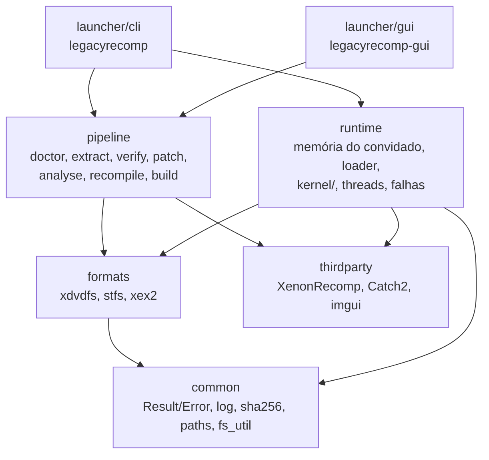

# Arquitetura

## Unidades e direção das dependências

A seta aponta de quem depende para quem é dependido; nada em `common` conhece as camadas acima. Namespaces:
`lr`, `lr::formats`, `lr::pipeline`, `lr::runtime`, `lr::kernel`.

| Unidade | Responsabilidade |
|---|---|
| `common` | `Result<T>`/`Error`, log, SHA-256, caminhos da pasta de dados, utilitários de arquivo |
| `formats` | Leitores de XDVDFS (ISO), STFS (pacotes LIVE/CON) e cabeçalhos XEX2; sem I/O além de `IReader` |
| `pipeline` | As sete etapas, o executor com cache (`state.toml`), execução de ferramentas externas (`posix_spawn`, grupo de processos próprio), gerador dos thunks de importação |
| `runtime` | Memória do convidado, carregador da imagem, tabela de funções, threads, handler de falhas, registro de importações do kernel, variáveis do kernel; lê o cabeçalho XEX2 via `formats/xex2` (o único código de `formats` que entra na biblioteca do jogo) |
| `launcher/cli`, `launcher/gui` | Frentes de uso: ambas chamam `pipeline::run` e `pipeline::launch` |

Regras: APIs públicas devolvem `lr::Result<T>` e nenhuma exceção atravessa módulos (única exceção:
`lr::kernel::UnimplementedImport`, lançada e capturada dentro do runtime).

## O runtime e o binário do jogo

O `legacyrecomp-game` é um executável compilado na máquina do usuário na etapa `build`. Ele junta:

- o C++ gerado pelo XenonRecomp (`work/generated/`);
- os thunks das importações (um por nome `__imp__*`, gerado a partir de `ppc_recomp_shared.h`; ver "Kernel");
- as bibliotecas pré-compiladas do runtime (`lr_runtime_core`, XenonUtils), numa variante sem sanitizers;
- o `main.cpp` do runtime, copiado como **fonte** e compilado junto do código gerado.

O `main.cpp` não pode ser uma biblioteca pré-compilada porque usa `PPC_IMAGE_BASE`, `PPC_CODE_SIZE`,
`PPC_CODE_BASE` e `PPCFuncMappings`, que só existem depois do `recompile`, e constrói o `PPCContext` com o
layout definido no `ppc_config.h` gerado (rulings R2 e R16, `docs/adr/0003-m1-plan-deviations.md`). O resto do
runtime nunca toca `PPCContext`: `run_guest(mem, body, user)` não conhece o layout.

Linha de comando do jogo: `legacyrecomp-game --image <xex> [--data <dir>] [--headless] [--coverage] [--strict-memory]`.
`--coverage` imprime a tabela de importações (ver `docs/kernel-coverage.md`); `--headless` não inicia SDL;
`--strict-memory` liga o modo estrito de memória (`KernelConfig.strict_memory`, ver abaixo).

## Mapa de memória do convidado

Um único mapeamento anônimo `MAP_NORESERVE` leitura/escrita de `4 GiB + 2 x PPC_CODE_SIZE` bytes. O endereço
convidado `G` fica em `base() + G`. Regiões fixas (spec M2 §6.1; constantes em `src/runtime/memory_map.h`):

| Faixa | Uso |
|---|---|
| `0x00000000`–`0x0000FFFF` | Guarda de ponteiro nulo, `PROT_NONE` desde `init_kernel` |
| `0x00010000`–`0x3FFFFFFF` | Heap virtual de páginas de 4 KiB: `NtAllocateVirtualMemory`, pool do kernel, corpos de objetos, PCR/KTHREAD/TLS |
| `0x40000000`–`0x6FFFFFFF` | Heap virtual de páginas de 64 KiB (`MEM_LARGE_PAGES`) |
| `0x70000000`–`0x7EFFFFFF` | Pilhas das threads do convidado, com página de guarda |
| `0x7F000000`–`0x7FFFFFFF` | Reservada para MMIO e write-back da GPU (M3) |
| `0x80000000`–`0x81FFFFFF` | Dados do kernel (`Kernel::kernel_data_alloc`, alocação sequencial, nunca liberada): cópia do cabeçalho XEX (sempre em `0x80000000`), `LDR_DATA_TABLE_ENTRY`, blocos das variáveis exportadas, páginas `PROT_NONE` de variáveis faltando |
| `0x82000000`–`~0x8659FFFF` | Imagem do jogo (`PPC_IMAGE_BASE`, `PPC_IMAGE_SIZE = 0x032D0000`, código em `0x82200000`) e tabela de funções em `PPC_IMAGE_BASE + PPC_IMAGE_SIZE` (`2 x PPC_CODE_SIZE`, um slot de 8 bytes por instrução). Nunca entregue por um heap |
| `0xA0000000`–`0xFFFFFFFF` | Vistas físicas: `0xA0` (64 KiB), `0xC0` (16 MiB), `0xE0` (4 KiB) |

Enquanto as threads do M2 não chegam, a thread principal ainda usa os blocos fixos do M1 (constantes em
`src/runtime/guest_thread.h`): pilha em `0x70000000` (1 MiB, `r1` = topo - `0x80`), KTHREAD falso zerado em
`0x7FFD0000`, TLS em `0x7FFE0000` e KPCR em `0x7FFF0000` (`r13`). KPCR mínimo (verificado contra o `X_KPCR` do
Xenia): `tls_ptr` `+0x00`, `pcr_ptr` `+0x30`, base da pilha `+0x70`, fim da pilha `+0x74`, `current_thread`
`+0x100`, `current_cpu` `+0x10C`.

Valores em big-endian (formato do convidado); o código gerado converte nos acessos.

### Alocadores e importações de memória

O `Kernel` tem três alocadores: `heap4k()` e `heap64k()` (`PageHeap`, só contabilidade de endereços) e
`physical()` (`PhysicalHeap`, 512 MiB de páginas físicas, sem espelhamento entre vistas). As importações ficam em
`src/runtime/kernel/exports/memory.cpp`, com a semântica do `xboxkrnl_memory.cc` do Xenia (só referência):
`NtAllocateVirtualMemory`/`NtFreeVirtualMemory`/`NtProtectVirtualMemory`/`NtQueryVirtualMemory` (ponteiros de
base e tamanho de entrada e saída em big-endian), `MmAllocatePhysicalMemoryEx` e afins, e o pool
(`ExAllocatePool*`, `XamAlloc*`, `ExFreePool`, `XamFree`), que é feito de alocações inteiras de páginas de 4 KiB,
confirmadas leitura/escrita e zeradas. `MmMapIoSpace` fica faltando até o M3.

O gancho de confirmação dos heaps virtuais zera as páginas recém-confirmadas (salvo `MEM_NOZERO`) com
`GuestMemory::zero`, que devolve páginas inteiras ao host com `madvise(MADV_DONTNEED)` em vez de escrevê-las.
Memória física também é zerada ao ser alocada.

**Modo estrito** (`--strict-memory`): no `init_kernel` os dois heaps virtuais ficam `PROT_NONE`
(`GuestMemory::protect`, `mprotect` por página de 4 KiB do host); o gancho deixa leitura/escrita as páginas
confirmadas e volta a `PROT_NONE` as desconfirmadas ou liberadas. Assim um acesso perdido falha com o endereço do
convidado (`SIGSEGV at guest 0x...`, saída 4) em vez de ler zeros. Sem o modo estrito, só a guarda de ponteiro
nulo é `PROT_NONE`. Proteções do convidado (`PAGE_READONLY` etc.) não viram proteção do host no M2.

## Threads

`run_guest` executa o corpo do jogo numa thread do host nova, com pilha de 16 MiB (`kHostStackSize`) e uma
pilha alternativa de sinal instalada por `install_thread_altstack()`. No M1 só existe essa thread. Retorno
normal dá saída 0; `UnimplementedImport` imprime o relatório e dá 3; qualquer outra exceção ou falha de
preparação dá 4. Falha real (SIGSEGV, SIGILL) é tratada pelo handler de sinais, que imprime o endereço e
chama `_exit(4)`. Threads do jogo criadas por `ExCreateThread` e sincronização entram no M2.

Códigos de saída do jogo (`runtime/guest_thread.h`): 0 normal, 2 uso/carga (`kExitUsage`), 3 importação
faltando (`kExitUnimplementedImport`), 4 falha (`kExitFault`), 5 erro fatal do convidado (`kExitGuestFatal`,
ver `guest_fatal` abaixo) e 6 impasse (`kExitDeadlock`, reservado para a detecção de impasse).

## Kernel

O kernel é escrito no `lr_runtime_core` pré-compilado, que nunca vê o `PPCContext` (R16). A ponte entre o
código gerado e o kernel tem três partes:

- **ABI fixa** (`runtime/kernel/abi.h`): `GuestCall` tem layout próprio, independente do `ppc_config.h`:
  `base`, `gpr[8]` (r3..r10), `fpr[13]` (f1..f13), `r1`, `r13`, `lr` e o retorno (`ret_gpr` para r3,
  `ret_fpr` para f1 quando `has_fpr_return`). Toda implementação tem a forma `KernelFn = void(GuestCall&)`.
- **Registro** (`runtime/kernel/registry`): nome → (estado, `KernelFn`). Estados (`ImportState`):
  `Implemented`, `Stub` e `Missing` (nada registrado). `LR_KERNEL(Nome)`, em escopo global num `.cpp`,
  registra `marshal<&exports::Nome>` como `Implemented`; `marshal` (`runtime/kernel/marshal.h`) converte o
  `GuestCall` nos parâmetros tipados da função C++ `lr::kernel::exports::Nome` e escreve o retorno.
  `LR_KERNEL_STUB(Nome, valor)` registra um `Stub` que só devolve a constante em r3 (com a mesma extensão de
  sinal de `marshal`); cada uso leva um comentário dizendo por que a constante basta. Os registros são
  inicializadores estáticos; o template liga o `lr_runtime_core` com `--whole-archive` só para que eles não
  sejam descartados. Registrar o mesmo nome duas vezes aborta na inicialização.
- **Thunks** (gerados por `lr::pipeline::render_import_thunks` em `work/generated/import_stubs.cpp` e
  compilados junto com o jogo): um `PPC_FUNC(__imp__Nome)` por importação. Na primeira chamada o thunk
  guarda `find_import("Nome")` num `static` local; em toda chamada registra o nome na trilha (`trace`) e,
  se não há função, chama `unimplemented_import`. Senão copia r3..r10, f1..f13, r1, r13 e lr para um
  `GuestCall`, guarda r1/r13 como o quadro atual do convidado nesta thread (`set_current_frame`, usado por
  `call_guest`), chama a função e escreve de volta r3 (e f1). A cópia está num único helper no topo do
  arquivo, não repetida 459 vezes. É o único código do kernel que toca o `PPCContext`.

**Estado do kernel** (`runtime/kernel/kernel.h`): `init_kernel(memória, KernelConfig)` cria, uma vez por
processo, a instância única `Kernel` (acessada por `kernel()`), da qual pendem os subsistemas do kernel
(memória do convidado e configuração: `game_dir`, `user_dir`, `language`, `strict_memory`, `trace_file`).
Uma segunda chamada devolve `Error{Internal}`. A instância, assim como a tabela do registro e seu mutex, é
vazada de propósito (nunca destruída), para que threads que ainda chamam thunks durante o fim do processo não
toquem memória destruída. Só os testes (`tests/support/kernel_fixture.h`) usam `reset_kernel_for_tests()`
para criar um kernel novo por fixture.

**`guest_fatal(o_quê)`**: erro irrecuperável do convidado (`KeBugCheck`, exceção do convidado sem tratamento,
chamada a endereço sem função recompilada). Escreve `Guest fatal: <o_quê>` e a linha de trilha da thread
(mesmo formato `Trail (last N): ...` do relatório de saída 3) em stderr, esvazia o stdio e sai com
`_exit(5)`. Toda condição fatal que não é importação faltando passa por ela.

**Chamadas do kernel para o convidado** (`runtime/kernel/glue.h`): rotinas de início de thread, APCs, DPCs e
callbacks são funções recompiladas, mas o `lr_runtime_core` não conhece o `PPCContext`. O `main.cpp`
(compilado com o jogo) instala no início uma cola `GuestGlue` com dois ponteiros: `call` monta um
`PPCContext` novo (r3.. = argumentos, r1, r13) e chama a função por `PPC_LOOKUP_FUNC`; `has_function`
confere primeiro se o endereço está em `[PPC_CODE_BASE, PPC_CODE_BASE + PPC_CODE_SIZE)` e alinhado a 4, e só
então lê a entrada da tabela de funções (não nula). `call_guest(endereço, args)` usa o quadro atual da thread
(gravado pelo thunk): a função chamada roda com `r1 = (r1 atual - 0x100) & ~0xF` e o mesmo r13, e o quadro
de quem chamou é restaurado na volta, inclusive quando uma exceção atravessa a chamada. O `PPCContext` novo
(e o da thread principal, em `guest_body`) carrega o `fpscr` do MXCSR real do host (`loadFromHost`), com
todas as exceções SSE mascaradas; a cola restaura o MXCSR de quem chamou depois do callback. Endereço sem função recompilada (ou mais de 8 argumentos, ou thread
sem quadro) termina com `guest_fatal` citando o endereço do convidado, nunca com salto para o endereço 0 do
host.

Como todo thunk passa por `trace`, a trilha do relatório de saída 3 (`Trail (last N): ...`, últimas 32
chamadas da thread) lista todas as importações chamadas antes da que falta, inclusive stubs, terminando
nela. `--coverage` imprime `| Import | Kind | Status |` para as 459 importações (tipo `function`; estado
`implemented`, `stub` ou `missing`) e termina com `Implemented: a, stub: b, missing: c / total` (ver
`docs/kernel-coverage.md`). Esse modelo substitui o do M1 (`LR_KERNEL_EXPORT` forte contra stub fraco), que
não funcionava com o runtime pré-compilado: ver `docs/adr/0004-m2-plan-deviations.md`.
