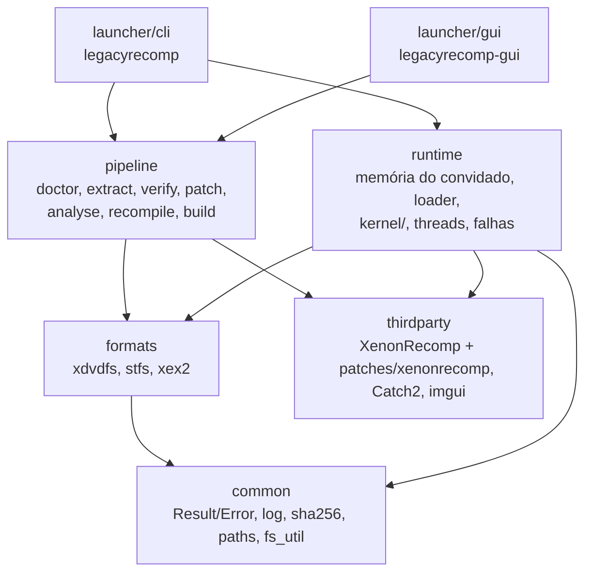

# Arquitetura

## Unidades e direção das dependências



A seta aponta de quem depende para quem é dependido; nada em `common` conhece as camadas acima. Namespaces:
`lr`, `lr::formats`, `lr::pipeline`, `lr::runtime`, `lr::kernel`.

| Unidade | Responsabilidade |
|---|---|
| `common` | `Result<T>`/`Error`, log, SHA-256, caminhos da pasta de dados, utilitários de arquivo |
| `formats` | Leitores de XDVDFS (ISO), STFS (pacotes LIVE/CON) e cabeçalhos XEX2; sem I/O além de `IReader` |
| `pipeline` | As sete etapas, o executor com cache (`state.toml`), execução de ferramentas externas (`posix_spawn`, grupo de processos próprio), gerador dos thunks de importação |
| `runtime` | Memória do convidado, carregador da imagem, tabela de funções, threads, handler de falhas, registro de importações do kernel, variáveis do kernel; lê o cabeçalho XEX2 via `formats/xex2` (o único código de `formats` que entra na biblioteca do jogo) |
| `launcher/cli`, `launcher/gui` | Frentes de uso: ambas chamam `pipeline::run` e `pipeline::launch` |

Regras: APIs públicas devolvem `lr::Result<T>` e nenhuma exceção atravessa módulos (só duas exceções,
lançadas e capturadas dentro do runtime: `lr::kernel::UnimplementedImport` e `lr::kernel::GuestThreadExit`, ver
ADR 0004).

## O runtime e o binário do jogo

O `legacyrecomp-game` é um executável compilado na máquina do usuário na etapa `build`. Ele junta:

- o C++ gerado pelo XenonRecomp (`work/generated/`);
- os thunks das importações (um por nome `__imp__*`, gerado a partir de `ppc_recomp_shared.h`; ver "Kernel");
- as bibliotecas pré-compiladas do runtime (`lr_runtime_core`, XenonUtils), numa variante sem sanitizers;
- o `main.cpp` do runtime, copiado como **fonte** e compilado junto do código gerado.

O `main.cpp` não pode ser uma biblioteca pré-compilada porque usa `PPC_IMAGE_BASE`, `PPC_CODE_SIZE`,
`PPC_CODE_BASE` e `PPCFuncMappings`, que só existem depois do `recompile`, e constrói o `PPCContext` com o
layout definido no `ppc_config.h` gerado (rulings R2 e R16, `docs/adr/0003-m1-plan-deviations.md`). O resto do
runtime nunca toca `PPCContext`: as threads do convidado (inclusive a principal, `run_main_thread`) entram no código
recompilado pela cola `GuestGlue` que o `main.cpp` instala (ver "Kernel").

Linha de comando do jogo:
`legacyrecomp-game --image <xex> [--data <dir>] [--headless] [--coverage] [--strict-memory]`. `--coverage` imprime
a tabela de importações (ver `docs/kernel-coverage.md`); `--headless` não inicia SDL; `--strict-memory` liga o modo
estrito de memória (`KernelConfig.strict_memory`, ver abaixo).

## Mapa de memória do convidado

Um único mapeamento anônimo `MAP_NORESERVE` leitura/escrita de `4 GiB + 2 x PPC_CODE_SIZE` bytes. O endereço
convidado `G` fica em `base() + G`. Regiões fixas (spec M2 §6.1; constantes em `src/runtime/memory_map.h`):

| Faixa | Uso |
|---|---|
| `0x00000000`–`0x0000FFFF` | Guarda de ponteiro nulo, `PROT_NONE` desde `init_kernel` |
| `0x00010000`–`0x3FFFFFFF` | Heap virtual de páginas de 4 KiB: `NtAllocateVirtualMemory`, pool do kernel, corpos de objetos, PCR/KTHREAD/TLS |
| `0x40000000`–`0x6FFFFFFF` | Heap virtual de páginas de 64 KiB (`MEM_LARGE_PAGES`) |
| `0x70000000`–`0x7EFFFFFF` | Pilhas das threads do convidado, com página de guarda |
| `0x7F000000`–`0x7FFFFFFF` | Reservada para MMIO e write-back da GPU (M3); janela MMIO em `0x7FC80000`–`0x7FCFFFFF` |
| `0x80000000`–`0x81FFFFFF` | Dados do kernel (`Kernel::kernel_data_alloc`, alocação sequencial, nunca liberada): cópia do cabeçalho XEX (sempre em `0x80000000`), `LDR_DATA_TABLE_ENTRY`, blocos das variáveis exportadas, páginas `PROT_NONE` de variáveis faltando |
| `0x82000000`–`~0x8659FFFF` | Imagem do jogo (`PPC_IMAGE_BASE`, `PPC_IMAGE_SIZE = 0x032D0000`, código em `0x82200000`) e tabela de funções em `PPC_IMAGE_BASE + PPC_IMAGE_SIZE` (`2 x PPC_CODE_SIZE`, um slot de 8 bytes por instrução). Nunca entregue por um heap |
| `0xA0000000`–`0xFFFFFFFF` | Vistas físicas: `0xA0` (64 KiB), `0xC0` (16 MiB), `0xE0` (4 KiB) |

Os blocos fixos do M1 em `0x7FFD0000`–`0x7FFF0000` (KTHREAD, TLS e KPCR da única thread) não existem mais: essa
faixa é da GPU. KPCR, KTHREAD e TLS são alocados por thread no pool do kernel e as pilhas vêm do heap de pilhas
(ver "Threads").

Valores em big-endian (formato do convidado); o código gerado converte nos acessos.

### Alocadores e importações de memória

O `Kernel` tem quatro alocadores: `heap4k()` e `heap64k()` (`PageHeap`, só contabilidade de endereços),
`stacks()` (`PageHeap` de páginas de 4 KiB sobre `0x70000000`–`0x7EFFFFFF`, as pilhas das threads; as importações
de memória também o consultam, então `NtQueryVirtualMemory`/`MmQueryAddressProtect` respondem por pilhas) e
`physical()` (`PhysicalHeap`, 512 MiB de páginas físicas, sem espelhamento entre vistas). As importações ficam em
`src/runtime/kernel/exports/memory.cpp`, com a semântica do `xboxkrnl_memory.cc` do Xenia (só referência):
`NtAllocateVirtualMemory`/`NtFreeVirtualMemory`/`NtProtectVirtualMemory`/`NtQueryVirtualMemory` (ponteiros de
base e tamanho de entrada e saída em big-endian), `MmAllocatePhysicalMemoryEx` e afins, e o pool
(`ExAllocatePool*`, `XamAlloc*`, `ExFreePool`, `XamFree`), que é feito de alocações inteiras de páginas de 4 KiB,
confirmadas leitura/escrita e zeradas. `MmMapIoSpace` (M3) devolve o próprio endereço recebido, como o Xenia: a janela
MMIO da GPU já está no seu endereço do convidado.

O gancho de confirmação dos heaps virtuais zera as páginas recém-confirmadas (salvo `MEM_NOZERO`) com
`GuestMemory::zero`, que devolve páginas inteiras ao host com `madvise(MADV_DONTNEED)` em vez de escrevê-las.
Memória física também é zerada ao ser alocada.

### Janela MMIO da GPU e tradução física para convidado (M3)

O XenonRecomp não emula MMIO: o jogo lê e escreve registradores da GPU como memória comum. A janela
`0x7FC80000`–`0x7FCFFFFF` (dentro da faixa reservada à GPU) é confirmada leitura/escrita por `Kernel::setup_memory`
(`gpu::init_mmio_window`, `src/runtime/gpu/mmio.{h,cpp}`). O registrador de índice `i` fica em `0x7FC80000 + 4 * i`,
em big-endian. Tudo lê 0, exceto os valores iniciais abaixo, que fazem a GPU parecer ociosa:

| Registrador | Índice | Valor inicial | Motivo |
|---|---|---|---|
| `RBBM_STATUS` | `0x05D0` (palpite) | `0x00000040` | status ocioso presumido: bit 31 ("GUI active") e bits de ocupado limpos, `CMDFIFO_AVAIL` (bits 0-6) = 64; índice e valor NÃO confirmados |
| `CP_RB_WPTR` | `0x01C5` | `0` | ponteiro de escrita do ring buffer; a thread da GPU o lê daqui |
| `COHER_STATUS_HOST` | `0x0A31` | `0` | nenhuma sincronização de cache pendente (bit 31 limpo) |
| `RB_EDRAM_TIMING` | `0x0F00` | `0x08100748` | valor fixo que o Xenia devolve na leitura (`GraphicsSystem::ReadRegister`) |
| `RB_BC_CONTROL` | `0x0F01` | `0x0000200E` | idem |
| `D1MODE_V_COUNTER` | `0x194C` | `0x000002D0` | idem |
| interrupção (status) | `0x1951` | `1` | idem |
| `D1MODE_VIEWPORT_SIZE` | `0x1961` | `0x050002D0` | idem; 1280x720 |

Os cinco últimos valores são constantes que o `GraphicsSystem::ReadRegister` do Xenia devolve (fatos de hardware; só referência, sem cópia de código). O `RBBM_STATUS` é um palpite não confirmado a partir do mapa R5xx: nem `RBBM_STATUS` nem `CP_RB_WPTR` estão no `register_table.inc` do Xenia, que devolve 0 em leituras não tratadas. Pergunta em aberto: `0x05D0` é índice de dword ou deslocamento em bytes (deslocamento / 4 = `0x174`)? A conferir quando o jogo real rodar (Tarefa 12).

`PhysicalHeap::guest_from_physical(phys)` converte um endereço físico no endereço de vista da alocação dona da
página (linear dentro da alocação; `nullopt` se não alocado). Cada página física pertence a uma única vista
(decisão do M2), então a resposta não é ambígua; na vista `0xE0` vale o deslocamento de `0x1000`.
`Kernel::gpu_memory_access()` monta o `gpu::MemoryAccess` do processador de comandos sobre essa conversão.

**Modo estrito** (`--strict-memory`): no `init_kernel` os dois heaps virtuais e o de pilhas ficam `PROT_NONE`
(`GuestMemory::protect`, `mprotect` por página de 4 KiB do host); o gancho deixa leitura/escrita as páginas
confirmadas e volta a `PROT_NONE` as desconfirmadas ou liberadas. Assim um acesso perdido falha com o endereço do
convidado (`SIGSEGV at guest 0x...`, saída 4) em vez de ler zeros. Sem o modo estrito, só a guarda de ponteiro
nulo é `PROT_NONE`. Proteções do convidado (`PAGE_READONLY` etc.) não viram proteção do host no M2.


## Threads

Cada thread do convidado, inclusive a principal, é uma thread do host (`runtime/kernel/threads.h`): pilha de
16 MiB (`kHostStackSize`, criada por `start_host_thread` em `runtime/guest_thread.h`) e pilha alternativa de sinal
(`install_thread_altstack()`). Na memória do convidado ela tem (layouts `X_KPCR`/`X_KTHREAD` do Xenia, conferidos
com `static_assert` em `guest_structs.h`; semântica do `xthread.cc`, só referência):

- um bloco do pool do kernel com KTHREAD (`0xAB0` bytes; cabeçalho de despachante tipo 6, pilha `+0x5C`/`+0x60`,
  TLS `+0x68`, id `+0x14C`, endereço de início `+0x150`, último erro `+0x160`), KPCR (`0x2D8` bytes, o `r13`:
  `tls_ptr` `+0x00`, `pcr_ptr` `+0x30`, topo da pilha `+0x70`, fundo `+0x74`, `current_thread` `+0x100`,
  `current_cpu` `+0x10C`) e o bloco TLS: cópia do modelo TLS do XEX (cabeçalho `0x00020104`: dados brutos de
  `raw_data_address`, completados com zeros até `data_size`) seguida dos slots de `KeTlsAlloc` (`be<uint32_t>`, no
  mínimo 64, ou o `slot_count` do cabeçalho se maior; bitmap de slots do processo). O `main.cpp` passa o cabeçalho
  a `Threads::set_image`, que o valida (no máximo 4096 slots e 4 MiB de dados, `raw_data_size` <= `data_size`,
  dados brutos dentro da imagem carregada; tamanhos calculados em 64 bits): um cabeçalho inválido é erro de carga
  (saída 2). `set_image` é recusado depois que existe alguma thread, então o layout de TLS é fixo. `tls_ptr` e
  `tls_address` apontam para a cópia do modelo, como o `tls_static_address` do Xenia;
- uma pilha do heap de pilhas (`Kernel::stacks()`), arredondada a 4 KiB, mínimo 16 KiB, com uma página de guarda
  reservada e `PROT_NONE` logo abaixo. A thread começa com `r1` = topo - `0x80`.

O KTHREAD é o objeto da thread: é o `guest_header()` do `KObject`, então `ObReferenceObjectByHandle`, as esperas
por handle e `KeWaitForSingleObject` no KTHREAD funcionam. A identidade da thread no despachante
(`current_thread_token`) é o endereço do KTHREAD, e o pseudo-handle `kCurrentThread` resolve para a thread atual.
Ids são inteiros crescentes a partir de 1 (a principal). A memória (bloco do pool e pilha) é liberada quando sai a
última referência (handles, referências do kernel, a própria thread do host em execução).

Início: toda thread entra no código recompilado pela cola (`call_guest_on_frame(início, args, r1, r13)`), que
carrega o `fpscr` do host. Com rotina de início XAPI chama `xapi(início, contexto)` e o código de saída é 0; sem
ela, `início(contexto)` e o código de saída é o r3 devolvido. `ExTerminateThread(código)` lança
`GuestThreadExit`, capturada no topo da thread (a segunda e última exceção permitida, ADR 0004). Ao terminar, o
`signal_state` do KTHREAD vira 1 e `Dispatcher::signal` acorda quem espera; APCs pendentes são descartadas e
`Dispatcher::thread_exited` apaga o despertar de APC pendente e abandona os mutantes que a thread ainda possui (quem
os adquire depois recebe `STATUS_ABANDONED_WAIT_0`), para que nada passe a uma thread nova cujo KTHREAD reutilize o
mesmo endereço.

No topo de cada thread: `UnimplementedImport` imprime o relatório com uma linha `Thread: <id>` (spec §11) e
encerra o processo inteiro com `_exit(3)`; qualquer outra exceção dá `_exit(4)`; falha real (SIGSEGV, SIGILL,
inclusive estouro de pilha na página de guarda) é tratada pelo handler de sinais (saída 4). `run_main_thread(entrada,
tamanho_da_pilha)` cria a thread principal pelo mesmo caminho (tamanho de pilha do cabeçalho XEX `0x00020200`,
256 KiB por padrão) e espera seu KTHREAD; quando ela termina, o `main.cpp` sai com 0 via `_exit`, derrubando as
outras threads. Com janela, o SDL roda na thread principal do host e a espera numa thread auxiliar, como antes.

Chamada indireta (`bctr`/`bctrl`, ponteiro de função) para um endereço sem função recompilada: o código gerado não passa
pelo `main.cpp`; o template o compila com `-include runtime/indirect_call.h` (staged; o `lr_fake_game`
usa o mesmo include forçado), que redefine `PPC_CALL_INDIRECT_FUNC` antes de `ppc_context.h`. O caminho rápido é uma
checagem de faixa `[PPC_CODE_BASE, PPC_CODE_BASE + PPC_CODE_SIZE)`, alinhamento e a leitura do slot; fora disso ou
com slot nulo, `lr::kernel::bad_indirect_call(alvo, ctx.lr)` imprime `Indirect call to 0x... without a recompiled
function (from 0x...)` com a trilha de importações e sai com 4 (em vez de saltar para o endereço de host 0 e dar
`SIGSEGV at host 0x0`). Num `bctr` de cauda, `ctx.lr` é o retorno da própria função envolvente.

Suspensão: o contador fica na `GuestThread`. Criação suspensa (bit 0 das flags) e auto-suspensão
(`NtSuspendThread` na própria thread) bloqueiam na hora; suspender outra thread em execução é cooperativo: o
gancho de entrada de importação (`set_import_entry_hook`, chamado por `trace` em todo thunk; uma leitura atômica)
bloqueia a thread na próxima importação. `NtResumeThread`/`KeResumeThread` decrementam. Prioridade e afinidade
(`KeSetBasePriorityThread`, `KeSetAffinityThread`, máscara de CPU no byte alto das flags, gravada em
`current_cpu`) são registradas, não aplicadas.

APCs: `NtQueueApcThread(handle, rotina, contexto, arg1, arg2)` põe `(rotina, contexto, arg1, arg2)` na fila da
thread e chama `Dispatcher::wake_for_apc`. Uma espera alertável (`KeWaitFor*`, `NtWaitFor*Ex`,
`NtSignalAndWaitForSingleObjectEx`, `KeDelayExecutionThread`; nesta, um ponteiro de intervalo nulo vale 0, um
yield, em vez de espera infinita) que volta com `STATUS_USER_APC` executa antes as APCs
da fila com `call_guest(rotina, {contexto, arg1, arg2})`, salvo dentro de `KeEnterCriticalRegion` (contador de
APCs desabilitadas; ao sair da região, APCs pendentes rearmam a próxima espera alertável). `queue_apc` chama
`wake_for_apc` sob o mutex da thread, o mesmo sob o qual `finish` marca a thread como terminada: ou a APC chega antes
e `thread_exited` apaga o despertar, ou ela vê a thread terminada e não faz nada, então nenhum despertar pendente
sobrevive à thread (ordem de travas: mutex da thread, depois o do despachante). `NtAlertThread` não é
importado pelo jogo, então `STATUS_ALERTED` nunca é produzido.

Outras importações (`exports/threads.cpp`): `KeTlsAlloc`/`KeTlsFree`/`KeTlsGetValue`/`KeTlsSetValue`,
`ObLookupThreadByThreadId` (KTHREAD com referência do kernel), `KeGetCurrentProcessType`/`KeSetCurrentProcessType`
(padrão 1), `ExRegisterTitleTerminateNotification` (registrada, nunca chamada no M2), `NtYieldExecution`,
`KiApcNormalRoutineNop`; stubs: `KeSetDisableBoostThread`, `KeSaveFloatingPointState`,
`KeRestoreFloatingPointState`, `KeEnableFpuExceptions`.

### Tempo, timers, DPCs e spinlocks

Relógios (`runtime/kernel/timers.h`, importações em `exports/time.cpp`): o XenonRecomp traduz a leitura do timebase
(`mftb`) para `__rdtsc()`, então o contador de desempenho do convidado **é o TSC do host**.
`KeQueryPerformanceFrequency` devolve a frequência do TSC medida **na inicialização** (`init_kernel` grava em
`Timers::tsc_hz()` o valor de `process_tsc_hz()`, que mede uma vez por processo com `calibrate_tsc_hz()`: três
amostras de ~16 ms dentro de 50 ms, cada leitura de `CLOCK_MONOTONIC` entre duas leituras de `__rdtsc()`, vence a
amostra de colchetes mais estreitos), como valor de 64 bits, e não os 50 MHz do console. `KeQuerySystemTime` grava
o relógio de tempo real do host como FILETIME (100 ns desde 1601-01-01 UTC, BE).
`RtlTimeToTimeFields`/`RtlTimeFieldsToTime` convertem para o calendário gregoriano proléptico (`X_TIME_FIELDS` do
Xenia: oito `be<int16_t>`, dia da semana por último, 0 = domingo); campos fora da faixa devolvem FALSE.

Thread de trabalho do kernel: uma por kernel, roda as expirações de timers, as rotinas de DPC e a atualização de
`KeTimeStampBundle`. Como rotinas de DPC são código do convidado, ela é uma thread interna do convidado
(`create_internal_guest_thread`): KTHREAD, KPCR e pilha do convidado próprios (64 KiB), id `0x10000` fora da
sequência do convidado (a thread principal continua sendo a 1), sem handle, fora de `Threads::live()` e de
`wait_for_guest_threads_for_tests`; ela espera numa variável de condição própria, nunca no despachante, então o
detector de impasse não a conta como thread do convidado (ele deve consultar `Timers::has_pending_work()`: timer
armado ou DPC na fila conta como trabalho pendente). Seu bloco de TLS copia o modelo de TLS do XEX como o de
qualquer thread, e criá-la congela o layout (`set_image` falha depois); por isso o `main.cpp` chama `set_image`
antes de `resolve_variable_imports`, que pode iniciá-la. Ela nasce sob demanda (primeiro timer armado, primeiro DPC
na fila ou importação de `KeTimeStampBundle`), roda em `DISPATCH_LEVEL` e chama o convidado por `call_guest` (a
cola, com o FPSCR do host). O destrutor do `Kernel` (e `reset_kernel_for_tests`, antes de soltar a instância) a
para e faz `join`. Uma `UnimplementedImport` dentro de um DPC sai com 3 e o relatório; qualquer outra exceção,
inclusive `ExTerminateThread`, sai com 4.

Timers: `NtCreateTimer(handle*, atributos, tipo)` aloca um `X_KTIMER` (0x28 bytes, layout do KTIMER do NT; o Xenia
não declara um) no pool com cabeçalho tipo 8 (notificação, tipo 0) ou 9 (sincronização, tipo 1, consumido pela
espera). `NtSetTimerEx(handle, vencimento*, rotina_apc, modo, contexto_apc, resume, período_ms, estado_anterior*)`
(ordem do Xenia) zera o `signal_state` e arma o timer: vencimento negativo = relativo em 100 ns, senão FILETIME
absoluto; período negativo devolve `STATUS_INVALID_PARAMETER` (o `Period` do NT é `LONG`); `resume` devolve
`STATUS_TIMER_RESUME_IGNORED` como no Xenia. Ao vencer, a thread de trabalho põe `signal_state` em 1 e chama
`Dispatcher::signal`, enfileira a APC `rotina(contexto, FILETIME baixo, alto)` na thread do convidado que armou o
timer (semântica do Xbox/Xenia, não roda na thread de trabalho) e rearma o timer periódico (períodos perdidos são
pulados). `NtCancelTimer` desarma e informa o estado atual. Fechar o último handle desarma o timer antes de liberar
o corpo. Prazo, período e APC ficam no host, indexados pelo endereço do cabeçalho.

DPCs: `KeInitializeDpc(dpc*, rotina, contexto)` grava o `XDPC` do Xenia (tipo 19 no byte alto da primeira palavra,
rotina `+0xC`, contexto `+0x10`, argumentos `+0x14`/`+0x18`). `KeInsertQueueDpc(dpc*, arg1, arg2)` devolve FALSE se
o DPC já está na fila; senão grava os argumentos e a thread de trabalho chama `rotina(dpc, contexto, arg1, arg2)`.
O DPC sai da fila antes de a rotina rodar, então pode ser reenfileirado (o Xenia nunca despacha DPCs). Um DPC com
rotina 0 é erro fatal do convidado (`guest_fatal`, saída 5), no `KeInsertQueueDpc` ou na thread de trabalho.

`KeTimeStampBundle` (`X_TIME_STAMP_BUNDLE`, 24 bytes): tempo de interrupção (100 ns desde o início do kernel), tempo
do sistema (FILETIME) e contagem de ticks em ms em `+0x10` (o único campo que o Xenia atualiza). O bloco é preenchido
na alocação; só quando o jogo importa a variável (`resolve_variable_imports`) a thread de trabalho passa a
atualizá-lo a cada 1 ms. Agora é `implemented` no `--coverage`.

Spinlocks e IRQL: a IRQL é um valor por thread do host (logo por thread do convidado, `current_irql()`).
`KfAcquireSpinLock(lock*)` adquire e sobe para `DISPATCH_LEVEL` (2), devolvendo a IRQL anterior;
`KfReleaseSpinLock(lock*, irql_antiga)` restaura a IRQL e libera. `KeAcquireSpinLockAtRaisedIrql` /
`KeReleaseSpinLockFromRaisedIrql` não mexem na IRQL. A palavra do lock (BE, na memória do convidado) vale 0 livre ou
o endereço do KTHREAD do dono (1 fora de threads do convidado); a aquisição é um CAS atômico do host sobre ela,
compatível com o `lwarx`/`stwcx.` do código gerado, com `pause` por 1000 voltas e depois `sched_yield` (o Xenia usa
0/1 e gira sem ceder em `KeAcquireSpinLockAtRaisedIrql`).

Códigos de saída do jogo (`runtime/guest_thread.h`): 0 normal, 2 uso/carga (`kExitUsage`), 3 importação
faltando (`kExitUnimplementedImport`), 4 falha (`kExitFault`), 5 erro fatal do convidado (`kExitGuestFatal`,
ver `guest_fatal` abaixo) e 6 impasse (`kExitDeadlock`, ver "Diagnóstico" abaixo).

## Kernel

O kernel é escrito no `lr_runtime_core` pré-compilado, que nunca vê o `PPCContext` (R16). A ponte entre o
código gerado e o kernel tem três partes:

- **ABI fixa** (`runtime/kernel/abi.h`): `GuestCall` tem layout próprio, independente do `ppc_config.h`:
  `base`, `gpr[8]` (r3..r10), `fpr[13]` (f1..f13), `r1`, `r13`, `lr` e o retorno (`ret_gpr` para r3,
  `ret_fpr` para f1 quando `has_fpr_return`). Toda implementação tem a forma `KernelFn = void(GuestCall&)`.
- **Registro** (`runtime/kernel/registry`): nome → (estado, `KernelFn`). Estados (`ImportState`):
  `Implemented`, `Stub` e `Missing` (nada registrado). `LR_KERNEL(Nome)`, em escopo global num `.cpp`,
  registra `marshal<&exports::Nome>` como `Implemented`; `marshal` (`runtime/kernel/marshal.h`) converte o
  `GuestCall` nos parâmetros tipados da função C++ `lr::kernel::exports::Nome` e escreve o retorno.
  `LR_KERNEL_STUB(Nome, valor)` registra um `Stub` que só devolve a constante em r3 (com a mesma extensão de
  sinal de `marshal`); cada uso leva um comentário dizendo por que a constante basta. Os registros são
  inicializadores estáticos; o template liga o `lr_runtime_core` com `--whole-archive` só para que eles não
  sejam descartados. Registrar o mesmo nome duas vezes aborta na inicialização.
- **Thunks** (gerados por `lr::pipeline::render_import_thunks` em `work/generated/import_stubs.cpp` e
  compilados junto com o jogo): um `PPC_FUNC(__imp__Nome)` por importação. Na primeira chamada o thunk
  guarda `find_import("Nome")` num `static` local; em toda chamada registra o nome na trilha (`trace`) e copia
  r3..r10, f1..f13, r1, r13 e lr para um `GuestCall`. Se não há função, registra a chamada no trace de importações
  (`trace_import_missing`) e chama `unimplemented_import`. Senão guarda r1/r13 como o quadro atual do convidado
  nesta thread (`set_current_frame`, usado por `call_guest`), chama a função, registra a chamada com o retorno
  (`trace_import_return`) e escreve de volta r3 (e f1). A cópia está num único helper no topo do
  arquivo, não repetida 459 vezes. É o único código do kernel que toca o `PPCContext`.

**Estado do kernel** (`runtime/kernel/kernel.h`): `init_kernel(memória, KernelConfig)` cria, uma vez por
processo, a instância única `Kernel` (acessada por `kernel()`), da qual pendem os subsistemas do kernel
(memória do convidado e configuração: `game_dir`, `user_dir`, `language`, `strict_memory`, `trace_imports`,
`trace_file`, `deadlock_seconds`).
Uma segunda chamada devolve `Error{Internal}`. A instância, assim como a tabela do registro e seu mutex, é
vazada de propósito (nunca destruída), para que threads que ainda chamam thunks durante o fim do processo não
toquem memória destruída. Só os testes (`tests/support/kernel_fixture.h`) usam `reset_kernel_for_tests()`
para criar um kernel novo por fixture.

**`guest_fatal(o_quê)`**: erro irrecuperável do convidado (`KeBugCheck`, exceção do convidado sem tratamento,
chamada a endereço sem função recompilada). Escreve `Guest fatal: <o_quê>` e a linha de trilha da thread
(mesmo formato `Trail (last N): ...` do relatório de saída 3) em stderr, esvazia o stdio e o trace de importações
e sai com `_exit(5)`. Toda condição fatal que não é importação faltando passa por ela.

**Chamadas do kernel para o convidado** (`runtime/kernel/glue.h`): rotinas de início de thread, APCs, DPCs e
callbacks são funções recompiladas, mas o `lr_runtime_core` não conhece o `PPCContext`. O `main.cpp` (compilado com
o jogo) instala no início uma cola `GuestGlue` com dois ponteiros: `call` monta um `PPCContext` novo (r3.. =
argumentos, r1, r13) e chama a função por `PPC_LOOKUP_FUNC`; `has_function` confere primeiro se o endereço está em
`[PPC_CODE_BASE, PPC_CODE_BASE + PPC_CODE_SIZE)` e alinhado a 4, e só então lê a entrada da tabela de funções (não
nula). `call_guest(endereço, args)` usa o quadro atual da thread (gravado pelo thunk): a função chamada roda com
`r1 = (r1 atual - 0x100) & ~0xF` e o mesmo r13, e o quadro de quem chamou é restaurado na volta, inclusive quando
uma exceção atravessa a chamada. O `PPCContext` novo (também o da entrada de cada thread do convidado) carrega o
`fpscr` do MXCSR real do host (`loadFromHost`), com todas as exceções SSE mascaradas; a cola restaura o MXCSR de
quem chamou depois do callback. Endereço sem função recompilada (ou mais de 8 argumentos, ou thread sem quadro)
termina com `guest_fatal` citando o endereço do convidado, nunca com salto para o endereço 0 do host.

Como todo thunk passa por `trace`, a trilha do relatório de saída 3 (`Trail (last N): ...`, últimas 32
chamadas da thread) lista todas as importações chamadas antes da que falta, inclusive stubs, terminando
nela. `--coverage` imprime `| Import | Kind | Status |` para as 459 importações (tipo `function`; estado
`implemented`, `stub` ou `missing`; com `--image <xex>`, também as importações de variável, tipo `variable`) e
termina com duas linhas de contagem, `Functions: implemented a, stub b, missing c / N` e `Variables: ... / M` (ver
`docs/kernel-coverage.md`). Esse modelo substitui o do M1 (`LR_KERNEL_EXPORT` forte contra stub fraco), que
não funcionava com o runtime pré-compilado: ver `docs/adr/0004-m2-plan-deviations.md`.

### Objetos, handles e esperas

`Kernel::objects()` (`runtime/kernel/objects.h`) é a tabela de handles (`0xF8000000 + 4·slot`). Um `KObject` pode
ter um corpo no convidado (`guest_header()`, o `DISPATCHER_HEADER`); `ObReferenceObjectByHandle` recusa objetos sem
endereço no convidado (nem cabeçalho nem corpo) com `STATUS_OBJECT_TYPE_MISMATCH`, sem escrever nada e sem fixar
referência.

`Kernel::dispatcher()` (`runtime/kernel/dispatcher.h`) é o motor de espera. A memória do convidado é a fonte da
verdade: ele trabalha só com endereços de `DISPATCHER_HEADER` (tipo `+0`, `signal_state` `+4`), então eventos que o
próprio jogo inicializa (o `KeInitializeEvent` é inline) funcionam sem handle. Um mutex global serializa tudo;
`signal_state` é lido e escrito com operações atômicas sobre a palavra big-endian, coerentes com o `lwarx`/`stwcx.`
do código gerado. Os esperadores ficam numa lista FIFO por endereço de cabeçalho, cada um com sua variável de
condição, e quem sinaliza (set, pulse, release) já os satisfaz e consome sob o mutex, então um pulso ou um evento
de reset automático nunca perde o despertar. Tipos: evento de notificação (0) e de sincronização (1, consumido),
mutante (2: `signal_state` 1 livre, desce a cada aquisição, recursão pelo dono; dono em `+0x18`), semáforo (5,
limite em `+0x10`), thread (6) e timers (8, 9 = reset automático). WaitAll adquire tudo ou nada. Tempo limite: nulo
= infinito, 0 = consulta, negativo = relativo em 100 ns, positivo = FILETIME absoluto contra o relógio real; as
esperas usam prazos do `steady_clock`. `wake_for_apc(thread)` faz uma espera alertável devolver `STATUS_USER_APC`
(ou a próxima, se a thread não está esperando). A identidade da thread vem de `current_thread_token()`: o endereço
do KTHREAD numa thread do convidado, um número por thread do host nas outras. `snapshot()` lista as esperas em
curso para o detector de impasse, cada uma com `apc_pending` (há um `wake_for_apc` pendente para aquela thread);
`activity()` conta entradas e saídas de espera. Um convidado que muda `signal_state` com escrita comum, sem
importação, só acorda alguém na próxima operação do despachante naquele cabeçalho.

As importações (`exports/sync.cpp`, semântica do `xboxkrnl_threading.cc` do Xenia, só referência) são
`KeSetEvent`/`KeResetEvent`, `KeInitializeMutant`/`KeReleaseMutant` (assinaturas do NT; liberar sem ser dono
devolve `STATUS_MUTANT_NOT_OWNED` em vez de levantar exceção), `KeWaitForSingleObject`,
`KeWaitForMultipleObjects`, `NtCreateEvent`, `NtSetEvent`, `NtClearEvent`, `NtPulseEvent`, `NtCreateSemaphore`,
`NtReleaseSemaphore`, `NtWaitForSingleObjectEx`, `NtWaitForMultipleObjectsEx` e
`NtSignalAndWaitForSingleObjectEx` (sinal e espera atômicos). Os `Nt*Create*` alocam o corpo no pool do kernel,
liberado quando o objeto morre; nomes e atributos de objeto são ignorados (objetos nomeados não existem no M2).
Esperar num handle sem cabeçalho devolve `STATUS_OBJECT_TYPE_MISMATCH`.

Um objeto que não é esperável pode ter só um corpo (`guest_body()`): `guest_object()` devolve o cabeçalho ou, na
falta dele, o corpo, e `by_guest_header` acha o objeto pelos dois. Assim `ObReferenceObjectByHandle` funciona com
handles de arquivo, enquanto as esperas continuam recusando-os (o `guest_header()` deles é 0).

### Arquivos

`Kernel::vfs()` (`runtime/kernel/vfs.h`) traduz caminhos do convidado (`game:\...`, `\??\...`,
`\Device\Cdrom0\...`, `cache:\...`) para caminhos do host, sem diferenciar maiúsculas; `game:` é só leitura e
`cache:` fica em `<user>/cache`. `update:` (o conteúdo do title update, que o jogo usa em caminhos como
`UPDATE:\res\1_2_2\gui\items.png`) aponta para a mesma pasta de `game:`, porque a etapa `extract` grava os arquivos
do pacote do TU1 por cima dos do jogo. Os dispositivos de disco `\Device\Harddisk0\Partition0` (o disco inteiro) e
`\Device\Harddisk0\Partition1` (a partição de dados) também são montados, graváveis, na mesma pasta `<user>/cache`
que `\Device\Harddisk0\Cache0` (spec, seção 9): o jogo vê uma única pasta gravável qualquer que seja o dispositivo
que nomeia, e os saves ficam todos num lugar só. As importações de arquivo (`exports/files.cpp`, semântica do
`xboxkrnl_io.cc`/`xboxkrnl_io_info.cc`/`xfile.cc` do Xenia, só referência) usam o `resolve()` dele:

- **`FileObject`** (`runtime/kernel/files.h`): um descritor do host aberto com `O_CLOEXEC` (arquivo ou
  diretório), posição atual, estado de enumeração e um corpo de 0x40 bytes zerado no pool (o `guest_body()`),
  liberado junto com o objeto. O descritor é fechado no destrutor; com "apagar ao fechar" o arquivo do host é
  removido nessa hora, ou seja, quando o objeto daquele handle é destruído (último handle fechado e nenhuma
  referência do kernel pendente), não no `NtClose` de outro handle do mesmo arquivo.
- **`NtCreateFile`** (9 argumentos, o 9º na pilha) e **`NtOpenFile`** (`FILE_OPEN`; `share_access` antes de
  `open_options`, como no xenia-canary): disposições `FILE_SUPERSEDE` 0 … `FILE_OVERWRITE_IF` 5;
  `IO_STATUS_BLOCK.information` = `FILE_SUPERSEDED` 0 / `FILE_OPENED` 1 / `FILE_CREATED` 2 / `FILE_OVERWRITTEN` 3.
  `root_directory` (diferente de 0 e de `0xFFFFFFFD`) é um handle de diretório aberto, e o nome é relativo a ele.
  Nome faltando → `STATUS_OBJECT_NAME_NOT_FOUND`; diretório intermediário faltando ou dispositivo desconhecido →
  `STATUS_OBJECT_PATH_NOT_FOUND`; criar, substituir ou truncar num ponto só leitura → `STATUS_ACCESS_DENIED`. Pedir
  acesso de escrita a um arquivo só leitura abre só para leitura (como o Xenia); a escrita por esse handle é
  recusada. Em pontos graváveis a máscara de acesso não é aplicada (leniente, como o Xenia): todo handle de arquivo
  pode ler e escrever. `FILE_DIRECTORY_FILE` (0x1) cria um diretório (ou recusa um arquivo com
  `STATUS_NOT_A_DIRECTORY`); `FILE_NON_DIRECTORY_FILE` (0x40) num diretório → `STATUS_FILE_IS_A_DIRECTORY`. Em
  falha o handle de saída recebe `0xFFFFFFFF`.
- **`NtReadFile`**, **`NtReadFileScatter`** (uma página de 4 KiB por segmento) e **`NtWriteFile`**: síncronos
  (`pread`/`pwrite`). O deslocamento é `*byte_offset`, ou a posição atual quando o ponteiro é nulo ou vale -1 ou
  -2 (`FILE_USE_FILE_POINTER_POSITION`); outro valor negativo → `STATUS_INVALID_PARAMETER`; depois a posição fica
  em deslocamento + bytes (como no NT). Ler um handle de diretório → `STATUS_INVALID_DEVICE_REQUEST`. Ler no fim
  ou depois dele → `STATUS_END_OF_FILE` com 0 bytes. `IO_STATUS_BLOCK` nulo → `STATUS_INVALID_PARAMETER`, buffer
  fora da memória do convidado (`valid_range`) → `STATUS_ACCESS_VIOLATION`, ambos sem tocar em nada. Ao terminar:
  `{status, bytes}` no `IO_STATUS_BLOCK`, o evento (se houver) é sinalizado e a APC (se rotina e contexto não forem
  nulos, como no Xenia) é enfileirada na thread que chamou com `(apc_context, io_status_block, 0)`.
- **`NtQueryInformationFile`**: classes 5 (Standard), 6 (Internal: o inode do host), 14 (Position) e 34
  (NetworkOpen); as outras → `STATUS_INVALID_PARAMETER`, buffer curto → `STATUS_INFO_LENGTH_MISMATCH`.
  **`NtSetInformationFile`**: 13 (Disposition: apagar ao fechar), 14 (Position) e 20 (EndOfFile: `ftruncate`).
  **`NtQueryFullAttributesFile`** preenche `X_FILE_NETWORK_OPEN_INFORMATION`. Datas em FILETIME a partir do
  `mtime`/`atime` do host; tamanho alocado = tamanho arredondado para 4 KiB; atributos `0x10` (diretório) ou
  `0x80` (normal).
- **`NtQueryDirectoryFile`**: uma entrada `X_FILE_DIRECTORY_INFORMATION` (0x40 bytes + nome ANSI) por chamada,
  como no Xenia. O padrão (`*` e `?`, sem diferenciar maiúsculas; `*.*` casa tudo) vale na primeira consulta ou
  num `restart_scan`, que tiram um retrato ordenado do diretório. Sem nenhum nome → `STATUS_NO_SUCH_FILE`; fim da
  lista → `STATUS_NO_MORE_FILES`; buffer menor que 72 bytes → `STATUS_INFO_LENGTH_MISMATCH`.
- **`NtQueryVolumeInformationFile`** com valores fixos: classe 3 (`FileFsSizeInformation`: setores de 512 bytes,
  32 setores por unidade, 0x100000 unidades no total, 0x80000 livres, ou seja 16 GiB com 8 GiB livres) e classe 5
  (`FileFsAttributeInformation`: atributos 0, nome de até 42 caracteres, sistema `FATX`).
- Stubs: `NtDeviceIoControlFile` → `STATUS_NOT_IMPLEMENTED`; `FscGetCacheElementCount` → 0;
  `FscSetCacheElementCount` → `STATUS_SUCCESS` (os valores do Xenia). `NtWriteFileGather` e `NtFlushBuffersFile`
  continuam faltando (M4).

### Consultas ao XEX, configuração do console e criptografia

`exports/xex.cpp`, `exports/config.cpp` e `exports/crypto.cpp` (semântica do Xenia, sem copiar código).

- **Cabeçalho do XEX**: `RtlImageXexHeaderField(cabeçalho, chave)` percorre a tabela de cabeçalhos opcionais da
  cópia do cabeçalho no convidado (`kKernelDataBase`); chave com byte baixo `0x00`/`0x01` devolve o valor, as
  demais um ponteiro do convidado para os dados; chave ausente → 0. `XexCheckExecutablePrivilege` lê o bit
  indicado dos flags de sistema (`0x00030000`), `XamGetExecutionId` devolve o ponteiro para as informações de
  execução (`0x00040006`) e `XexGetModuleSection` procura em `0x000002FF`.
- **Módulos**: `XexGetModuleHandle` aceita NULL ou `default.xex` (a entrada LDR do executável) e
  `xboxkrnl.exe`/`xam.xex` (entradas LDR falsas, criadas na primeira consulta e guardadas no `Kernel`); outro nome
  → `*saída = 0`, `ERROR_NOT_FOUND`. `XexGetProcedureAddress(módulo, ordinal)` devolve o thunk da importação
  (`Kernel::import_thunks()`, preenchido por `resolve_variable_imports`); só existem ordinais que o executável
  importa, o resto (e a busca por nome) dá `0xC0000263`. `XexLoadImage` só "carrega" módulos já presentes
  (executável, `xboxkrnl.exe`, `xam.xex`: devolve o handle, como o Xenia; outro nome → `*saída = 0`,
  `STATUS_NO_SUCH_FILE`, carregar XEX do disco é M5); `XexUnloadImage` nunca descarrega (sucesso para módulos
  conhecidos). `XamLoaderLaunchTitle` encerra com `guest_fatal("the game asked to relaunch itself (XamLoaderLaunchTitle)")` (saída 5, M3). `XamLoaderGetLaunchData[Size]` → `ERROR_NOT_FOUND`;
  `XamLoaderTerminateTitle` sai com 0.
- **Valores fixos** (os padrões do Xenia): título `0x584111F7`; região do jogo (`XGetGameRegion`) `0xFFFF`
  (sem região); versão do dashboard (`XamGetSystemVersion`) 0; `ExGetXConfigSetting`: região AV
  (categoria 2, configuração 2) `0x00001000`, flags de vídeo do usuário `0x00040000`, país 103 (1 byte), fuso
  horário e flags de varejo 0; configuração ou categoria desconhecida → `0xC00000F0` / `0xC00000EF`, buffer
  pequeno → `STATUS_BUFFER_TOO_SMALL`; `*required_size` é sempre escrito (se o ponteiro for válido): o tamanho
  em caso de sucesso, 0 em qualquer erro, como no Xenia.
- **Idioma**: `main.cpp` copia `LC_ALL` (ou `LANG`) para `KernelConfig::language`; `XGetLanguage` e
  `USER_LANGUAGE` mapeiam o prefixo: en 1, ja 2, de 3, fr 4, es 5, it 6, ko 7, zh_TW/zh_HK 8, pt 9, outros zh 10,
  pl 11, ru 12; qualquer outro valor (incluindo `C`) → 1.
- **Criptografia**: `XeCryptShaInit/Update/Final`, `XeCryptSha` (até três buffers), `XeCryptSha256Init/Update/Final`
  e `XeCryptRandom` (`getrandom`). O estado fica todo na memória do convidado (`XECRYPT_SHA_STATE` de 0x58 bytes:
  contagem, 5 palavras, bloco de 64 bytes; versão SHA-256 de 0x64 bytes, tudo big-endian), porque o jogo copia
  estados; uma `lr::Sha1`/`lr::Sha256` é reconstruída a cada chamada (`load`/`store`). Diferença do Xenia:
  `XeCryptSha256Final` não sobrescreve o bloco do estado. `XeCryptRotSumSha` e os `XeKeys*` /
  `XeCryptBnQwBeSigVerify` continuam faltando (M4).

### XAM mínima, vídeo e rede

`exports/xam.cpp`, `exports/video.cpp` e `exports/net.cpp` (semântica do Xenia, sem copiar código; layouts em
`runtime/kernel/xam.h` com `static_assert`). Importações que só devolvem um valor fixo, mesmo escrevendo uma
estrutura, são registradas como `stub` (`LR_KERNEL_STUB` ou `LR_KERNEL_STUB_FN`).

- **XOVERLAPPED** (`XAM_OVERLAPPED`, 0x1C bytes): toda operação XAM conclui na hora. Com overlapped, preenche
  `result`, `length`, `context` (handle da thread atual), `extended_error` (HRESULT do resultado), sinaliza o
  evento (se o handle for de um evento; outro tipo de objeto, como um semáforo, é ignorado sem erro), enfileira a
  rotina de conclusão como APC na thread atual e devolve `ERROR_IO_PENDING`; sem overlapped devolve o resultado
  direto. `XamGetOverlappedResult(ov, length*, wait)`: resultado pronto → ele mesmo (`*length` só em sucesso);
  pendente sem evento ou sem `wait` → `ERROR_IO_INCOMPLETE`; senão espera o evento. Diferença do Xenia: ele adia
  `XamEnumerate` em 100 ms numa thread de trabalho.
- **Enumeradores**: objeto `Enumerator` cujo corpo no convidado (pool) é um `X_KENUMERATOR` (0x18 bytes) seguido
  dos bytes privados. `create_enumerator` (C++) cria um sobre itens fixos; `XamEnumerate` copia até
  `items_per_enumerate` itens por chamada, `ERROR_INSUFFICIENT_BUFFER` se o lote não cabe e `ERROR_NO_MORE_FILES`
  no fim.
  `XamCreateEnumeratorHandle(user_index, app_id, open_message, close_message, extra_size, items_per_enumerate, flags, handle*)`
  cria um enumerador vazio (no Xenia é um stub que falha; a ordem dos argumentos segue os campos de
  `XEnumerator::Initialize` e é suposição). `XamGetPrivateEnumStructureFromHandle` devolve o `X_KENUMERATOR` com
  uma referência de kernel liberada por `ObDereferenceObject` (ponteiro de saída inválido →
  `STATUS_INVALID_PARAMETER`, sem referência).
- **Tarefas**: `XamTaskSchedule(callback, mensagem, ?, handle*)` roda `callback(mensagem)` numa thread do convidado
  nova e escreve o handle real dela (o Xenia escreve um marcador).
- **Mensagens XMsg** (`exports/msg.cpp`): só existe o app XAM (`0xFE`), com as mensagens que o Xenia responde:
  `0x00022005` e `0x00021012` dão sucesso sem tocar o buffer, `0x00020021` escreve 0 no ponteiro em buffer+0x44;
  outra mensagem → `X_E_FAIL`, outro app → `X_E_NOTFOUND` (`X_E_INVALIDARG` em `XMsgStartIORequest`). Tudo
  conclui na hora (com overlapped: `ERROR_IO_PENDING`). O último erro da thread não é ajustado.
- **Notificações**: o listener é esperável (evento de notificação no pool, sinalizado enquanto há itens). Máscara de
  64 bits: o id `XNID` tem a área nos bits 25..30 e a versão nos bits 16..24; só entra o que tem a área na máscara
  e versão ≤ `max_version` (limitado a 10). Todo listener da área do sistema (bit 0) nasce com sign-in alterado
  (`0x0A`, parâmetro 1 = usuário 0) e dispositivos de armazenamento alterados (`0x0B`); `XNotifyGetNext` entrega
  cada um uma vez (o mais antigo, ou o primeiro com `match_id`) e depois FALSE. O Xenia só enfileira para o primeiro
  listener e também manda notificações de UI e de entrada.
- **Usuário**: um usuário local "Player", XUID offline `0xE000000000000001`, estado 1 (conectado localmente), só no
  índice 0. Outros índices: estado 0, `X_E_NO_SUCH_USER` (`0x80070525`); índice ≥ 4 → `X_E_INVALIDARG` em
  `XamUserGetXUID`, `XamUserGetName` e `XamUserGetSigninInfo`. `XamUserGetXUID` responde a qualquer bit de tipo
  (offline 1, online 2 e 4), como o perfil local do Xenia; máscara sem esses bits → `X_E_NO_SUCH_USER`.
  `XamUserReadProfileSettings` não tem perfil gravado: configurações int32/float com padrão no Xenia vêm com
  `from = 1` e o valor; o resto (strings, binários, desconhecidas) vem sem valor (`from = 0`, só o tipo). Buffer
  menor que o necessário → `*buffer_size` = necessário e `ERROR_INSUFFICIENT_BUFFER`; o necessário é 8 + por
  usuário 0x28 por configuração + o tamanho das strings/binários (o espaço que o Xenia reserva).
- **Conteúdo**: nenhum dispositivo de armazenamento no M2 (`XamContentGetDeviceState` →
  `ERROR_DEVICE_NOT_CONNECTED`, enumeração de dispositivos vazia com itens de 0x50 bytes) e licença completa
  (`0xFFFFFFFF`).
- **Vídeo** (só consultas): 1280x720, widescreen, progressivo, 60 Hz, NTSC (`X_VIDEO_MODE` de 0x30 bytes, com os
  valores desconhecidos `0x4A`/`0x01` do Xenia); `VdQueryVideoFlags` 3; `VdGetCurrentDisplayInformation` com
  escalonador 1:1 e overscan 320/180; gama tipo 2, potência 2.22222233; `XGetAVPack` 6 (o valor do Xenia; os jogos
  tratam qualquer valor fora de 3/4/6/8 como PAL); `VdIsHSIOTrainingSucceeded` 1. Os `Vd*` que criam ou usam a GPU são do M3 (seção "GPU emulada" abaixo).
- **Rede, UI, entrada, áudio**: os `NetDll_*` recebem o chamador em r3; `NetDll_WSAStartup` preenche o `WSADATA`
  (versão pedida, 100 sockets, datagramas de 1024 bytes) e devolve 0, `NetDll_XNetStartup` 0,
  `NetDll_XNetGetEthernetLinkStatus` 0 (sem link). `XamIsUIActive` 0, `XNotifyPositionUI` no-op,
  `XamInputGetCapabilities` `ERROR_DEVICE_NOT_CONNECTED`, `XAudioGetSpeakerConfig` estéreo (`0x00010001`) e
  `XamShowDirtyDiscErrorUI` encerra com `guest_fatal("dirty disc")` (saída 5).
- **M3 (áudio silencioso e UI)**: `exports/audio.cpp` — `XAudioRegisterRenderDriverClient` escreve o handle `0x41550000` e nunca chama o
  callback, `XAudioUnregisterRenderDriverClient`/`XAudioSubmitRenderDriverFrame` → 0 (quadro descartado),
  `XAudioGetVoiceCategoryVolume` escreve `1.0f`; `exports/xam_ui.cpp` — `XamShowMessageBoxUI` imprime
  `[game] message box: <título> — <texto> [<botões>]` no stderr, escreve resultado 0 (primeiro botão) e completa o overlapped
  (`ERROR_IO_PENDING`; sem overlapped, `ERROR_SUCCESS`).

## GPU emulada: ring buffer, write-back e interrupções (M3)

`gpu::GpuSystem` (`src/runtime/gpu/gpu_system.{h,cpp}`) é a GPU por trás das importações `Vd*`
(`src/runtime/kernel/exports/video.cpp`). O `Kernel` a cria no construtor (`Kernel::gpu()`), ligada por
`gpu::GpuHooks`: as interrupções vão para o worker do kernel (`Timers::queue_call`, que chama o callback do jogo com
`call_guest`), a memória de rascunho vem do pool do kernel e os erros fatais viram `guest_fatal` (saída 5). O
`~Kernel` (e o `reset_kernel_for_tests`) para a GPU antes do worker. O `kernel.h` só declara `gpu::GpuSystem`
adiantado, para os cabeçalhos do template do jogo continuarem pequenos.

- **Ring buffer**: `VdInitializeRingBuffer(físico, size_log2)` dá um anel de 2^(size_log2 + 3) bytes (o jogo real
  usa `0x1FFF4000`, log2 12 = 32 KiB) e inicia as threads. Uma thread do host ("GPU") lê `CP_RB_WPTR` na janela
  MMIO (índice em dwords, gravado pelo jogo como memória comum), executa `[RPTR, WPTR)` no `CommandProcessor` e, a
  cada passo, grava o RPTR (dwords, big-endian) no endereço de write-back (`VdEnableRingBufferRPtrWriteBack`,
  físico; o jogo real usa `0x1FFFD03C`) e em `CP_RB_RPTR` (`0x01C4`) na janela MMIO. Ociosa, a thread gira 200 vezes
  com `yield` e depois espera 0,5 ms por vez.
- **Volta do anel**: o `execute()` recebe um trecho contíguo: `[RPTR, WPTR)` ou, se o anel deu a volta,
  `[RPTR, fim)`. Um pacote que atravessa o fim é linearizado: o final `[RPTR, fim)` e o começo `[0, WPTR)` são
  copiados, em ordem, para uma área de rascunho do tamanho do anel **dentro da memória do convidado** (alocada no
  `VdInitializeRingBuffer`) e executados ali. Assim, endereços do convidado tirados do pacote (o microcódigo do
  `IM_LOAD_IMMEDIATE`) continuam válidos durante a chamada; os pacotes seguintes copiados também rodam da cópia, e
  o RPTR avança por tudo o que ela consumiu.
- **Anel malformado**: um passo que não consome nada embora todos os dwords até o WPTR tenham sido entregues (sem
  corte pela volta, ou na cópia linear) nunca vai progredir: `guest_fatal` com RPTR e WPTR na mensagem, nunca uma
  espera silenciosa. Também são fatais um erro do `execute()` (opcode desconhecido, pacote malformado) e um WPTR
  fora do anel. `stop()` chama `request_stop()`, então um `WAIT_REG_MEM` girando volta com `Cancelled`.
- **Interrupções**: `VdSetGraphicsInterruptCallback(fn, dado)` registra `fn(fonte, dado)`; fonte 0 = vblank,
  1 = interrupção do processador de comandos (pacote `INTERRUPT`, uma por bit da máscara de CPUs), a convenção do
  Xenia (`graphics_system.cc`/`command_processor.cc`, conferida). Cada interrupção também tem uma CPU, como no Xenia: o
  vblank vai para a CPU 2 e o `INTERRUPT`, para cada CPU da máscara. Durante a chamada, o KPCR do worker informa
  essa CPU (`current_cpu`): o callback do D3D apaga da máscara o bit da CPU em que roda, e a GPU espera essa máscara
  zerar (`WAIT_REG_MEM`); com a CPU errada, a GPU travava (achado na Task 12 do M3). Uma interrupção por vez no
  worker, na ordem em que foram geradas; sem callback, são descartadas (como no Xenia).
- **Ritmo do vblank** (spec, seção 11): com janela, `Realtime60Hz` (um vblank a cada 1/60 s do relógio; um vblank
  ainda não entregue absorve o seguinte). Headless (`--headless`, `KernelConfig::vblank_paced_by_swap`),
  `PacedBySwap`: um vblank por swap processado, nenhum descartado, mais um vblank de reserva quando passam 16 ms do
  relógio desde o último vblank **e** desde a última chamada ao backend (esse vblank de reserva é absorvido por
  outro ainda não entregue, como no modo de 60 Hz, para a fila não crescer sem limite). Um renderizador lento recebe então cerca de
  um vblank por quadro, e um jogo que espera vblanks antes do primeiro swap continua recebendo-os.
- **VdSwap**: argumentos como no Xenia: `(buffer*, fetch_constant*, unk2, unk3, unk4, frontbuffer*, formato*,
  espaço_de_cor*, largura*, altura*)`, os dois últimos na pilha do convidado. O D3D reserva 64 dwords no anel em
  `buffer`; primeiro os enchemos de NOPs tipo 2 (`0x80000000`), depois escrevemos um pacote tipo 0 de 7 dwords (os 6 dwords da fetch constant em
  `SHADER_CONSTANT_FETCH_00_0`, com o endereço base trocado pela página física do front buffer) e um `LR_SWAP`
  tipo 3 de 57 dwords que cobre o resto (`kSwapMagic`, front buffer físico, largura, altura e os NOPs como carga
  ignorada). Ponteiro inválido ou front buffer fora das vistas físicas: `guest_fatal` (saída 5) com o valor (o Xenia
  só registra, mas o quadro se perderia em silêncio). Endereço base da fetch constant diferente de `*frontbuffer`:
  aviso em stderr, como o assert do Xenia.
- **Demais importações e variáveis** (valores do Xenia e do experimento da seção 2 da spec):
  `VdInitializeEngines` 1, `VdGetSystemCommandBuffer` escreve `0xBEEF0000`/`0xBEEF0001`, `VdPersistDisplay` 1
  (e um bloco físico de 64 bytes no ponteiro opcional), `VdInitializeScalerCommandBuffer` enche o destino de NOPs
  tipo 2; os outros `Vd*` (desligar, buffer de comandos do sistema, EDRAM, modo de vídeo, clock gating,
  notificações) são stubs que devolvem 0. Variáveis: `VdGlobalDevice`/`VdGlobalXamDevice` 0, `VdGpuClockInMHz`
  500, `VdHSIOCalibrationLock` como seção crítica (spin 10000), `KeCertMonitorData` ponteiro nulo.
- **Impasse**: chamadas na fila do worker (as interrupções) contam como trabalho pendente
  (`Timers::has_pending_work`).

**Trace da GPU** (`--trace-gpu`, repassado por `legacyrecomp run -- --trace-gpu`): uma linha por pacote PM4
(`pm4 type3 DRAW_INDX_2 dwords=3`, `pm4 type0 dwords=7`), por draw (`draw prim=4 count=3`), por resolve e por swap
(`swap 1 fb=0x... 1280x720`), e uma vez por segundo `stats draws=N resolves=N textures=N swaps=N` (contagens daquele
segundo). Destino: `--gpu-trace-file <caminho>` (sem ele, stderr); o `legacyrecomp run` sempre passa
`<raiz>/work/logs/gpu-trace.log`, que sozinho não faz nada. Escrito pela thread da GPU e descarregado a cada passo,
antes do write-back do RPTR (um jogo que viu o RPTR andar também vê as linhas no disco) e em todo caminho de saída
que descarrega o trace de importações (`set_trace_flush_hook`: saída normal, 3, 5 e 6; não no handler de falhas,
saída 4, porque não é seguro em sinal); limite de 64 MiB, com uma
linha final `gpu trace capped at 64 MiB`.

**Saída depois de N swaps** (`--exit-after-swaps <n>`, `KernelConfig::exit_after_swaps`): quando a GPU termina o
`n`-ésimo swap, a thread da GPU escreve `[gpu] exit after <n> swaps` no stderr, descarrega os traces e encerra o
processo com código 0. Serve ao teste de integração do M3 (`tests/test_integration_m3.cpp`), que roda o jogo até 60
swaps e espera saída 0.

## Contrato dos shaders traduzidos (M3)

Os shaders do jogo são traduzidos na instalação pelo XenosRecomp do fork: o submódulo fixado em `990d03b` mais
`thirdparty/patches/xenosrecomp/`, no modo `LR_LEGACYRECOMP` (o CMake define o símbolo ao compilar a ferramenta; tudo o
que os patches acrescentam fica atrás dele, e os caminhos do Unleashed Recompiled ficam de fora). Esta seção é o
contrato entre o SPIR-V gerado e a GPU emulada: o lado do runtime (Tarefa 20) se implementa só a partir dela. Os
números são as macros `LR_*` e `SPEC_CONSTANT_*` de `XenosRecomp/shader_common.h` (com os patches); o teste
`shared constants layout matches the documented contract` (`tests/shaders`) confere os valores desta seção.

**Ferramenta.** `XenosRecomp <arquivo ou pasta> <shader_cache.cpp> <xenos_shader_common.h> [--hlsl-dir <pasta>]`.
Procura contêineres como o upstream (cabeçalho `0x102A11xx`, bit 0 = vertex shader; tamanho virtual + físico cabendo
no arquivo; `field1C` e `field20` zero; contêineres de bytes idênticos contam uma vez), traduz cada um para HLSL e
compila com o DXC (`-spirv -T vs_6_0|ps_6_0 -HV 2021 -fvk-use-dx-layout -all-resources-bound`, mais `-fvk-invert-y` no
VS e `-DLR_LEGACYRECOMP`). Escreve uma linha `container 0x<hash do contêiner> microcode 0x<hash do microcódigo>
vertex|pixel` por contêiner traduzido, os erros (`error: container 0x...: <motivo>`, com o diagnóstico do DXC) no
stderr e, no fim, `translated N of M` (M = contêineres distintos encontrados). Saída 0 só com N = M ≥ 1; 1 quando algum
contêiner falha (tabela fora do contêiner, construção não suportada, erro do DXC, o mesmo microcódigo em dois
contêineres com traduções diferentes) ou nenhum é encontrado; 2 para uso errado ou arquivo ilegível. Com falha, o
`.cpp` não é escrito. `--hlsl-dir` grava o HLSL de cada entrada como `<hash do microcódigo>.hlsl` (os que falharam,
como `container-<hash>.hlsl`), com o prelúdio trocado por `#include "shader_common.h"`.

**Hash do microcódigo.** XXH3-64 (xxHash) dos `size` bytes de microcódigo exatamente como estão no contêiner
(big-endian), em `virtualSize + shader.physicalOffset`. O runtime calcula o mesmo hash sobre os dwords que o jogo
carrega com `IM_LOAD`/`IM_LOAD_IMMEDIATE`, lidos da memória do convidado sem troca de bytes. O hash do contêiner
(XXH3-64 do contêiner inteiro, a chave do upstream) só aparece no log e em comentário no cache.

**Cache gerado** (`shader_cache.cpp`, derivado do jogo: só em `work/`, nunca no repositório):

```
struct lr_shader_cache_entry { uint64_t microcode_hash; uint8_t stage; uint32_t spirv_offset, spirv_size; uint32_t spec_mask; };
struct lr_shader_vertex_input { uint64_t microcode_hash; uint32_t location, fetch_slot, offset_dwords, stride_dwords,
                                format, flags; int32_t exp_adjust; };
extern "C" const lr_shader_cache_entry lr_shader_cache[];          extern "C" const size_t lr_shader_cache_count;
extern "C" const lr_shader_vertex_input lr_shader_vertex_inputs[]; extern "C" const size_t lr_shader_vertex_input_count;
extern "C" const uint8_t lr_shader_blob[];                         extern "C" const size_t lr_shader_blob_size;
extern "C" const size_t lr_shader_blob_uncompressed_size;
```

Uma entrada por hash de microcódigo, em ordem crescente de hash (comentário com os contêineres que a geraram).
`stage`: 0 = vertex, 1 = pixel. `spirv_offset`/`spirv_size`: bytes no blob **descomprimido**; o blob é zstd de
SPIR-V cru (sem smol-v), cada módulo começando em offset múltiplo de 4. `spec_mask`: bits da constante de
especialização 0 que o shader lê (0 ou `0x1E` hoje). `lr_shader_vertex_inputs`: zero ou mais linhas por vertex shader
(quando não há nenhuma, o array tem uma linha de zeros e o contador é 0).

**Push constants** (24 bytes no offset 0, visíveis nos estágios vertex e fragment): offset 0 `uint64`
`VertexShaderConstants`, offset 8 `uint64` `PixelShaderConstants`, offset 16 `uint64` `SharedConstants`. São
endereços de dispositivo (`bufferDeviceAddress`) de três buffers lidos com `vk::RawBufferLoad`.

**Constantes float** (`VertexShaderConstants`, `PixelShaderConstants`): 256 `float4` (4096 bytes) por estágio,
little-endian, alinhados a 16; o elemento i é o registrador de constante i como o microcódigo o endereça. VS: i = a
constante float i do arquivo de registradores; PS: i = a constante float 256 + i (convenção do D3D do Xbox 360: as
definições de PS na tabela do contêiner já vêm com registrador ≥ 256). Endereço relativo (`+ a0` ou `+ aL`) fora de
0..255 lê zero. Constantes definidas na tabela de definições do contêiner viram literais no shader quando o acesso não
é relativo.

**Bloco compartilhado** (`SharedConstants`, 688 bytes, little-endian, valores de 32 bits alinhados a 4):

| Offset | Tipo | Conteúdo |
|---|---|---|
| 0 | `uint[32]` | índice no heap de `Texture2D` para cada texture fetch constant tf0..tf31 |
| 128 | `uint[32]` | índice no heap de `Texture3D`, por fetch constant |
| 256 | `uint[32]` | índice no heap de `TextureCube`, por fetch constant |
| 384 | `uint[32]` | índice no heap de samplers, por fetch constant |
| 512 | `uint[8]` | 256 booleanos: o booleano b é o bit `b % 32` da palavra `b / 32`; 0..127 = banco do VS, 128..255 = banco do PS (cópia, em ordem, dos 8 registradores `SHADER_CONSTANT_BOOL_000_031` .. `_224_255`) |
| 544 | `uint[32]` | constantes de laço 0..31 (cópia de `SHADER_CONSTANT_LOOP_00` .. `_31`): bits 0..7 contagem, 8..15 valor inicial de `aL`, 16..23 passo de `aL` com sinal; as mesmas para VS e PS |
| 672 | `float2` | meio pixel: o VS termina com `oPos.xy += g_HalfPixelOffset * oPos.w` (zero desliga) |
| 680 | `float` | referência do alpha test (`RB_ALPHA_REF`) |
| 684 | `uint` | reservado (zero) |

Cada estágio vê 128 booleanos: o tradutor usa o índice `(PS ? 128 : 0) + (endereço de 8 bits do microcódigo % 128)`,
que vale tanto se o microcódigo do PS endereça 128..255 quanto 0..127. Um laço usa a constante indicada pelo
microcódigo; se a tabela de definições do contêiner traz um literal inteiro para ela, o literal tem prioridade.
`cond_exec`, `cond_exec_pred` e `cond_jmp` respeitam a condição; laços aninhados restauram `aL` no fim.

**Texturas e samplers (bindless).** `Texture2D<float4>[]` no set 0, binding 0; `Texture3D<float4>[]` no set 1,
binding 0; `TextureCube<float4>[]` no set 2, binding 0; `SamplerState[]` no set 3, binding 0. São arrays de tamanho de
execução: o runtime usa descriptor indexing (partially bound, update-after-bind). Um `tfetch` da fetch constant k lê
`heap[índice[k]]` com o sampler `samplers[sampler[k]]` (tabela acima). Texturas 1D não são suportadas (a tradução
falha no DXC).

**Especialização.** Constante de especialização 0 (`uint`): bit 1 liga o alpha test; bits 2..4 são a função de
comparação do Xenos (`RB_COLORCONTROL.ALPHA_FUNC`: 0 nunca, 1 menor, 2 igual, 3 menor ou igual, 4 maior, 5 diferente,
6 maior ou igual, 7 sempre). Ao fim de um pixel shader que escreve `oC0`, se o teste está ligado e
`oC0.w <função> referência` é falso, o pixel é descartado. O bit 0 não é usado.

**Entradas de vértice.** O elemento de vértice i do contêiner (a instrução `vfetch` no endereço que ele indica) é a
entrada `location = i`, sempre `float4`; elementos que nenhum `vfetch` das cláusulas de exec lê não viram entrada. Para cada
entrada, `lr_shader_vertex_inputs` diz como alimentá-la: `fetch_slot` = vertex fetch constant 0..95
(`const_index * 3 + const_index_select`; endereço base e troca de bytes vêm dela), `offset_dwords` e
`stride_dwords` da instrução (um mini-fetch herda slot e stride do fetch completo anterior), `format` = formato de
vértice do Xenos (6 bits), `flags` bit 0 = componentes com sinal, bit 1 = inteiro (não normalizado), bit 2 =
`signed_rf_mode`, e `exp_adjust`. O runtime escolhe o `VkFormat` (normalizado ou "scaled" conforme as flags), faz a
troca de bytes no upload e converte os formatos sem `VkFormat` equivalente; componentes ausentes valem (0, 0, 0, 1).
O registrador de índice da instrução é ignorado (o índice é o do desenho); `r0.x` começa com o índice do vértice
(`SV_VertexID`, isto é, `VertexIndex` do Vulkan, que inclui o `vertexOffset`).

**Saídas do VS e entradas do PS.** O VS sempre declara 18 saídas `float4`: `TEXCOORD0..15` nas locations 0..15,
`COLOR0` na 16 e `COLOR1` na 17 (mais a posição); o PS declara as mesmas entradas nas mesmas locations, ligadas por
semântica pelas tabelas de interpoladores dos contêineres. Isso exige `maxVertexOutputComponents` ≥ 72 (acima do
mínimo de 64 do Vulkan; lavapipe e GPUs de desktop têm 128). O VS sai com Y invertido (`-fvk-invert-y`): o viewport
usa altura positiva, como no D3D. O registrador de posição do PS (campo do contêiner) recebe
`((iPos.xy - 0.5) * (frente ? 1 : -1, 1), 0, 0)`. Saídas do PS: `SV_Target0..3` nas locations 0..3 (só as que o
contêiner declara) e `SV_Depth`.

**Limites conhecidos** (falham alto, nunca em silêncio, salvo onde indicado): texturas 1D; laço aninhado num shader com
saltos (`switch` de pc); exportação de memória (registradores 32..37); o tamanho de ponto exportado pelo VS é
descartado em silêncio; `loop_end` com quebra por predicado é tratado como `loop_end` comum (como no upstream).

## Diagnóstico

Os modos de falha do ciclo "rodar, ver onde para, implementar" são importação faltando (saída 3), falha (4), erro
fatal pedido pelo convidado (5) e impasse (6). Além do relatório de cada um, há o trace de importações.

**Trace de importações** (`runtime/kernel/trace.h`): `legacyrecomp-game --trace-imports` (repassado por
`legacyrecomp run -- --trace-imports`) grava uma linha por chamada de importação:

```
[<tid>] <Nome> r3=0x%08X r4=0x%08X r5=0x%08X r6=0x%08X -> 0x%08X
```

com os 32 bits baixos de r3..r6 na entrada e de r3 no retorno; `tid` é o id da thread do convidado (0 fora de
uma). A linha é escrita depois que a importação volta; uma importação faltando é registrada com `-> missing` antes
do relatório de saída 3, e uma que nunca volta (`KeBugCheckEx`, `ExTerminateThread`, `HalReturnToFirmware`) não
tem linha. O destino é `--trace-file <caminho>` (diretórios criados; sem ele, stderr). O `legacyrecomp run`
(`pipeline::launch`) sempre passa `--trace-file <raiz>/work/logs/game-trace.log`, que sozinho não faz nada.
As linhas vão para um buffer de 64 KiB protegido por um spinlock (uma flag atômica) e são escritas com `write(2)`
quando ele enche, a cada segundo pelo detector de impasse (quando ele roda), na saída normal (`atexit` e o
`_exit` do `main.cpp`) e em todo caminho fatal: saída 3 (topo da
thread), 5 (`guest_fatal`), 6 (detector) e `HalReturnToFirmware`. O handler de falhas (saída 4) só tenta o
spinlock, sem bloquear (seguro em sinal): se a própria thread que falhou estava escrevendo uma linha, as linhas no
buffer se perdem. Desligado, cada thunk paga uma leitura atômica.

**Detector de impasse** (`runtime/kernel/deadlock.h`): uma thread do host (não do convidado), iniciada com a
primeira thread do convidado quando `KernelConfig::deadlock_seconds` > 0 (o `main.cpp` usa 10 s, ou a variável
de ambiente `LR_DEADLOCK_SECONDS`; 0 desliga; os testes usam 1). A cada segundo ela observa: todas as threads
vivas do convidado (`Threads::live()`, sem o worker interno nem a espera de `run_main_thread`, que é do host)
estão numa espera do despachante infinita e não alertável-com-APC-pendente, e não há timer armado nem DPC na fila
ou rodando (`Timers::has_pending_work()`). Uma thread fora de uma espera do despachante (rodando código,
suspensa, começando) significa que não há impasse. A observação só vale se `Dispatcher::activity()` não mudou
durante ela, e o impasse exige o mesmo `activity()` por pelo menos N segundos seguidos. Então o detector imprime
em stderr

```
Deadlock: every guest thread is blocked in an infinite wait (no timer, DPC or APC pending) for N s
Thread <id>: waiting on 0x<cabeçalho> (<tipo>)
Trail (last K): ...
```

para cada thread (tipo do `KObject` dono do cabeçalho, ou o byte de tipo do cabeçalho quando o próprio convidado
o inicializou; várias esperas com `(any)`/`(all)`), esvazia o stdio e o trace e sai com `_exit(6)`. A trilha de
cada thread é lida pelo handle da sua trilha (`current_trail_handle`/`trail_of`), seguro porque a thread está
bloqueada.

O único sinalizador do lado do host hoje é o worker de timers/DPCs (e as APCs). Todo sinalizador futuro do host que
possa acordar uma thread do convidado (E/S assíncrona, notificações da XAM, interrupções emuladas) precisa contar
como trabalho pendente para o detector, senão uma espera legítima por ele vira falso impasse (saída 6). Se a thread
do detector não puder ser criada, o jogo avisa em stderr e roda sem ele. Antes de sair, o detector repete a
observação depois de montar o relatório: se algo mudou nesse meio tempo, descarta o relatório e continua observando.

**Importações de depuração** (`exports/debug.cpp`, semântica do `xboxkrnl_debug.cc`/`xboxkrnl_hal.cc` do Xenia, só
referência): `DbgPrint` imprime a string de formato literal com prefixo `[guest] ` (até o interpretador de
`printf`); `DbgBreakPoint` registra e continua; `KeBugCheck(código)`/`KeBugCheckEx(código, p1..p4)` →
`guest_fatal("KeBugCheckEx 0x%08X (0x..., ...)")`; `HalReturnToFirmware` esvazia o trace e sai com 0;
`RtlCaptureContext` preenche o `X_CONTEXT` do convidado (`guest_structs.h`, 0xA40 bytes; o Xenia não define esse
tipo, o layout é o do `CONTEXT` público do Xbox 360) escrevendo só os campos conhecidos (`ContextFlags` = controle
| inteiros, `iar` = lr, lr, r1, r3..r10 e r13) e nada mais: como o layout não foi conferido, zerar 0xA40 bytes
poderia sobrescrever a pilha de quem chamou; `RtlRaiseException` → `guest_fatal` com o código da exceção, exceto
`0x406D1388` (o `SetThreadName` do MSVC, que o Xenia também trata e retorna); `RtlUnwind` e `__C_specific_handler`
→ `guest_fatal` com o nome (sem SEH do convidado). Stubs com sucesso: `EtxProducerRegister`/`Unregister`/`Log`,
`KeLockL2`/`KeUnlockL2`.
